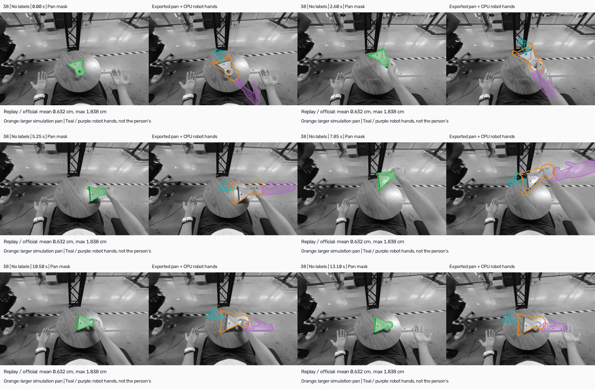
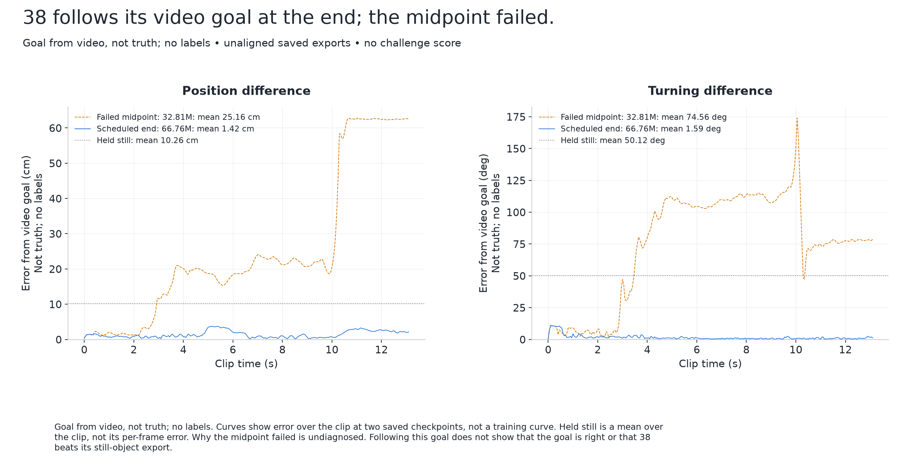
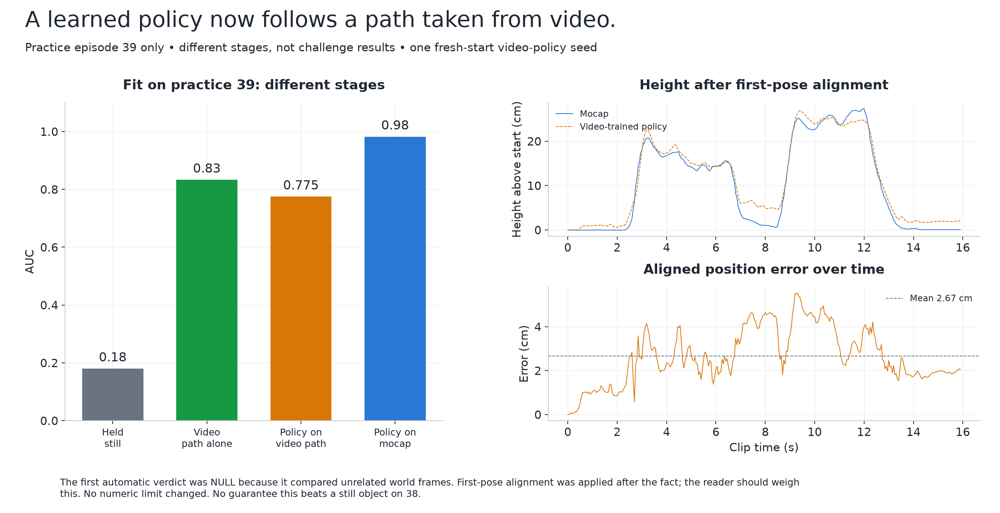
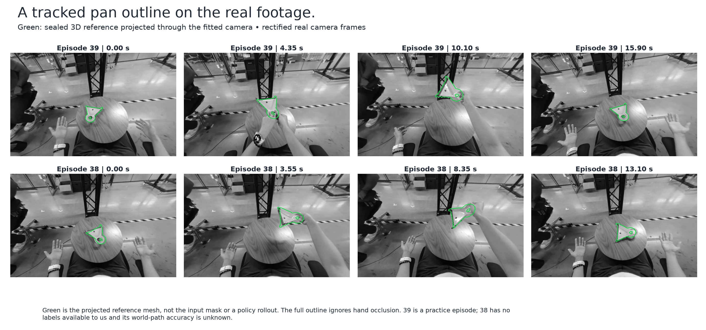

# Video2Data Track 3 entry

This Linux checkout contains the mesh and pose entry, its technical report and
recorded development evidence. The owner pushes the release commit and uploads
packed files; repository commands do not upload them. Current package paths,
hashes and limitations are in [the submission ledger](docs/chain/SUBMISSION.md).

## Visualisations

More figures and the full explanation are in the
[non-technical report](docs/report/nontechnical/report.md). None of these is a
challenge score.

The trained policy on episode 38. Green is the pan mask from the video. Orange is
the larger simulated pan and the coloured shapes are the robot hands, drawn through
the fitted camera. Episode 38 has no labels, so this shows the policy following its
video-derived goal, not that the goal is correct. [Watch the clip](docs/report/nontechnical/figures/21-episode38-on-real-footage.mp4).



Tracking error against that same goal, at the failed midpoint check and at the end
of training. Why the midpoint failed has not been diagnosed.



Practice episode 39, compared with motion capture at each stage. These numbers use
the scorer from the kit we had before the organisers replaced it on 2 November. A
rough re-check with the new scorer's code, using public shapes, moves the video
policy from 0.775 to 0.669.



The video tracker's pan outline on real footage from episodes 39 and 38. [Watch the clips](docs/report/nontechnical/figures/16-tracked-pan.mp4).



## Current entry points

- Meshes: [mesh extents](src/features/mesh_extents/README.md),
  [pretrained shapes](src/features/mesh_generative/README.md) and
  [packed mesh evaluation](src/features/mesh_eval/README.md). D1 v5 retains
  v4 meshes except the two video-admitted pot/pitcher replacements.
- Poses: [pose insurance](src/features/pose_insurance/README.md) owns the
  shipped static-pose policy line and its frozen diagnostics. This entry does
  not claim moving-object reconstruction.
- Report: [report sources and evidence](docs/report/track3/README.md).
- Reproduction: [scripts and hash coverage](scripts/reproduce/README.md).
  Source-drift gates remain strict; historical reproduction can require the
  original commit even when packed artifacts remain available.

These commands print CPU reproduction plans or verify preserved artifacts:
The full commit URL below is packed into the file; shortening it changes the packed bytes.

```bash
bash scripts/reproduce/d1_meshes.sh https://github.com/BDavid03/video2data/commit/b1617234a85e316baa4a67b7f10ff053f5f92c4d --version v4
bash scripts/reproduce/d1_meshes_v5.sh https://github.com/BDavid03/video2data/commit/b1617234a85e316baa4a67b7f10ff053f5f92c4d
bash scripts/reproduce/verify.sh submission/20261103T2058Z-d1-v5/track3_meshes_v5_final.manifest.json
bash scripts/reproduce/d3_report.sh
```

The v4 command reads the unchanged build request at
`src/features/mesh_extents/requests/build-v4.json`; the v5 command checks the
passing G2 production artifacts. Execution requires a separately authorized
`--run`; follow the linked reproduction documentation for its requirements.

## Architecture and execution

Each vertical slice owns its requests, handlers, integrations, runtime flags,
persistence and README. Shared code in `src/` provides stable path, geometry,
provenance, episode-admission and GPU-lease primitives. The
[feature directory](docs/design/README.md#feature-directory) lists all eleven
retained slices, including perception preparation and unsuccessful routes kept
as cited evidence.

Read [AGENTS.md](AGENTS.md), [CLAUDE.md](CLAUDE.md) and the current task brief before
running anything. Generated artifacts and caches stay inside the permitted Linux
checkout; dataset snapshots, model inputs and upstream references are read-only.
Episode 41 and holdout episodes 43/44 are excluded from current work. GPU work
requires explicit authorization and the shared lease. No test suites,
installations or uploads are implied by these commands.

## Archived research and scaffolding

The finished depth study and unrun general-pipeline slices now live under
`data/recycle/20261104T010336Z/`; their recorded outputs remain in place. The
[recycle manifest](data/recycle/20261104T010336Z/MANIFEST.md) lists all 17 slices and
companion scripts, with the reason for each move. Restore a required dependency
group to its original paths with Git moves before using the archived commands;
the archived code still imports siblings by their original package names.

The [depth-study README](data/recycle/20261104T010336Z/track3/features/learning_experiments/README.md)
and [closed-loop README](data/recycle/20261104T010336Z/track3/features/auto_research/README.md)
retain historical measurements against MoGe2 pseudo-labels. Those measurements
are separate from the challenge entry's mesh and policy results.

## Inputs and evidence

Read-only inputs: dataset `nvidia/video_to_data_challenge` at
`5f68335f3acc802033d1e80728c1633197521de8`; FlashCHORD at
`aee95f25ae0943f335d8bb42fa95b6a9acfa266f`; the Submission Kit under `upstream/`, hashed in
`data/configs/sources.lock.json`.

- [Data audit](data/reports/data-audit/README.md), [calibration](data/reports/calibration/README.md),
  [metric protocol](data/reports/metric-protocol.md) and [frozen split](data/configs/splits/public-v1.json).
- [Official contract](data/reports/contract.md): what is submitted and how it is scored.
- [Model readiness](data/reports/model-readiness/README.md): models, licences and version pins.

Public labels are diagnostic references only. Evaluation task identities and labels are not
inferred.

## Documentation

Start with the [design index](docs/design/README.md),
[research volumes](docs/research/README.md) and
[dated implementation history](data/reports/implementation-status.md). Older documents
retain their original scope and dates; the design index explains recycled paths.

The [documentation compiler](scripts/documentation/README.md) writes
`docs/compiled/all-documentation.md`, which is untracked.
