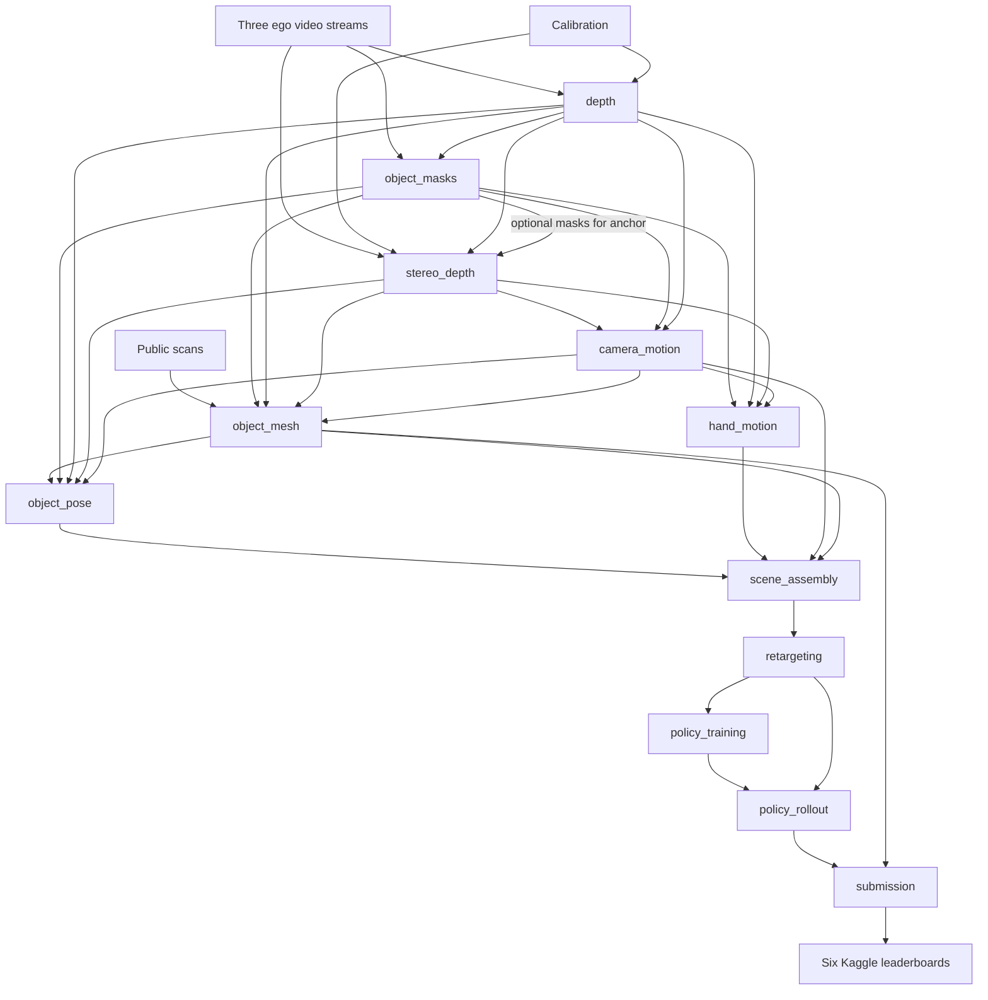

# Artifact contracts

Slices never import each other. They exchange files. This document lists every
artifact that crosses a slice boundary, who writes it, who reads it, and the rules
all of them share. Field-level detail lives in the producing slice's README.

Nothing here has been exercised. depth and scratch_depth are implemented but
have never run. Their current run records do not yet meet the shared contract
below; the migration is listed explicitly. Every other contract is design.

## Shared rules

**Run directories.** Per-episode runs normally use
`<root>/<name>/<split>/episode_XXXXXX/<run-id>/`, with a UTC timestamp run id.
A run never overwrites another run. `<root>` is `outputs/` for perception and
scene data and `runs/` for policies and rollouts. `<split>` is `public` or
`evaluation`. `<name>` normally equals the slice name; policy_training uses the
short name `policy` and policy_rollout uses `rollout`.

Multi-episode exceptions: submission uses `submissions/<submission-id>/`, with
a UTC timestamp and short label; scratch_depth uses
`outputs/scratch_depth/<operation>/<run-id>/`, with a UTC timestamp and UUID
suffix (`track3/features/scratch_depth/_common.py:72-73`).

**Run record (target contract).** Every run directory will hold a `run.json`
with at least:

| Field | Meaning |
|---|---|
| `kind` | The slice and operation |
| `status` | `running`, `completed`, `failed` or `interrupted` |
| `request` | The request file's content |
| `inputs` | Each input artifact's path and SHA-256 |
| `sources` | Hashes of the slice's code and of `configs/sources.lock.json` |
| `provenance` | `video_only`, `public_asset_diagnostic` or `public_label_diagnostic` |
| `frames` | Per-frame status where the operation is per-frame |
| `timing`, `gpu` | Wall time and sampled device memory, where applicable |

A consumer accepts an input only when its `status` is `completed` and its
`provenance` is allowed for the consumer's own run.

**Implemented record migration.** depth and scratch_depth currently use
`feature` instead of `kind`, `input_hashes` instead of `inputs`, separate
`source-files.json` instead of an inline `sources` field, and no `provenance`.
Before downstream consumers are enabled, their slices must add `kind`, path/hash
entries in `inputs`, `sources` including the source lock, and inherited
`provenance`; operation-specific frame, timing and GPU fields must follow the
table where applicable. Preserve the existing source manifest and legacy fields
for traceability. An untagged legacy record is refused, never assumed
`video_only`. This is implementation work still to do, not a migration performed
while writing the design.

**Provenance tags.** A run inherits the most restrictive tag among its inputs.

| Tag | Meaning | May feed an evaluation submission |
|---|---|---|
| `video_only` | Built from videos, calibration and organiser files that carry no pose | Yes |
| `public_asset_diagnostic` | Compared against a public scan to measure shape quality | No |
| `public_label_diagnostic` | Used public pose labels in any way | No |

Using a public scan as the mesh for tracking or simulation does not change a
run's tag; comparing against it to score a reconstruction does.

**Frame identity.** A frame is identified by `(split, episode_index,
frame_index)`. Frame index i is the i-th decoded frame of every stream and row i
of the public Parquet (**Official**, dataset `track_3/README.md`). The scored
roster's frame counts equal the decoded frame counts of the evaluation clips for
all 20 scored episodes (**Measured**, `reports/data-audit/videos.json` against
`KIT/data/track_3_sample_submission.csv`), so roster frame f is taken to be video
frame f.

**Clocks.** Artifacts carry `frame_index` and the integer MP4 PTS. Seconds are
derived as `pts / 10240` at 20 frames per second (**Measured**, data audit). The
public Parquet's `timestamp` and `capture_time` are different clocks and are
never used to pair frames.

**Frames of reference.**

| Name | Definition |
|---|---|
| `camA` | Colour camera optical frame: x right, y down, z forward |
| `world` | Metric, z up along the table normal, fixed for the episode. Origin and heading follow the rule recorded in `world.json`. |
| `object` | The mesh's own body frame, as recorded in `mesh.json` |

`parent_T_child` maps child coordinates into the parent. Matrices are 4×4,
float64, column-vector convention.

**Quaternion order at external interfaces.**

| Interface | Order | Source |
|---|---|---|
| Public dataset Parquet | `[x, y, z, qw, qx, qy, qz]` | **Official**, dataset `track_3/README.md` |
| Upstream motion format read by FlashCHORD | Scalar-first | **Official**, `FC/CONVENTIONS.md` |
| Simulator internals | Scalar-last | **Official**, `FC/CONVENTIONS.md` |
| Official rollout Parquet | Scalar-last (`xyzw`) | **Official**, `FC/src/flash_chord/evaluation/rollout.py:66` |
| Submission CSV | Scalar-last (`xyzw`) | **Official**, `KIT/v2dlb/object_pose.py:10,47` |

Inside the project, rotations are matrices. Each conversion to a quaternion
happens once, in the slice that owns that interface.

**Validity.** Invalid numeric values are NaN and are accompanied by a boolean
mask. A consumer reads the mask first. An estimate that was interpolated or
filled is flagged separately from one that was observed, and the two are never
merged into one flag.

**Pixel grid.** All colour-image products use the pinhole grid defined by the
depth slice's `preprocessing.npz`. A product records that file's hash, and a
consumer refuses products from different grids.

Implemented depth currently accepts only frozen public development episodes and
writes under `outputs/depth/public/`; it refuses public validation and evaluation
episodes. Evaluation and validation grids require the planned depth split
extension in [roadmap Phase 0](roadmap.md). No such grids exist today.

## Registry

| Artifact | Written by | Read by | Path under the run directory |
|---|---|---|---|
| Monocular depth | [depth](../../track3/features/depth/README.md) | object_masks, stereo_depth, camera_motion, object_mesh, object_pose, hand_motion, scratch_depth | `frames/frame_XXXXXX.npz`, `preprocessing.npz` |
| Stereo depth and scale | [stereo_depth](../../track3/features/stereo_depth/README.md) | camera_motion, object_mesh, object_pose, hand_motion | `frames/`, `anchor.json` |
| Instance masks | [object_masks](../../track3/features/object_masks/README.md) | stereo_depth, camera_motion, object_mesh, object_pose, hand_motion | `frames/`, `keyframes.json` |
| Camera trajectory and world | [camera_motion](../../track3/features/camera_motion/README.md) | object_mesh, object_pose, hand_motion, scene_assembly | `trajectory.npz`, `world.json` |
| Object meshes | [object_mesh](../../track3/features/object_mesh/README.md) | object_pose, scene_assembly, submission | `<object>.glb`, `mesh.json` |
| Object poses | [object_pose](../../track3/features/object_pose/README.md) | scene_assembly | `poses.npz`, `opening.json` |
| Hand motion | [hand_motion](../../track3/features/hand_motion/README.md) | scene_assembly | `hands.npz` |
| Scene bundle | [scene_assembly](../../track3/features/scene_assembly/README.md) | retargeting | `scene.json`, `trajectories.npz`, `assets/` |
| Training-ready sequence | [retargeting](../../track3/features/retargeting/README.md) | policy_training, policy_rollout | An upstream-format partition and its assets |
| Policy checkpoint | [policy_training](../../track3/features/policy_training/README.md) | policy_rollout | `policy_<steps>.safetensors` |
| Rollout trajectory | [policy_rollout](../../track3/features/policy_rollout/README.md) | submission | `episode_XXXXXX.parquet`, `episode_XXXXXX.json` |
| Submission files | [submission](../../track3/features/submission/README.md) | Kaggle | `track3_poses.csv`, `track3_meshes.parquet` |

## Flow

Everything from the videos to the scene bundle runs in Windows perception
environments, with hand_motion kinematics in the separate Windows MANO process.
Hand parameters go to that process and joint positions and rotations return.
All retargeting operations, training and rollout run in the Linux policy
environment. The scene bundle and its assets go from Windows to Linux. Rollout
Parquet, evaluator JSON and run/inspection records return to Windows submission.
Reconstructed meshes go from perception to submission within Windows. These
files stay on `Z:`; policy-readable stored paths use the Linux form.

## The two boundaries that decide the score

Most contracts above are internal, and a mistake in one shows up as a failed run.
Two are external, and a mistake in either produces a valid-looking submission
with a bad score.

**Scene bundle to training-ready sequence.** The upstream format fixes units,
quaternion order, frame rate handling and object order. The
[retargeting](../../track3/features/retargeting/README.md) README lists each
field and the check that guards it.

**Rollout trajectory to submission rows.** Rows are matched to the roster by
exact integer frame index. A rollout that plays the reference more slowly than
the video can still fill every roster frame, with poses from the wrong moments,
and nothing rejects it. Faster playback or a lower control rate produces fewer
steps and can instead fail for missing rows (`KIT/tools/pack_submission.py:277-293`). The [policy_rollout](../../track3/features/policy_rollout/README.md)
README states how the frame index is kept equal to the video frame index.
