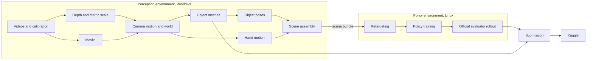

# System overview

Written 2026-09-30. Nothing described here has run.

## What the entry has to produce

Track 3 gives 20 evaluation episodes. Each is a short head-mounted recording, in
three video streams, of a person handling one or two objects on a table. The
entry submits two files.

| File | Content | Scored by |
|---|---|---|
| Pose CSV | For every frame of every episode, the pose of each object as a robot policy moved it in simulation | AUC, SP-SR, MP-SR, RPE, MPPE |
| Mesh Parquet | One reconstructed mesh for each of 36 episode-object pairs | CD-O |

The pose file is not the reconstruction. It is what happened in the simulator when
a policy, trained to imitate the reconstructed demonstration, was rolled out
(**Official**, `KIT/tracks/track_3/README.md:10-22`). A perfect reconstruction
with a policy that drops the object scores badly. A policy can also do no better
than the demonstration it was given.

No metric looks at the robot or the hands. Only the objects are scored.

## How the pose score is computed

All **Official**, from `KIT/v2dlb/object_pose.py`. The reference is confidential,
so there is no local score for evaluation episodes.

1. For each episode, one rigid transform is computed from the first frame of
   object slot 0 and applied to the whole submitted trajectory. This removes the
   difference between the simulator's world and the reference world.
2. No scale is removed.
3. Each metric is computed per episode and averaged over the 20 episodes with
   equal weight.

| Metric | Measures | Better |
|---|---|---|
| AUC | Share of frames whose average point distance is under each threshold from 1 to 9 cm | Higher |
| SP-SR | Episode succeeds when mean position error is at most 10 cm and mean angle at most 0.5 rad, averaged over objects | Higher |
| MP-SR | Episode succeeds when every object is under 3 cm and 30 degrees on average | Higher |
| RPE | Error in object 1's position seen from object 0's frame. Single-object episodes count as zero. | Lower |
| MPPE | Mean error of six points 5 cm from each object's origin | Lower |
| CD-O | Distance between reconstructed and scanned surfaces, after the scorer rescales and registers the submitted mesh | Lower |

A submission missing any row is rejected whole.

## The pipeline

| Stage | Slices | Question it answers |
|---|---|---|
| Measure | depth, stereo_depth, object_masks | How far is each pixel, in metres, and what does it belong to? |
| Locate | camera_motion | Where is the camera in a fixed world? |
| Model | object_mesh | What shape is each object, and where is its body frame? |
| Track | object_pose, hand_motion | Where are the objects and hands in every frame? |
| Assemble | scene_assembly | What complete, physically possible scene do the measurements describe? |
| Transfer | retargeting | What should the robot hands do to repeat it? |
| Learn | policy_training | Which policy makes the simulated objects follow the demonstration? |
| Record | policy_rollout | What did the objects do under that policy? |
| Deliver | submission | Are the files complete, correct and sent once? |

The registry of files that pass between slices is in
[artifact contracts](artifact-contracts.md).

## The two runtimes

| | Perception environment | Policy environment |
|---|---|---|
| System | Windows 11 | Ubuntu 24.04 under WSL 2, isolated, disk on `Z:` |
| Exists today | One: `.runtime/moge-python313`, MoGe2 only | No |
| Python | 3.13 | 3.11 |
| Main packages | PyTorch, OpenCV, the perception models | Newton, Warp, MuJoCo Warp, JAX, Pinocchio |
| Source of truth | Per-slice locks under `configs/perception/` | The `uv.lock` in the pinned FlashCHORD source |
| Slices | depth to scene_assembly, submission | retargeting, policy_training, policy_rollout |

The scene bundle crosses between them as files under `outputs/`. Windows sees
the project at `Z:\hugging-face\video2data` and Linux at
`/mnt/z/hugging-face/video2data`. Paths stored inside artifacts that the policy
environment reads are written in the Linux form.

One GPU serves both. `track3/gpu.py` provides a cooperative lock so only one GPU
stage runs at a time. The lock is a file on `Z:`, which both systems can see.
Whether the lock holds between a Windows process and a Linux process is
unverified.

## Data separation

| Set | Episodes | Has pose labels | Used for |
|---|---|---|---|
| Public development | 13 | Yes | Building and tuning |
| Public validation | 7 | Yes | One check after settings are frozen |
| Evaluation | 20 | No | The submission |

The split is frozen in `configs/splits/public-v1.json`. Evaluation episode
indices and public episode indices are different recordings even where an
integer could coincide. Every run carries a provenance tag, and a run that
touched a public label cannot feed a submission. The tags are defined in
[artifact contracts](artifact-contracts.md).

## Where accuracy is decided

| Source of error | Enters at | Shows up as |
|---|---|---|
| Scale | stereo_depth | Every distance wrong by the same factor |
| Camera drift | camera_motion | Objects that creep while resting |
| First pose of slot 0 | object_pose | The whole episode rotated about that object |
| Body frame of an object | object_mesh | Error that grows as the object turns |
| Lost track during occlusion | object_pose | A gap, then a jump |
| Hand placement | hand_motion | A policy that misses or knocks the object |
| Policy failure | policy_training | An object that stays where it started |

An object that stays where it started is a particular case worth stating. If the
policy never moves an object, the rollout reports its resting pose for every
frame. Slot 0's first pose is aligned exactly, so the score then depends on how
far the real objects moved during the demonstration. Where they moved little, a
static rollout already scores well. Where they moved far, it scores poorly. The
first complete submission will show where this floor lies.

## Execution policy

Every operation is disabled by a flag in its slice's `runtime.json`. The flags are
false. `AGENTS.md` forbids tests, smoke checks, validation commands and model
execution until the user says otherwise, and asks for confirmation before any new
production dependency. The design is written so that each authorization is
narrow: one operation, in one slice, on named episodes.

## Current state

| Item | State |
|---|---|
| Dataset audit, calibration audit, frozen split | Done before the no-testing instruction, with recorded results |
| MoGe2 environment and weights | Installed, never run |
| depth, scratch_depth | Implemented, never run |
| Official contract | Recorded from the kit on 2026-09-30 |
| Eleven remaining slices | Designed |
| Policy environment | Does not exist |
| Git repository, Kaggle access | Do not exist |
| Reconstructions, policies, submissions | None |

Next steps and their dates are in the [roadmap](roadmap.md). What can stop the
entry is in [risks and open questions](risks-and-open-questions.md).
