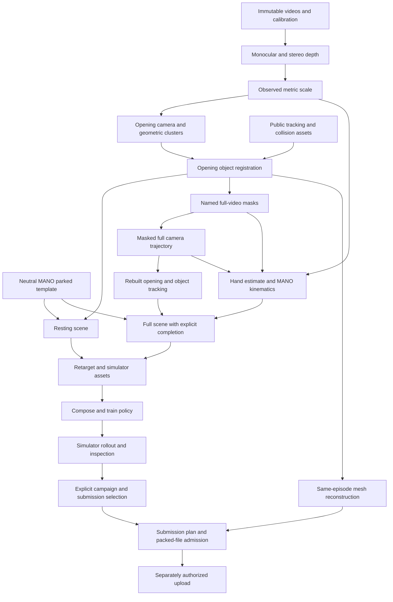

# System overview

The project converts egocentric video into a metric tabletop demonstration,
retargets that demonstration to simulated hands, and trains a policy whose
**achieved** object motion can be submitted. A separate reconstruction path
produces the meshes used for shape scoring. Both paths retain exact source and
artifact lineage.

This is the current source design, dated 5 October 2026. The end-to-end system
has not run. All execution restrictions in [AGENTS.md](../../AGENTS.md) apply.

## Architecture and ownership

New work uses vertical slices under `track3/features/`. A feature owns its public
request, handler, backend adapters, output format, runtime configuration and
README. Consumers exchange completed artifacts with explicit path/hash bindings.
They do not reach into another feature's private adapter or ask a shared service
to decide which run is current.

Stable technical primitives live in [paths.py](../../track3/paths.py),
[provenance.py](../../track3/provenance.py) and [gpu.py](../../track3/gpu.py).
Existing data, calibration and pose utilities remain technical building blocks.
Campaign selection metadata has a public feature boundary in
[campaign/selections.py](../../track3/features/campaign/selections.py).
There is no new horizontal service or repository layer.

The diagram compresses multiple immutable runs. It does not imply that an
opening camera can satisfy a full-camera dependency or that a resting scene can
replace a full scene. The [operating reference](operations.md) explains these
phase boundaries and the spoon's two-pass opening path.

## Perception and metric geometry

The depth slice owns colour-camera preprocessing and the common pinhole grid.
Stereo rectification is derived consistently from one calibration operation;
metric stereo is transferred back into the colour grid. The anchor operation
records per-frame monocular scale and its observed support. Downstream geometry
uses direct valid stereo where available, then monocular depth with an observed
scale for that frame. Missing support is not repaired by silently applying an
episode median.

Camera motion estimates the fixed world needed to separate head motion from
object motion. It uses static image features and metric landmarks, masking
moving objects and hands when full masks exist. The table normal defines +z;
its interpretation as gravity is an assumption. The first camera's projected
viewing direction defines heading. An explicit slot-0 point can define the
origin; otherwise the implemented opening path uses the first camera's principal
ray intersection with the table. `world.json` records the actual rule.

Object initialisation registers opening geometry. Full tracking uses persistent
masks, metric points, local registration and bounded recovery. The object body
frame belongs to its mesh; a consistent world transform cannot correct a wrong
body frame. Camera-relative observations remain distinct from world-valid poses.
Ambiguous symmetry and occlusion remain limitations, not evidence of stationarity.

Hands pass through separate estimation, MANO kinematics and metric lifting
operations. Anonymous segmentation slots `hand_0` and `hand_1` do not define
anatomical left and right. The hand slice establishes the anatomical association
and emits MANO21 joints, frames and validity in fixed `[left, right]` order.
Metric fitting shifts the model along the camera ray without independently
stretching its bones. The optional selected-frame preview is a review aid and
does not promote a run or approve its quality.

## Meshes have separate purposes

Tracking and simulation use unchanged public scans and their recorded collision
assets where available. The missing spoon scan requires reconstructed collision
geometry and an explicitly reviewed body-frame convention. This convention
remains unresolved.

CD-O submission geometry is reconstructed separately for every required
episode-object pair, including scanned objects. The default opening hull closes
visible measurements with table footprints and fills concavities. Optional
opening TSDF fusion extracts only sufficiently observed zero crossings; it may
be open or fragmented and does not infer unseen surfaces. An observed TSDF mesh
cannot replace the spoon's required closed collision hull. Cross-episode reuse
remains disallowed without the explicit decision described as Q06.

Both methods share bounded point accumulation within the object-mesh slice.
Capacity limits make overflow explicit; they do not establish total memory use,
shape quality or a runtime estimate.

## Completion belongs to scene assembly

Perception retains invalid measurements. Scene assembly turns admitted inputs
into a complete reference, with each fill recorded. It seats resting objects on
their support, smooths measured motion and bridges only permitted object gaps.
Long or unbounded object gaps fail rather than becoming held observations.

Hands can interpolate short gaps or transition to a sourced parked template.
Completion traverses the MANO21 tree, blending parent-frame bone directions,
anatomical rotations and endpoint bone lengths. Equal endpoint lengths remain
constant by construction. This reference completion is not a MANO solve and does
not establish joint-limit compliance or collision-free transit.

Contacts use 16 upstream hand-link slots, not 21 joint slots. The implementation
finds nearest object triangles from sampled link proxies. It records proximity,
not observed grasp forces or exact hand-surface collision. Scene metadata retains
this approximation and the parked template's model-asset lineage.

## Robot and policy boundary

Retargeting consumes a complete scene, exact contact order, supports and collision
assets. It exports the pinned upstream format and prepares robot references.
Policy composition saves a resolved recipe; training must retain that recipe
apart from the permitted output-directory change. Checkpoints bind configuration,
source, reference, counters and file identity.

The rollout is an actual simulator result from an admitted policy checkpoint.
An untrained resting policy still needs simulation, inspection and selection.
A reference trajectory copied from perception cannot substitute for achieved
motion. References and outputs use the exact 20 Hz scoring correspondence
explained in [policy rollout](../../track3/features/policy_rollout/README.md).
Capture timestamps remain separate from that playback contract.

## Campaign and release boundaries

Campaign records explicit, role-aware choices and plans dependencies. It does not
launch producers. Queue drafts can contain null unresolved inputs and always
retain `ready: false` and `execution_authorized: false`. A newer run becomes a
candidate; it does not silently replace a pinned one.

Submission owns an immutable plan and snapshots its campaign choices. Packing
uses the pinned, unchanged kit and then admits the exact file that was produced.
Upload requires the intact pack/admission record, exact plan, explicit user
authorization and a quota-ledger reservation. Successful local packaging is not
an accepted submission.

## Isolation and storage

The existing MoGe2 environment is the baseline for perception packages. Optional
mask, WiLoR and MANO backends have separate environment/asset contracts. The
policy environment is a dedicated project-backed WSL design; the submission
environment is separate again. Their configuration files do not prove that they
are provisioned. Required installation records and several model pins/assets
remain missing.

All generated state belongs under `Z:/hugging-face/video2data`, using the path
primitive's platform mappings. Upstream trees are immutable references. Existing
external environments stay read-only. GPU operations are intended to use the
shared lease, with actual headroom and timing evidence still required after
execution is authorized.

For exact interfaces see [artifact contracts](artifact-contracts.md); for current
blockers see [risks and open questions](risks-and-open-questions.md).
