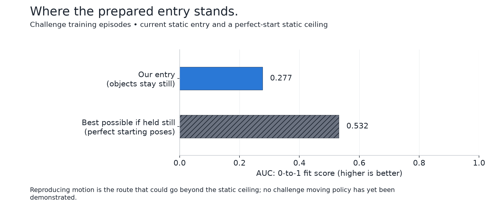
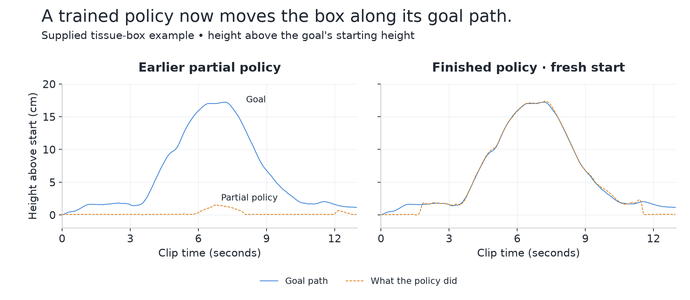
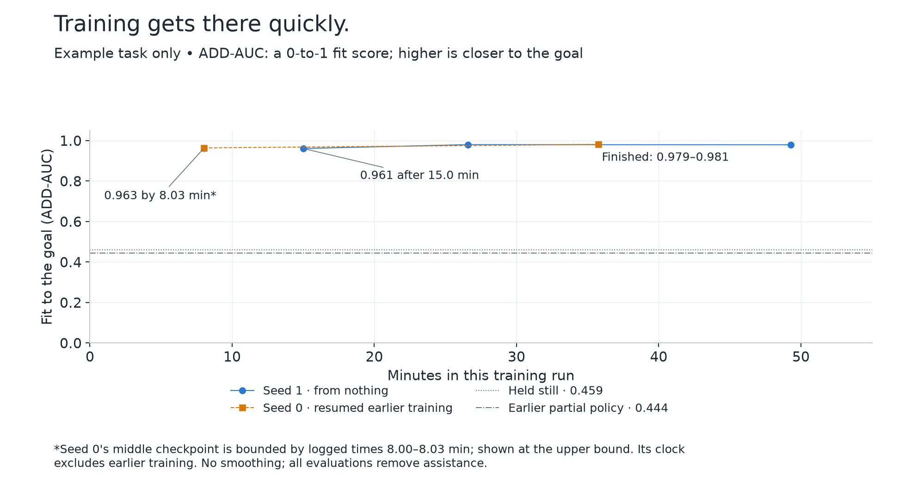
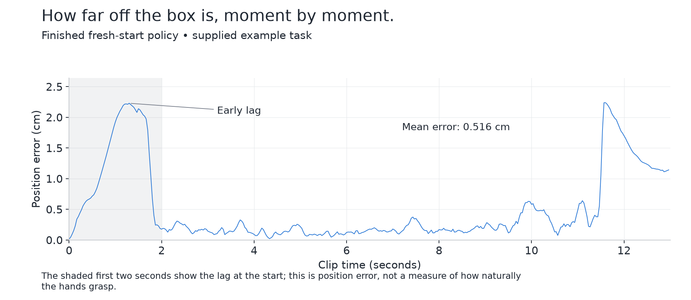
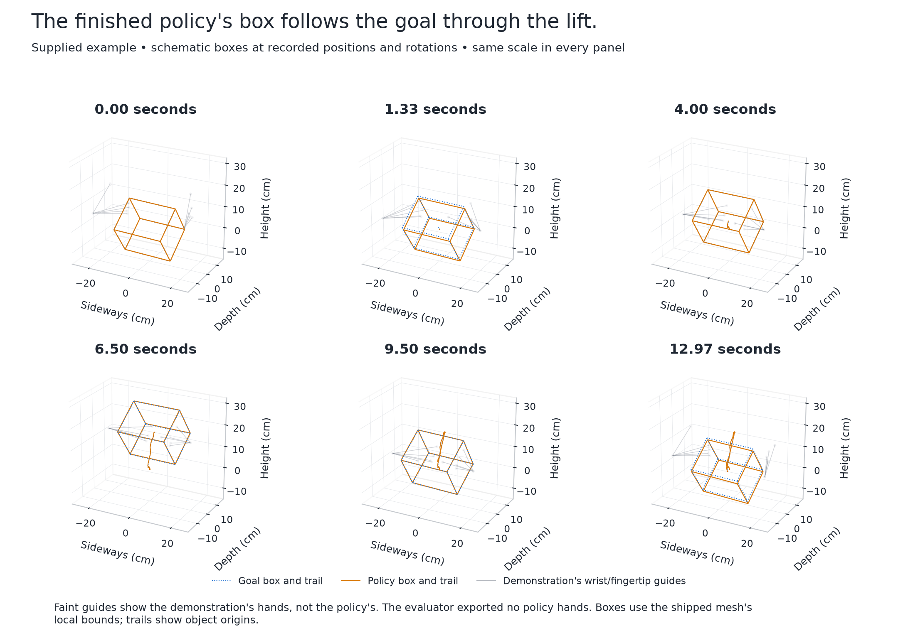
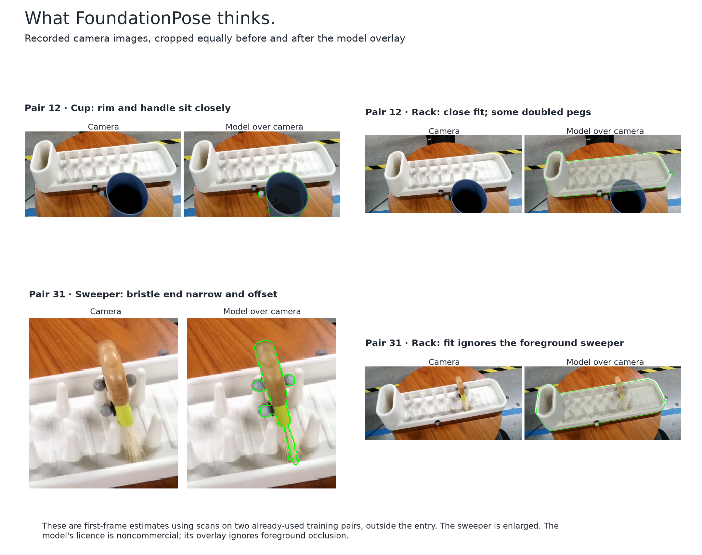
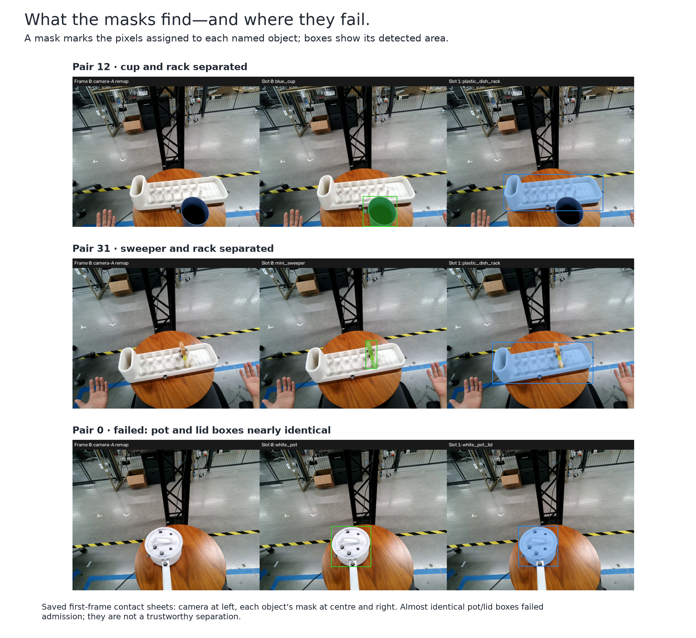
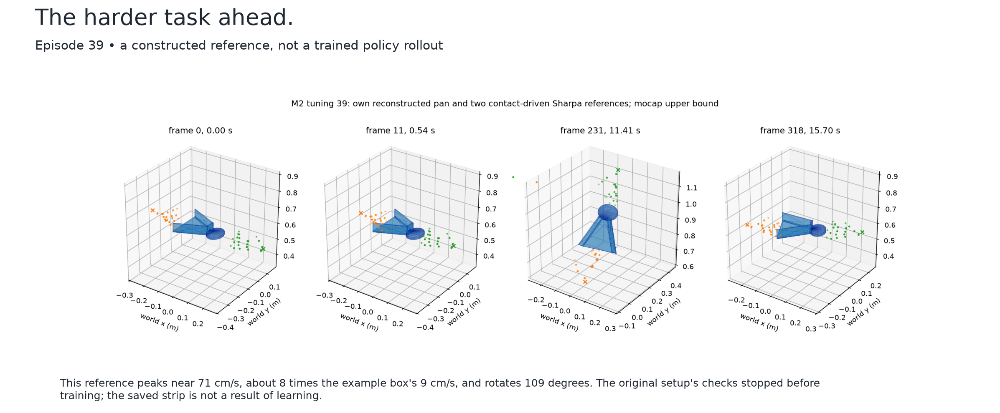

# Seeing what the models do

Recorded state: 4 November 2026, after the two tissue-box runs and the original episode-39 checks.

## What the challenge asks

Watch a person's camera footage, reconstruct the objects, and reproduce their movement in simulation. A **policy** is a controller trained by trial and error in simulation. A **reference** is the goal path it tries to follow. **AUC** is a 0-to-1 fit score: higher means closer agreement across a range of allowed errors; it is not a percentage of tasks completed.

**No moving policy exists yet for any challenge episode. Our current entry's objects stay still.** The moving box below is the example task supplied with the tools, not a challenge result. This report describes the prepared entry and recorded experiments; it claims no upload or leaderboard score.

## What we have prepared to submit so far

The entry prepared for submission uses measured simple shapes plus two shapes made by a pretrained model. Its object poses come from short simulated policy runs; the objects remain at their starting positions. On challenge training episodes, its AUC is **0.277**. Even the best possible starting poses, held still, score only **0.532**. That ceiling shows why reproducing motion matters; it does not forecast what a moving policy would score.



The comparison uses challenge training episodes only; the example box's score is deliberately kept separate.

## What changed today

Two completed policies now move the supplied tissue box along its goal path. One resumed earlier training; the other started from nothing, with a different random seed. Their example-task fit scores are **0.981 and 0.979**, and mean position errors are **0.562 and 0.516 cm**. The earlier partial policy averaged **6.803 cm**. These are simulator exports with evaluation assistance removed.

The example is slow, mostly vertical, and comes with its own captured hands and mesh. It reaches only about 9 cm/s and rotates 5.4 degrees. **Its roughly 0.98 score is not a challenge score.** Several training settings changed together, so the records do not isolate which change caused the improvement.

## What the pictures show



The goal and achieved heights share the same axes: the earlier policy barely lifts the box, while the finished fresh-start policy follows the lift and return.



The fresh run reaches 0.961 in 15.0 minutes and finishes in 49.3; the resumed run finishes in 35.8 minutes after resuming, excluding prior training. Its middle checkpoint's time is bounded by progress logs, not timed exactly. Lines connect measured evaluations without smoothing; early checkpoints trained with assistance, removed during evaluation.



The first two seconds expose the initial lag; mean position error is 0.516 cm, with a peak of 2.24 cm at 11.60 seconds.



Blue dotted outlines show the goal; amber solid outlines show what happened, with trails. These are schematic boxes using the shipped mesh's dimensions and the exported positions and rotations. Faint wrist-to-fingertip guides are **the demonstration's hands, not the policy's**; intermediate finger joints are not available. The evaluator export has no policy hands, so their actual grasp is unshown and its naturalness unmeasured.

[Earlier partial policy: the same six moments](figures/08-partial-policy.png) · [Side-by-side video](figures/10-policy-comparison.mp4)

### Telling apart two objects' position

First-frame error in one object's position relative to the other, in centimetres:

| Pair | Current method (T1) | Geometric registration (TW) | FoundationPose |
| --- | ---: | ---: | ---: |
| 12 | 29.08 cm | Not changed from T1 | 1.81 cm |
| 31 | 30.05 cm | 5.12 cm | 1.23 cm |

T1 is the current starting-pose method; registration fits shapes geometrically; FoundationPose is a pretrained image-and-shape pose model. Pair 12 has no separate panel registration estimate: that arm retained T1. These are two already-used training pairs, not independent validation. FoundationPose is outside the entry, uses scans here, and has a **noncommercial licence**.



The cup and racks sit closely over the photograph, but some pegs double and the sweeper's bristle end looks too narrow and offset; foreground occlusion is ignored. First-frame agreement does not demonstrate tracking or reliably resolving a 180-degree flip.



Masks mark pixels assigned to each object. Cup/rack and sweeper/rack are separated; the almost identical pot/lid boxes fail the input check.



This reference moves about eight times faster than the example box and rotates 109 degrees. Its original setup checks stopped before training: the saved strip is a proposed reference, not a learned rollout. A disclosed redesign is in the protocol; no success from it is claimed here.

## What is still unproven

Transferring the box result to a challenge episode still needs a usable object reconstruction, a reliable path from video, hands that can follow it, and a learned policy that moves the object physically. None of those links is established by the box's score. FoundationPose has only been screened on two used pairs and is not in the entry. The challenge result remains static.

### Placeholder — tracked object on a real camera clip

**Not available yet.** No per-frame tracking of a challenge episode exists in these records. The camera overlays above are single-frame pose estimates. A future clip would need recorded per-frame object poses and camera motion before a tracked object could honestly be drawn over the footage; no synthetic stand-in is shown.

---

Rebuild all figures, animations, the table and this report on CPU:

```bash
CUDA_VISIBLE_DEVICES='' PYTHONPATH=. data/.runtime/linux-cuda/bin/python -B scripts/report/nontechnical_figures.py
```

Input SHA-256 hashes and per-figure source mappings: `data/outputs/visuals/inputs.json`; numeric checks and build details: `data/outputs/visuals/build-summary.json`. Only saved outputs, the supplied box mesh and recorded notes are read; no model runs or challenge videos are opened.

Evidence: [box outcomes](../../chain/moving-m0b-outcome.md), [earlier policy](../../chain/moving-m0-outcome.md), [pose pilot](../../chain/foundationpose-pilot-outcome.md), [frame-zero panel](../../chain/frame0-panel-outcome.md), [episode-39 state](../../chain/moving-m2-protocol.md), [entry facts](../../chain/COMPLETION-PLAN.md#1-where-the-entry-really-stands).
