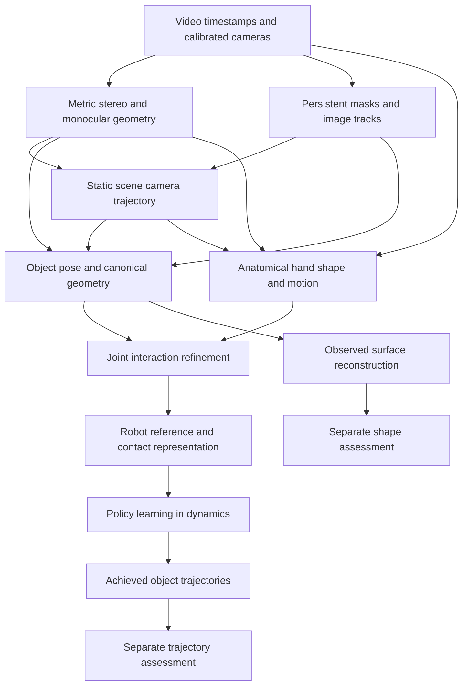

# Problem definition and mathematical foundations

Research cutoff: **18 October 2026**. Scope: the Video2Data Track 3 pipeline, including metric scene reconstruction, hand–object interaction, learned depth, synthetic supervision, robot retargeting, contact-aware policy learning, and prospective Rust implementations with Candle and Burn.

The central design problem is recovering a physically useful, temporally coherent interaction from incomplete visual observations. A sharper depth image, a plausible hand mesh, and a high tracking reward each solve only part of that problem. The strongest research direction for this project is to combine calibrated geometric evidence with learned priors, preserve uncertainty and missing observations, and judge downstream claims at the stage where they become observable.

This reference distinguishes **paper findings**, **mathematical derivations**, **project source facts**, and **prospective designs**. Equations labelled as proposed or derived explain an adaptation; they are not presented as a paper's exact implementation. Literature descriptions cite primary papers, author repositories, or official framework documentation. Newer papers describe research alternatives and do not replace pinned project dependencies or the official evaluator.

## The task and its evidence boundaries

### What the system must recover

For video frames indexed by physical time, the perception system estimates a camera trajectory, metric object trajectories, anatomical hand motion, object geometry, and interaction events. Scene assembly completes an explicit robot reference from admitted observations. Retargeting maps that reference to the chosen embodiment. Policy learning then produces actions whose **achieved simulator object poses** form the trajectory deliverable. An independent geometry branch produces reconstructed object meshes. This is the source architecture in the [system overview](../../design/system-overview.md), with feature-specific contracts in the [documentation index](../../design/README.md).

Four evidence categories must remain distinct:

| Evidence | What it can establish | What it cannot establish alone |
|---|---|---|
| Agreement with MoGe2 pseudo-depth | Fidelity to the teacher on the admitted pixels and frames | Independent depth accuracy or unbiased metric scale |
| Calibrated stereo and independent image geometry | Metric measurements where correspondence, timing and calibration support them | Correct geometry in unsupported or ambiguous regions |
| Public reference diagnostics | Pose or shape error under an explicit public-data protocol | Eligibility of those labels as production inputs or confidential evaluation performance |
| Achieved simulation trajectories | Behavior realized by a particular policy, scene and simulator | Accuracy of the scene reconstruction or real-world task success |

This separation follows the project [metric protocol](../../../reports/metric-protocol.md), [contract reading](../../../reports/contract.md), and [error budget](../../design/error-budget.md). A model can improve the first row while degrading another row. That possibility motivates independent geometric diagnostics and task-level assessment.

### The actual learning regime

The completed expanded depth campaign used eight training episodes, `0/11/12/18/21/23/26/31`, and tuning episodes `39/42`. Its scratch training set contains 128 prepared real images with MoGe2 pseudo-depth; tuning contains 32 images. Images were prepared at maximum side 128. A separate procedural pilot produced 128 training-only synthetic pairs, with analytic optical-axis depth and instance masks. Those synthetic samples did not enter the completed model campaign. These are recorded source facts in [learning experiments](../../../track3/features/learning_experiments/README.md) and [synthetic depth](../../../track3/features/synthetic_depth/README.md).

The frozen eager/BF16 scratch-CNN ensemble was selected using tuning evidence before assessment on episodes `43/44`. Those holdout outcomes have now been observed. Later architecture, loss, ensemble, synthetic-mixture and framework choices cannot claim those episodes as an untouched final assessment. Episode `41` remains excluded. The current [workspace instructions](../../../AGENTS.md) govern these boundaries.

The relevant statistical sample size is much closer to the number of independent episodes than to the number of supervised pixels. Dense labels from adjacent video frames share scene layout, camera characteristics, objects and teacher errors. This is a mathematical and experimental consideration, not an estimate of an exact effective sample count.

### Research scope and source authority

The challenge contract in this reference is the repository's pinned source interpretation, not a new ruling about permissible inputs. In particular, the recorded uncertainty about stereo, scans, calibration and annotation at official evaluation remains a contract question. A useful research method is not automatically an admissible competition method. The pinned [contract](../../../reports/contract.md) and [decision register](../../design/decisions.md) own those distinctions.

This document is maintained source documentation. Pipeline outputs, downloaded assets, compiler caches, environments and temporary experiment artifacts continue to belong under `Z:/hugging-face/video2data`. Literature research adds no model dependency, changes no execution gate and supplies no new runtime result.

## Mathematical foundations and observability

The derivations in this section establish shared notation for the later papers and proposed adaptations. They follow directly from the stated camera, rigid-body and probability models; they are not claims that the repository implements every objective.

### Coordinate transforms

Let

\[
{}^A T_B=
\begin{bmatrix}{}^A R_B&{}^A t_B\\0&1\end{bmatrix}\in SE(3)
\]

map a point expressed in frame \(B\) into frame \(A\). For column vectors,

\[
{}^A p={}^A R_B{}^B p+{}^A t_B,
\qquad {}^A T_C={}^A T_B{}^B T_C,
\]

\[
({}^A T_B)^{-1}=
\begin{bmatrix}({}^A R_B)^\top&-({}^A R_B)^\top{}^A t_B\\0&1\end{bmatrix}.
\]

Use \(C_t={}^W T_{C_t}\) for the camera pose and \(O_{kt}={}^W T_{O_k,t}\) for object \(k\). A camera-relative object estimate satisfies

\[
{}^{C_t}T_{O_k}=C_t^{-1}O_{kt},
\qquad O_{kt}=C_t\,{}^{C_t}T_{O_k}.
\]

The projection of a canonical object vertex \(X\) is

\[
u_{kt}=\pi(K_t[I_3\;0]C_t^{-1}O_{kt}\widetilde X),
\quad \pi([x,y,z]^\top)=[x/z,y/z]^\top,
\]

where \([I_3\;0]\) selects Cartesian camera coordinates and multiplication by \(K_t\) precedes homogeneous division. Camera motion and object motion are therefore coupled in image measurements. Solving only for apparent object motion without the camera factor mixes the two.

### Optical depth and radial range

For a pinhole camera,

\[
K=\begin{bmatrix}f_x&0&c_x\\0&f_y&c_y\\0&0&1\end{bmatrix},
\quad r(u,v)=K^{-1}[u,v,1]^\top,
\quad P(u,v)=Z(u,v)r(u,v).
\]

The ray has third coordinate one, so \(Z\) is optical-axis depth in metres. Euclidean camera range is

\[
R=\|P\|=Z\|r\|,
\quad Z=R/\|r\|.
\]

A renderer that returns ray distance along unit vectors and a depth estimator that returns camera \(z\) produce different quantities away from the principal ray. Treating them as interchangeable warps surfaces increasingly toward the image edges. The procedural pilot explicitly uses rays with \(r_z=1\); its intersection parameter is optical \(z\), as recorded in its [feature contract](../../../track3/features/synthetic_depth/README.md).

### Image operations change the camera

For an affine mapping of pixel coordinates \(\widetilde u'=A\widetilde u\), the corresponding pinhole matrix is \(K'=AK\). A crop with top-left offset \((a,b)\), followed by scaling \((s_x,s_y)\), gives

\[
f_x'=s_xf_x,\quad f_y'=s_yf_y,
\quad c_x'=s_x(c_x-a),\quad c_y'=s_y(c_y-b)
\]

when the resize convention maps continuous pixel coordinates directly. For a half-pixel centre convention,

\[
c_x'=s_x(c_x-a+\tfrac12)-\tfrac12,
\quad c_y'=s_y(c_y-b+\tfrac12)-\tfrac12.
\]

Choose the equation matching the actual resampler. Distortion removal is a separate nonlinear ray mapping; rotation, rectification, crop and resize must retain their order. Merely resizing a depth array to the RGB dimensions does not establish pixel correspondence.

### Gauge freedoms

In an unanchored reconstruction, replacing every camera and object pose by

\[
C_t'=GC_t,\qquad O_{kt}'=GO_{kt},\qquad G\in SE(3)
\]

preserves \(C_t^{-1}O_{kt}\), hence preserves image projections. This is a global world-frame gauge. Monocular reconstruction can additionally admit a common scale ambiguity: scaling geometry and translations together preserves perspective images. Known metric baseline or other independent metric measurements constrain this degree of freedom.

A body-frame change is different. If a new mesh frame is related by a fixed transform \(B\), then \(O_{kt}'=O_{kt}B\) must accompany \(X'=B^{-1}X\). Image geometry stays identical, but pose coordinates change. A left world transform cannot generally undo a right body-frame transform over arbitrary object rotations. This is why spoon origin/orientation conventions must be resolved explicitly rather than left to an episode alignment.

### From depth to geometric sensitivity

Writing \(x_n=(u-c_x)/f_x\) and \(y_n=(v-c_y)/f_y\),

\[
P=[Zx_n,Zy_n,Z]^\top,
\quad \frac{\partial P}{\partial Z}=[x_n,y_n,1]^\top,
\quad \frac{\partial X}{\partial f_x}=-\frac{Z(u-c_x)}{f_x^2}.
\]

Depth errors change all three point coordinates; focal errors change lateral geometry. With an input vector \(a=(Z,f_x,f_y,c_x,c_y,u,v)\), first-order covariance propagation is

\[
\Sigma_P\approx J_a\Sigma_aJ_a^\top.
\]

Cross-covariances matter when parameters came from the same learned prediction or calibration fit. Adding independent scalar error bars would assume those terms vanish without evidence.

For a small pose perturbation, a point at distance \(r\) from a rotation centre moves by approximately \(r|\delta\theta|\). A time error \(\delta t\) produces approximately \(\|v\||\delta t|\) positional error at local speed \(v\). These effects persist even with excellent per-frame depth.

### Rotation errors and temporal differences

For rotations \(R_1,R_2\),

\[
d_{SO(3)}(R_1,R_2)=\cos^{-1}\!\left(\operatorname{clip}\!\left[\frac{\operatorname{tr}(R_1^\top R_2)-1}{2},-1,1\right]\right).
\]

For a unit relative quaternion \(q_\Delta=(w,\mathbf v)\), the equivalent sign-invariant expression is

\[
\theta=2\operatorname{atan2}(\|\mathbf v\|,|w|).
\]

A finite rotation increment is \(\Delta R_t=R_t^\top R_{t+1}\). Its angular velocity is approximated by \(\operatorname{Log}(\Delta R_t)^\vee/\Delta t\), with actual timestamps and a chosen tangent-frame convention. Differencing raw quaternion components confuses their sign gauge with physical motion. Invalid zero quaternions are not identity rotations. The project [metric protocol](../../../reports/metric-protocol.md) specifies its admitted pose and timestamp semantics.

### A joint inference objective

A proposed maximum a posteriori formulation collects latent cameras \(C\), objects \(O\), hand pose/shape \((\theta,\beta)\), surfaces \(S\), scale \(s\), and interaction state \(c\):

\[
\arg\min_{C,O,\theta,\beta,S,s,c}
E_{\rm image}+E_{\rm stereo}+E_{\rm teacher}+E_{\rm hand}
+E_{\rm rigid}+E_{\rm contact}+E_{\rm collision}+E_{\rm temporal}+E_{\rm prior}.
\]

For measurement residual \(r_j\), a consistent construction is \(\rho(r_j^\top\Sigma_j^{-1}r_j)\), where \(\Sigma_j\) expresses that measurement's scale and \(\rho\) limits outlier influence. A pixel residual, metre residual and radian residual need explicit scaling before addition. Shared teacher features also mean the terms are not necessarily statistically independent; the sum can be a useful engineering energy without being an exact likelihood.

Optimizing all variables simultaneously is expensive and can fit a mutually consistent but wrong explanation. A practical prospective strategy alternates blocks: static camera estimation, object initialization, hand estimation, then localized interaction refinement. Keep independent stereo/image evidence available rather than using the same pseudo-label as both optimizer target and proof of correctness.

### What images cannot determine

An occluded object pose can have several compatible continuations. A silhouette cannot reveal an unseen concavity. A symmetric visible surface may not determine mesh-frame yaw. Hand–object proximity does not identify contact force. Under Coulomb friction, many force sets can realize the same object motion, and uncertain mass or inertia introduces further ambiguity.

Consequently, priors and physical constraints should make assumptions explicit. A completed trajectory is an inference with provenance; it is not a newly observed measurement. A contact capability or wrench set can guide a robot without pretending that an RGB video directly measured force.
