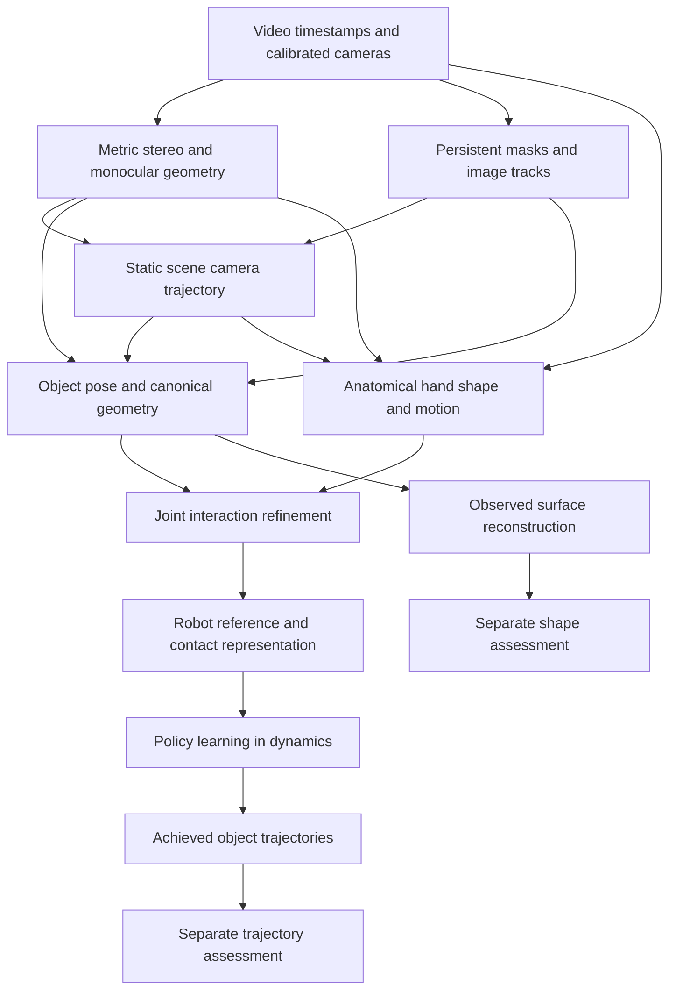

# Research foundations for egocentric video to robot policies

Research cutoff: **18 October 2026**. This compendium combines eight standalone research volumes covering model architectures, mathematical derivations, geometric reasoning, learning methodology, hand–object interaction, robot policies, GPU systems, and Rust with Candle and Burn.

The central design problem is recovering a metric, temporally coherent interaction that a robot can physically realize. Learned geometry, calibrated measurements, inferred contacts and achieved simulator trajectories provide different evidence. The chapters distinguish published findings, source-visible implementation facts and original project deductions throughout.

The [research index](README.md) links to each maintained volume. This collection preserves their equations, primary citations and bibliographies, while adapting navigation and repository links for a single-file reading experience. It is source documentation; it adds no runtime result or dependency.

## Reading map

| Purpose | Read first |
|---|---|
| Understand the full task and its mathematical conventions | [Problem and mathematics](#chapter-01) |
| Study MoGe2, recent depth architectures and supervision gauges | [Depth models](#chapter-02) |
| Recover metric geometry and separate camera/object motion | [Stereo motion and surfaces](#chapter-03) |
| Reconstruct hands, objects and meaningful interactions | [Hand and object interaction](#chapter-04) |
| Develop the scratch CNN and synthetic enrichment scientifically | [Learning and synthetic data](#chapter-05) |
| Understand contact-wrench guidance and realized robot behavior | [Retargeting and policies](#chapter-06) |
| Assess Candle, Burn and a faithful Rust model transplant | [Rust Candle and Burn](#chapter-07) |
| Design numerical, geometric and downstream assessment | [Systems evaluation and agenda](#chapter-08) |

## Contents

- [1. Problem definition and mathematical foundations](#chapter-01)
  - [The task and its evidence boundaries](#chapter-01-the-task-and-its-evidence-boundaries)
  - [Mathematical foundations and observability](#chapter-01-mathematical-foundations-and-observability)
- [2. Monocular depth and geometry models: architectures, supervision and task-specific deductions](#chapter-02)
  - [Representation and gauge determine what the model can claim](#chapter-02-representation-and-gauge-determine-what-the-model-can-claim)
  - [Foundations: relative geometry, multiscale context and pretrained features](#chapter-02-foundations-relative-geometry-multiscale-context-and-pretrained-features)
  - [Monocular geometry and metric-depth model families](#chapter-02-monocular-geometry-and-metric-depth-model-families)
  - [Video and multi-view geometry](#chapter-02-video-and-multi-view-geometry)
  - [Verified 2026 development: MoGe-3 sparse volumetric refinement](#chapter-02-verified-2026-development-moge-3-sparse-volumetric-refinement)
  - [Architecture comparison and project relevance](#chapter-02-architecture-comparison-and-project-relevance)
  - [Existing scratch CNN and mathematically motivated adaptations](#chapter-02-existing-scratch-cnn-and-mathematically-motivated-adaptations)
  - [Independent stereo anchors, calibration and target preparation](#chapter-02-independent-stereo-anchors-calibration-and-target-preparation)
  - [Distillation bias, ensembles and confidence](#chapter-02-distillation-bias-ensembles-and-confidence)
  - [Failure modes and bounded research questions](#chapter-02-failure-modes-and-bounded-research-questions)
  - [Primary-source bibliography and reading locators](#chapter-02-primary-source-bibliography-and-reading-locators)
- [3. Calibrated stereo, camera motion, and reconstructable surfaces](#chapter-03)
  - [Purpose and evidence boundaries](#chapter-03-purpose-and-evidence-boundaries)
  - [The metric camera contract](#chapter-03-the-metric-camera-contract)
  - [Stereo model architectures and the evidence they exploit](#chapter-03-stereo-model-architectures-and-the-evidence-they-exploit)
  - [Metric anchoring without silently changing the current design](#chapter-03-metric-anchoring-without-silently-changing-the-current-design)
  - [Camera motion and bundle adjustment](#chapter-03-camera-motion-and-bundle-adjustment)
  - [Pointmap models and multiview geometry transformers](#chapter-03-pointmap-models-and-multiview-geometry-transformers)
  - [Camera-object motion decomposition and canonical fusion](#chapter-03-camera-object-motion-decomposition-and-canonical-fusion)
  - [TSDF fusion and what a surface means](#chapter-03-tsdf-fusion-and-what-a-surface-means)
  - [Neural surfaces and appearance representations](#chapter-03-neural-surfaces-and-appearance-representations)
  - [Research priorities and decision boundaries](#chapter-03-research-priorities-and-decision-boundaries)
  - [Primary bibliography](#chapter-03-primary-bibliography)
- [4. Hand–object reconstruction, tracking, contact, and retargeting](#chapter-04)
  - [Purpose, evidence boundaries, and project context](#chapter-04-purpose-evidence-boundaries-and-project-context)
  - [What the video can identify](#chapter-04-what-the-video-can-identify)
  - [Detection, segmentation, and point tracking](#chapter-04-detection-segmentation-and-point-tracking)
  - [Parametric hands and reconstruction architectures](#chapter-04-parametric-hands-and-reconstruction-architectures)
  - [Camera, crop, anatomical side, and orientation conventions](#chapter-04-camera-crop-anatomical-side-and-orientation-conventions)
  - [Object geometry, canonical frames, and robust tracking](#chapter-04-object-geometry-canonical-frames-and-robust-tracking)
  - [Joint reconstruction and contemporary systems](#chapter-04-joint-reconstruction-and-contemporary-systems)
  - [Contact geometry, collision, and mechanics](#chapter-04-contact-geometry-collision-and-mechanics)
  - [Retargeting across embodiments](#chapter-04-retargeting-across-embodiments)
  - [Design decisions supported by the synthesis](#chapter-04-design-decisions-supported-by-the-synthesis)
  - [Primary bibliography and version notes](#chapter-04-primary-bibliography-and-version-notes)
- [5. Learning architectures, pseudo-supervision, synthetic enrichment, and experimental inference](#chapter-05)
  - [Reading the evidence correctly](#chapter-05-reading-the-evidence-correctly)
  - [The actual student and the limits of “from scratch”](#chapter-05-the-actual-student-and-the-limits-of-from-scratch)
  - [Exact coursework CNN architecture](#chapter-05-exact-coursework-cnn-architecture)
  - [The other implemented model families](#chapter-05-the-other-implemented-model-families)
  - [Loss mathematics, support, and geometry](#chapter-05-loss-mathematics-support-and-geometry)
  - [Synthetic data: causal meaning, exposure, and provenance](#chapter-05-synthetic-data-causal-meaning-exposure-and-provenance)
  - [Ensembles: aggregation space, dependence, and uncertainty](#chapter-05-ensembles-aggregation-space-dependence-and-uncertainty)
  - [Grouped selection, leakage, and a fresh assessment](#chapter-05-grouped-selection-leakage-and-a-fresh-assessment)
  - [Optimizers, seeds, and fair research budgets](#chapter-05-optimizers-seeds-and-fair-research-budgets)
  - [Prospective research decisions supported by this synthesis](#chapter-05-prospective-research-decisions-supported-by-this-synthesis)
  - [Primary bibliography](#chapter-05-primary-bibliography)
- [6. Retargeting, contact mechanics, and reference-conditioned robot policies](#chapter-06)
  - [Scope and evidence](#chapter-06-scope-and-evidence)
  - [The task is physical reference tracking](#chapter-06-the-task-is-physical-reference-tracking)
  - [Closest manipulation-transfer papers](#chapter-06-closest-manipulation-transfer-papers)
  - [Contact mechanics: independent derivations and limits](#chapter-06-contact-mechanics-independent-derivations-and-limits)
  - [Pinned FlashCHORD: executable details and paper divergence](#chapter-06-pinned-flashchord-executable-details-and-paper-divergence)
  - [Retargeting and dynamic feasibility](#chapter-06-retargeting-and-dynamic-feasibility)
  - [Policy learning: algorithms versus runtime architectures](#chapter-06-policy-learning-algorithms-versus-runtime-architectures)
  - [Assistance, resets, time, and robustness](#chapter-06-assistance-resets-time-and-robustness)
  - [Whole-body methods and alternative policy families](#chapter-06-whole-body-methods-and-alternative-policy-families)
  - [Resource implications and prospective questions](#chapter-06-resource-implications-and-prospective-questions)
  - [Primary bibliography](#chapter-06-primary-bibliography)
- [7. Rust, Candle and Burn for depth estimation](#chapter-07)
  - [Scope and conclusion](#chapter-07-scope-and-conclusion)
  - [Version and evidence ledger](#chapter-07-version-and-evidence-ledger)
  - [Framework architecture and current API](#chapter-07-framework-architecture-and-current-api)
  - [Exact local model contract](#chapter-07-exact-local-model-contract)
  - [Operator support and parity](#chapter-07-operator-support-and-parity)
  - [Bilinear interpolation and its missing derivative](#chapter-07-bilinear-interpolation-and-its-missing-derivative)
  - [Dropout and train/evaluation behavior](#chapter-07-dropout-and-trainevaluation-behavior)
  - [Loss mathematics and numerical behavior](#chapter-07-loss-mathematics-and-numerical-behavior)
  - [Gradients and optimizer equivalence](#chapter-07-gradients-and-optimizer-equivalence)
  - [CubeCL, fusion and memory movement](#chapter-07-cubecl-fusion-and-memory-movement)
  - [Checkpoint and architecture interchange](#chapter-07-checkpoint-and-architecture-interchange)
  - [RTX 5080 and toolchain requirements](#chapter-07-rtx-5080-and-toolchain-requirements)
  - [Prospective vertical-slice integration](#chapter-07-prospective-vertical-slice-integration)
  - [Cost, benefit and unresolved questions](#chapter-07-cost-benefit-and-unresolved-questions)
- [8. Systems evaluation and the project research agenda](#chapter-08)
  - [GPU systems are part of the scientific method](#chapter-08-gpu-systems-are-part-of-the-scientific-method)
  - [What should be measured](#chapter-08-what-should-be-measured)
  - [The pinned trajectory and mesh metrics](#chapter-08-the-pinned-trajectory-and-mesh-metrics)
  - [Experimental reasoning with a consumed holdout](#chapter-08-experimental-reasoning-with-a-consumed-holdout)
  - [A literature informed research agenda](#chapter-08-a-literature-informed-research-agenda)
  - [Decision records worth preserving](#chapter-08-decision-records-worth-preserving)
  - [Primary systems references](#chapter-08-primary-systems-references)

## 1 Problem definition and mathematical foundations

Maintained source: [01-problem-and-mathematics.md](chapters/01-problem-and-mathematics.md).

Research cutoff: **18 October 2026**. Scope: the Video2Data Track 3 pipeline, including metric scene reconstruction, hand–object interaction, learned depth, synthetic supervision, robot retargeting, contact-aware policy learning, and prospective Rust implementations with Candle and Burn.

The central design problem is recovering a physically useful, temporally coherent interaction from incomplete visual observations. A sharper depth image, a plausible hand mesh, and a high tracking reward each solve only part of that problem. The strongest research direction for this project is to combine calibrated geometric evidence with learned priors, preserve uncertainty and missing observations, and judge downstream claims at the stage where they become observable.

This reference distinguishes **paper findings**, **mathematical derivations**, **project source facts**, and **prospective designs**. Equations labelled as proposed or derived explain an adaptation; they are not presented as a paper's exact implementation. Literature descriptions cite primary papers, author repositories, or official framework documentation. Newer papers describe research alternatives and do not replace pinned project dependencies or the official evaluator.

### The task and its evidence boundaries

#### What the system must recover

For video frames indexed by physical time, the perception system estimates a camera trajectory, metric object trajectories, anatomical hand motion, object geometry, and interaction events. Scene assembly completes an explicit robot reference from admitted observations. Retargeting maps that reference to the chosen embodiment. Policy learning then produces actions whose **achieved simulator object poses** form the trajectory deliverable. An independent geometry branch produces reconstructed object meshes. This is the source architecture in the [system overview](../design/system-overview.md), with feature-specific contracts in the [documentation index](../design/README.md).

Four evidence categories must remain distinct:

| Evidence | What it can establish | What it cannot establish alone |
|---|---|---|
| Agreement with MoGe2 pseudo-depth | Fidelity to the teacher on the admitted pixels and frames | Independent depth accuracy or unbiased metric scale |
| Calibrated stereo and independent image geometry | Metric measurements where correspondence, timing and calibration support them | Correct geometry in unsupported or ambiguous regions |
| Public reference diagnostics | Pose or shape error under an explicit public-data protocol | Eligibility of those labels as production inputs or confidential evaluation performance |
| Achieved simulation trajectories | Behavior realized by a particular policy, scene and simulator | Accuracy of the scene reconstruction or real-world task success |

This separation follows the project [metric protocol](../../reports/metric-protocol.md), [contract reading](../../reports/contract.md), and [error budget](../design/error-budget.md). A model can improve the first row while degrading another row. That possibility motivates independent geometric diagnostics and task-level assessment.

#### The actual learning regime

The completed expanded depth campaign used eight training episodes, `0/11/12/18/21/23/26/31`, and tuning episodes `39/42`. Its scratch training set contains 128 prepared real images with MoGe2 pseudo-depth; tuning contains 32 images. Images were prepared at maximum side 128. A separate procedural pilot produced 128 training-only synthetic pairs, with analytic optical-axis depth and instance masks. Those synthetic samples did not enter the completed model campaign. These are recorded source facts in [learning experiments](../../track3/features/learning_experiments/README.md) and [synthetic depth](../../track3/features/synthetic_depth/README.md).

The frozen eager/BF16 scratch-CNN ensemble was selected using tuning evidence before assessment on episodes `43/44`. Those holdout outcomes have now been observed. Later architecture, loss, ensemble, synthetic-mixture and framework choices cannot claim those episodes as an untouched final assessment. Episode `41` remains excluded. The current [workspace instructions](../../AGENTS.md) govern these boundaries.

The relevant statistical sample size is much closer to the number of independent episodes than to the number of supervised pixels. Dense labels from adjacent video frames share scene layout, camera characteristics, objects and teacher errors. This is a mathematical and experimental consideration, not an estimate of an exact effective sample count.

#### Research scope and source authority

The challenge contract in this reference is the repository's pinned source interpretation, not a new ruling about permissible inputs. In particular, the recorded uncertainty about stereo, scans, calibration and annotation at official evaluation remains a contract question. A useful research method is not automatically an admissible competition method. The pinned [contract](../../reports/contract.md) and [decision register](../design/decisions.md) own those distinctions.

This document is maintained source documentation. Pipeline outputs, downloaded assets, compiler caches, environments and temporary experiment artifacts continue to belong under `Z:/hugging-face/video2data`. Literature research adds no model dependency, changes no execution gate and supplies no new runtime result.

### Mathematical foundations and observability

The derivations in this section establish shared notation for the later papers and proposed adaptations. They follow directly from the stated camera, rigid-body and probability models; they are not claims that the repository implements every objective.

#### Coordinate transforms

Let

\[
{}^A T_B=
\begin{bmatrix}{}^A R_B&{}^A t_B\\0&1\end{bmatrix}\in SE(3)
\]

map a point expressed in frame \(B\) into frame \(A\). For column vectors,

\[
{}^A p={}^A R_B{}^B p+{}^A t_B,
\qquad {}^A T_C={}^A T_B{}^B T_C,
\]

\[
({}^A T_B)^{-1}=
\begin{bmatrix}({}^A R_B)^\top&-({}^A R_B)^\top{}^A t_B\\0&1\end{bmatrix}.
\]

Use \(C_t={}^W T_{C_t}\) for the camera pose and \(O_{kt}={}^W T_{O_k,t}\) for object \(k\). A camera-relative object estimate satisfies

\[
{}^{C_t}T_{O_k}=C_t^{-1}O_{kt},
\qquad O_{kt}=C_t\,{}^{C_t}T_{O_k}.
\]

The projection of a canonical object vertex \(X\) is

\[
u_{kt}=\pi(K_t[I_3\;0]C_t^{-1}O_{kt}\widetilde X),
\quad \pi([x,y,z]^\top)=[x/z,y/z]^\top,
\]

where \([I_3\;0]\) selects Cartesian camera coordinates and multiplication by \(K_t\) precedes homogeneous division. Camera motion and object motion are therefore coupled in image measurements. Solving only for apparent object motion without the camera factor mixes the two.

#### Optical depth and radial range

For a pinhole camera,

\[
K=\begin{bmatrix}f_x&0&c_x\\0&f_y&c_y\\0&0&1\end{bmatrix},
\quad r(u,v)=K^{-1}[u,v,1]^\top,
\quad P(u,v)=Z(u,v)r(u,v).
\]

The ray has third coordinate one, so \(Z\) is optical-axis depth in metres. Euclidean camera range is

\[
R=\|P\|=Z\|r\|,
\quad Z=R/\|r\|.
\]

A renderer that returns ray distance along unit vectors and a depth estimator that returns camera \(z\) produce different quantities away from the principal ray. Treating them as interchangeable warps surfaces increasingly toward the image edges. The procedural pilot explicitly uses rays with \(r_z=1\); its intersection parameter is optical \(z\), as recorded in its [feature contract](../../track3/features/synthetic_depth/README.md).

#### Image operations change the camera

For an affine mapping of pixel coordinates \(\widetilde u'=A\widetilde u\), the corresponding pinhole matrix is \(K'=AK\). A crop with top-left offset \((a,b)\), followed by scaling \((s_x,s_y)\), gives

\[
f_x'=s_xf_x,\quad f_y'=s_yf_y,
\quad c_x'=s_x(c_x-a),\quad c_y'=s_y(c_y-b)
\]

when the resize convention maps continuous pixel coordinates directly. For a half-pixel centre convention,

\[
c_x'=s_x(c_x-a+\tfrac12)-\tfrac12,
\quad c_y'=s_y(c_y-b+\tfrac12)-\tfrac12.
\]

Choose the equation matching the actual resampler. Distortion removal is a separate nonlinear ray mapping; rotation, rectification, crop and resize must retain their order. Merely resizing a depth array to the RGB dimensions does not establish pixel correspondence.

#### Gauge freedoms

In an unanchored reconstruction, replacing every camera and object pose by

\[
C_t'=GC_t,\qquad O_{kt}'=GO_{kt},\qquad G\in SE(3)
\]

preserves \(C_t^{-1}O_{kt}\), hence preserves image projections. This is a global world-frame gauge. Monocular reconstruction can additionally admit a common scale ambiguity: scaling geometry and translations together preserves perspective images. Known metric baseline or other independent metric measurements constrain this degree of freedom.

A body-frame change is different. If a new mesh frame is related by a fixed transform \(B\), then \(O_{kt}'=O_{kt}B\) must accompany \(X'=B^{-1}X\). Image geometry stays identical, but pose coordinates change. A left world transform cannot generally undo a right body-frame transform over arbitrary object rotations. This is why spoon origin/orientation conventions must be resolved explicitly rather than left to an episode alignment.

#### From depth to geometric sensitivity

Writing \(x_n=(u-c_x)/f_x\) and \(y_n=(v-c_y)/f_y\),

\[
P=[Zx_n,Zy_n,Z]^\top,
\quad \frac{\partial P}{\partial Z}=[x_n,y_n,1]^\top,
\quad \frac{\partial X}{\partial f_x}=-\frac{Z(u-c_x)}{f_x^2}.
\]

Depth errors change all three point coordinates; focal errors change lateral geometry. With an input vector \(a=(Z,f_x,f_y,c_x,c_y,u,v)\), first-order covariance propagation is

\[
\Sigma_P\approx J_a\Sigma_aJ_a^\top.
\]

Cross-covariances matter when parameters came from the same learned prediction or calibration fit. Adding independent scalar error bars would assume those terms vanish without evidence.

For a small pose perturbation, a point at distance \(r\) from a rotation centre moves by approximately \(r|\delta\theta|\). A time error \(\delta t\) produces approximately \(\|v\||\delta t|\) positional error at local speed \(v\). These effects persist even with excellent per-frame depth.

#### Rotation errors and temporal differences

For rotations \(R_1,R_2\),

\[
d_{SO(3)}(R_1,R_2)=\cos^{-1}\!\left(\operatorname{clip}\!\left[\frac{\operatorname{tr}(R_1^\top R_2)-1}{2},-1,1\right]\right).
\]

For a unit relative quaternion \(q_\Delta=(w,\mathbf v)\), the equivalent sign-invariant expression is

\[
\theta=2\operatorname{atan2}(\|\mathbf v\|,|w|).
\]

A finite rotation increment is \(\Delta R_t=R_t^\top R_{t+1}\). Its angular velocity is approximated by \(\operatorname{Log}(\Delta R_t)^\vee/\Delta t\), with actual timestamps and a chosen tangent-frame convention. Differencing raw quaternion components confuses their sign gauge with physical motion. Invalid zero quaternions are not identity rotations. The project [metric protocol](../../reports/metric-protocol.md) specifies its admitted pose and timestamp semantics.

#### A joint inference objective

A proposed maximum a posteriori formulation collects latent cameras \(C\), objects \(O\), hand pose/shape \((\theta,\beta)\), surfaces \(S\), scale \(s\), and interaction state \(c\):

\[
\arg\min_{C,O,\theta,\beta,S,s,c}
E_{\rm image}+E_{\rm stereo}+E_{\rm teacher}+E_{\rm hand}
+E_{\rm rigid}+E_{\rm contact}+E_{\rm collision}+E_{\rm temporal}+E_{\rm prior}.
\]

For measurement residual \(r_j\), a consistent construction is \(\rho(r_j^\top\Sigma_j^{-1}r_j)\), where \(\Sigma_j\) expresses that measurement's scale and \(\rho\) limits outlier influence. A pixel residual, metre residual and radian residual need explicit scaling before addition. Shared teacher features also mean the terms are not necessarily statistically independent; the sum can be a useful engineering energy without being an exact likelihood.

Optimizing all variables simultaneously is expensive and can fit a mutually consistent but wrong explanation. A practical prospective strategy alternates blocks: static camera estimation, object initialization, hand estimation, then localized interaction refinement. Keep independent stereo/image evidence available rather than using the same pseudo-label as both optimizer target and proof of correctness.

#### What images cannot determine

An occluded object pose can have several compatible continuations. A silhouette cannot reveal an unseen concavity. A symmetric visible surface may not determine mesh-frame yaw. Hand–object proximity does not identify contact force. Under Coulomb friction, many force sets can realize the same object motion, and uncertain mass or inertia introduces further ambiguity.

Consequently, priors and physical constraints should make assumptions explicit. A completed trajectory is an inference with provenance; it is not a newly observed measurement. A contact capability or wrench set can guide a robot without pretending that an RGB video directly measured force.

## 2 Monocular depth and geometry models: architectures, supervision and task-specific deductions

Maintained source: [02-depth-models.md](chapters/02-depth-models.md).

This chapter connects the depth-estimation literature to the project's calibrated video pipeline, MoGe2 pseudo-labels and original scratch CNN. It covers primary papers available by **18 October 2026**, including Depth Anything 3, DINOv3 and the verified MoGe-3 preprint. A publication's existence, architecture or published benchmark result does not establish local installation, compatibility, runtime or accuracy. The installed teacher remains the pinned MoGe2 baseline; newer models discussed here are research references.

**Evidence labels.** “Paper facts” summarize linked primary sources. “Original derivation” and “Proposed adaptation” identify mathematical synthesis or project-specific hypotheses, rather than author-reported results.

**Repository grounding.** Existing implementation descriptions below come from static source reading, principally the [scratch network](../../track3/features/scratch_depth/_network.py), [research variants and objectives](../../track3/features/scratch_depth/_research_network.py), [feature documentation](../../track3/features/scratch_depth/README.md) and [MoGe installation manifest](../../configs/perception/moge/README.md). No model, test, notebook, compiler or dependency command accompanied this research. No historical holdout result selects any proposed adaptation here. Episode 41 stays excluded; synthetic pilot samples remain explicitly training-only.

### Representation and gauge determine what the model can claim

#### Depth, range, inverse depth and points

**Original derivation.** For pixel \(p=(u,v,1)^\top\), calibrated pinhole intrinsics \(K\), and optical-axis depth \(Z(p)>0\), define

\[
r(p)=K^{-1}p,\qquad P(p)=Z(p)r(p).
\]

For ordinary homogeneous pinhole rays, \(r_z=1\). The Euclidean distance from the camera center is therefore

\[
R(p)=\|P(p)\|_2=Z(p)\|r(p)\|_2.
\]

Axial depth and range coincide on the optical axis and diverge away from it. A teacher target in range cannot be consumed as axial depth without a pixel-dependent conversion. The point cloud may look globally plausible while its peripheral geometry is stretched.

Inverse depth is \(\rho=1/Z\). Its gradients emphasize nearby geometry:

\[
\frac{\partial\rho}{\partial Z}=-Z^{-2}.
\]

This is a mathematical change of error weighting, not a universal improvement. A one-centimeter near-surface error and a one-meter far-surface error can exchange importance when moving from metric-depth MAE to inverse-depth MAE. Choose a representation with the downstream use in mind, and preserve the original metric interpretation in artifact metadata.

#### Gauge comparison

| Output representation | Equivalence or remaining ambiguity | Information needed for metric use | Main failure if misinterpreted |
|---|---|---|---|
| Metric axial depth \(Z\) | None by definition | Correct calibration and units | Learned metric scale can still be biased |
| Scale-invariant depth | \(Z\sim aZ\), \(a>0\) | A reliable scale constraint | Correct shape at incorrect scene scale |
| Affine-invariant depth | \(Z\sim aZ+b\) | Independent scale and shift constraints | Additive shift changes reconstructed shape |
| Affine-invariant inverse depth | \(\rho\sim a\rho+b\) | Calibration in inverse-depth space | Treating it as affine depth gives wrong surfaces |
| Scale-and-translation-invariant point map | \(P\sim aP+t\) | Camera/projection recovery plus metric scale | Projection and translation conventions become entangled |
| Canonical inverse depth | Model-specific camera normalization | Correct de-canonicalization and focal convention | Missing width/focal factors create scale error |
| Depth and dense ray map | Depends on ray magnitudes and scene normalization | The published ray convention and external metric constraints where needed | Unit-normalizing an intentionally unnormalized ray changes the meaning of depth |

“Affine point map” in the MoGe discussion means global isotropic scale plus translation, with the centered-camera simplification often restricting translation to the optical axis. It does **not** mean an unrestricted \(3\times3\) affine deformation. Such a deformation could alter angles and relative lengths and is a different gauge entirely. The relevant MoGe convention is specified in [MoGe §3.1](https://arxiv.org/html/2410.19115v1#S3.SS1).

**Original derivation.** If \(\rho'=a\rho+b\), then

\[
Z'=\frac{Z}{a+bZ}.
\]

This is a fractional transformation of depth, not \(aZ+b\). A successful affine-disparity alignment says little about absolute depth unless the fitted parameters and support remain physically valid. An ensemble should convert members to one admitted representation before averaging.

### Foundations: relative geometry, multiscale context and pretrained features

#### Eigen, Puhrsch and Fergus: global prediction and scale-invariant error

**Paper facts.** *Depth Map Prediction from a Single Image using a Multi-Scale Deep Network* (2014), arXiv:1406.2283, combines coarse image-wide prediction with local refinement. The coarse network is trained first; the fine network then learns with coarse outputs fixed. The network predicts log depth. With \(d_i=\log\hat Z_i-\log Z_i\), its training objective is

\[
L_\lambda=\frac1n\sum_i d_i^2-
\frac{\lambda}{n^2}\left(\sum_i d_i\right)^2.
\]

The paper uses \(\lambda=0.5\); \(\lambda=1\) removes global log-scale error, whereas \(\lambda=0\) is log-space MSE. Missing labels are excluded. Source locators: §§3.1–3.3, especially Eq. 4. [Primary PDF](https://arxiv.org/pdf/1406.2283)

**Original derivation.** Let \(\mu=n^{-1}\sum_i d_i\). Then

\[
L_\lambda=\operatorname{Var}(d)+(1-\lambda)\mu^2.
\]

The objective is a shape-error variance plus a separately weighted scale error. Adding a constant \(c\) to predicted log depth changes only the mean term. For \(\lambda=1\), every global scale has identical loss. Consequently, low fully scale-invariant training error does not imply a metrically useful prediction. A project that needs distance must retain a metric term or provide a separately constrained scale estimator.

#### MiDaS: learn from incompatible depth sources

**Paper facts.** *Towards Robust Monocular Depth Estimation: Mixing Datasets for Zero-shot Cross-dataset Transfer* (2019 preprint; subsequently TPAMI), arXiv:1907.01341, combines heterogeneous supervision using scale-and-shift-invariant fitting, multiscale gradient supervision, auxiliary encoder pretraining and multiobjective dataset mixing. Its disparity/inverse-depth representation is distinct from affine invariance in metric depth. The paper considers scale-and-shift fitting and robust normalized alternatives, including median centering and mean absolute deviation normalization. Its zero-shot protocol excludes evaluation datasets from training. Source locators: §V, training objectives and multiobjective optimization; §IV explains varying stereo-film depth budgets. [Primary full text](https://arxiv.org/html/1907.01341v3)

**Original derivation.** For predictions \(x_i\), labels \(y_i\), and valid weights \(w_i\), affine least-squares alignment solves

\[
\min_{a,b}\sum_iw_i(ax_i+b-y_i)^2.
\]

The normal equations are

\[
\begin{bmatrix}
\sum wx^2&\sum wx\\
\sum wx&\sum w
\end{bmatrix}
\begin{bmatrix}a\\b\end{bmatrix}
=\begin{bmatrix}\sum wxy\\\sum wy\end{bmatrix}.
\]

Their determinant is \((\sum w)^2\operatorname{Var}_w(x)\). Constant or nearly constant predictions make scale and shift unidentifiable or ill-conditioned. Implementing an affine objective without a degeneracy policy can therefore generate unstable targets or gradients precisely on flat-depth frames.

The invariant objective also leaves a learning ambiguity: outputs \(x\) and \(cx+d\) can receive the same aligned loss. This is useful when labels have incompatible gauges, but it prevents a direct metric interpretation of the raw output. Keep separate names for raw relative output, aligned output and metric output.

#### DPT: a transformer-to-dense decoder

**Paper facts.** *Vision Transformers for Dense Prediction* (2021), arXiv:2103.13413, introduces Dense Prediction Transformers. Intermediate states of a transformer are reassembled into image-like features at different resolutions, then progressively fused by a convolutional decoder. Token reshaping, readout-token handling and spatial resampling bridge classification-oriented ViTs and dense prediction. The transformer supplies broad context while the decoder restores a pixel grid. DPT is an architecture, not inherently a metric-depth formulation; the task head and supervision determine its output gauge. Source locators: §3 and Figure 1. [Primary PDF](https://arxiv.org/pdf/2103.13413)

**Original derivation.** If a ViT patch size is \(p\), its initial spatial token count is approximately \(N=HW/p^2\). Full attention forms \(N\times N\) relationships; doubling both image dimensions multiplies token count by four and attention-pair count by sixteen. A convolutional decoder can restore output dimensions cheaply relative to this global attention expansion, but interpolation alone cannot recreate information discarded before tokenization. The cost/detail tradeoff is therefore coupled to encoder resolution, not merely the resolution of the final depth map.

#### DINOv2 and DINOv3: representation learning is not metric calibration

**Paper facts: DINOv2.** *DINOv2: Learning Robust Visual Features without Supervision* (2023), arXiv:2304.07193, combines image-level DINO self-distillation with masked patch-level iBOT objectives. The teacher is an exponential moving average of the student; separate objective heads and centering support training. The normalized-feature KoLeo regularizer is

\[
L_{\rm KoLeo}=-\frac1n\sum_i\log\min_{j\ne i}\|x_i-x_j\|_2.
\]

The LVD-142M dataset is curated by retrieval and deduplication; a late higher-resolution stage supports dense tasks. Large representations are distilled into smaller ViTs. DINOv2 supplies image features, not metric depth. Source locators: §§3–5 and §6.4. [Primary full text](https://arxiv.org/html/2304.07193v1)

**Paper facts: DINOv3.** *DINOv3* (2025), arXiv:2508.10104, introduces Gram anchoring to counter dense-feature degradation during long self-supervised training, alongside scaled curation/training and later adaptation strategies. It is relevant as an encoder development, rather than a calibrated depth estimator. Its release does not establish compatibility with this project's pinned MoGe2 code or checkpoints. Source locator: abstract and technical report. [Primary paper](https://arxiv.org/abs/2508.10104)

**Original deduction.** A scratch CNN trained from random weights on MoGe2 labels is independent of pretrained *student weights*, but not independent of pretrained *knowledge*. Teacher outputs transmit priors from its encoder, geometry training data and label refinement. This distinction matters for scientific attribution and interpreting generalization. A student reproducing teacher depth on a familiar camera distribution does not demonstrate that a few local episodes suffice to learn universal depth from scratch.

### Monocular geometry and metric-depth model families

#### MoGe: optimal alignment before geometry supervision

**Paper facts.** *MoGe: Unlocking Accurate Monocular Geometry Estimation for Open-Domain Images with Optimal Training Supervision* (2024 preprint; CVPR 2025), arXiv:2410.19115, predicts point maps up to scale and translation. Assuming a centered principal point and square pixels simplifies translation to an optical-axis shift. It recovers camera parameters through

\[
\min_{f,\tau}\sum_i
\left(\frac{fX_i}{Z_i+\tau}-u_i\right)^2+
\left(\frac{fY_i}{Z_i+\tau}-v_i\right)^2.
\]

A robust optimal alignment solver supports inverse-depth-weighted \(L_1\) point supervision. Multiscale spherical neighborhoods add local supervision. The formulation addresses focal-distance ambiguity but does not independently recover metric scale. Source locators: §§3.1–3.3, especially §3.1 Eq. 2. [Primary full text](https://arxiv.org/html/2410.19115v1)

**Original deduction.** Projection-consistent geometry and metric geometry are separate conditions. Multiplying every point by \(s>0\) preserves image projection:

\[
\frac{f(sX)}{sZ}=\frac{fX}{Z}.
\]

Thus camera reprojection error alone cannot fix scene scale. A low reprojection residual should not be used as a certificate that distances are correct. It only assesses compatibility of points and projection under the selected camera assumptions.

#### MoGe-2: metric scale and label refinement

**Paper facts.** *MoGe-2: Accurate Monocular Geometry with Metric Scale and Sharp Details* (2025), arXiv:2507.02546, keeps affine point-map supervision

\[
L_G=\sum_{i\in M} Z_i^{-1}\|s^*\hat P_i+t^*-P_i\|_1
\]

and adds detached scale supervision

\[
L_s=\|\log\hat s-\operatorname{sg}(\log s^*)\|_2^2.
\]

A two-layer CLS-token MLP exponentiates its scalar output. DINOv2 layers 6, 12, 18 and final are projected, reshaped and summed; a residual convolutional decoder uses upsampling and UV information. A synthetic-trained model filters locally inconsistent real geometry; removed regions are completed by matching synthetic-model log-depth gradients under retained real-depth boundary conditions:

\[
\min_{Z^c}\sum_\Omega\|\nabla\log Z^c-\nabla\log\hat Z_{\rm syn}\|_2^2.
\]

Source locators: §§3.1–3.3, Eqs. 1, 3, 7; Appendix A.1. [Primary full text](https://arxiv.org/html/2507.02546v1)

**Original derivation: why detach a fitted scale target?** If \(s^*\) is computed from a prediction \(P_\theta\), then an unrestricted scale loss can backpropagate through both the predicted scale and the geometric fit. The scale target moves as the geometry branch changes. Detaching the fitted target makes the scale branch chase the current geometric normalization without allowing this loss alone to reshape the point field merely to make scale regression easier. It does not completely eliminate task interaction if encoder parameters remain shared; it removes one explicit gradient path.

**Original derivation: the completion equation.** Let \(x=\log Z^c\), \(g=\nabla\log\hat Z_{\rm syn}\). Minimizing \(\int_\Omega\|\nabla x-g\|^2\) with fixed boundary values yields the Euler–Lagrange equation

\[
\Delta x=\nabla\cdot g
\]

inside the completed region. Boundary constraints anchor the solution; a disconnected component without boundary constraints retains an additive log-depth ambiguity, equivalent to multiplicative scale. This explains why “completion” is not equivalent to replacing all real labels with synthetic-model predictions. The boundary conditions carry metric information.

**Proposed adaptation.** For this project, treat MoGe2 depth as a rich but fallible supervisory source. Preserve teacher masks and camera conventions. Add independent stereo evidence only where admitted by its own reliability criteria. Do not infer teacher certainty from visually sharp boundaries or from a low student-to-teacher loss.

#### Depth Anything V2: synthetic precision transferred through real imagery

**Paper facts.** *Depth Anything V2* (2024), arXiv:2406.09414, combines precise synthetic labeled images, a large teacher and student distillation through pseudo-labeled real images. The DINOv2-based teacher uses a DPT decoder. The relative-depth formulation includes scale-and-shift-invariant supervision and gradient matching. Appendix B.7 links the usefulness of gradient supervision to accurate labels and adopts gradient-loss weight 2.0 for its studied setup. Metric variants receive additional metric-label fine-tuning; ordinary relative outputs should not be treated as metric depths. Source locators: §§2–5 and Appendix B.7. [Primary full text](https://arxiv.org/html/2406.09414v1)

**Original deduction.** Synthetic supervision and real pseudo-labeling solve different problems. Synthetic labels can have precise boundaries while covering an incomplete appearance distribution. Real inputs broaden appearance coverage while retaining the teacher's structured errors. Neither property establishes that an arbitrary procedural pilot resembles the real task's objects, camera, contact geometry, lighting or depth distribution. Future synthetic mixture weights must therefore be selected on real tuning episodes, with explicit provenance and no historical holdout feedback.

#### Depth Pro: canonical inverse depth and multiple image scales

**Paper facts.** *Depth Pro: Sharp Monocular Metric Depth in Less Than a Second* (2024 preprint; ICLR 2025), arXiv:2410.02073, uses a shared ViT patch encoder over multiple scales and a separate whole-image encoder. Merged patch features enter a DPT-like decoder. The described network uses \(1536^2\) processing with \(384^2\) encoder inputs. It predicts canonical inverse depth \(C\), converted using

\[
Z=\frac{f_{\rm px}}{wC}.
\]

A focal/field-of-view estimator permits operation without supplied intrinsics. Training combines real and synthetic supervision followed by a synthetic-detail stage; canonical inverse-depth and derivative objectives support geometric and boundary learning. Source locators: §§3.1–3.3. [Primary full text](https://arxiv.org/html/2410.02073v1)

**Original derivation.** For fixed \(w\), small multiplicative errors satisfy

\[
\delta\log Z\approx\delta\log f_{\rm px}-\delta\log C.
\]

Focal prediction error and canonical-depth error can compensate or reinforce each other. On a calibrated task, replacing inferred focal length with correct transformed intrinsics is a distinct intervention whose effect should be measured on real tuning data. It is not safe to assume that the two heads' errors are independent or that a checkpoint was trained to accept any alternate preprocessing.

#### Metric3Dv2: canonical cameras and joint depth–normal refinement

**Paper facts.** *Metric3Dv2: A Versatile Monocular Geometric Foundation Model for Zero-shot Metric Depth and Surface Normal Estimation* (2024), arXiv:2404.15506, uses canonical focal length \(f_c\). Its label-transform option applies

\[
Z_c=(f_c/f)Z,\qquad Z=(f/f_c)\hat Z_c.
\]

An alternative resizes image coordinates by \(f_c/f\) without scaling depth values. A ConvGRU-based refinement module jointly updates depth and normals. Supervision includes log-depth, virtual/pairwise-normal, random-proposal local normalization, available normal labels and depth–normal consistency. Known intrinsics enable canonicalization across its mixed datasets. Source locators: §§III-B–III-D, Eqs. 2–10. [Primary full text](https://arxiv.org/html/2404.15506v1)

**Original derivation.** With backprojected points, a local normal can be estimated by

\[
n_i=\frac{(P_{i+e_x}-P_i)\times(P_{i+e_y}-P_i)}
{\|(P_{i+e_x}-P_i)\times(P_{i+e_y}-P_i)\|_2}.
\]

A three-pixel neighborhood crossing an occlusion boundary combines different surfaces and produces an artificial normal. Normal losses therefore need neighborhood-level support, not just a valid central depth. Tiny cross products also make normalization unstable. A normal term can regularize within-surface shape, but it should not smooth foreground depth toward background depth merely because adjacent pixels exist.

#### UniDepthV2: camera conditioning, local shape and uncertainty

**Paper facts.** *UniDepthV2: Universal Monocular Metric Depth Estimation Made Simpler* (2025), arXiv:2502.20110, represents output as azimuth, elevation and log axial depth. A camera module constructs angular rays and conditions multiresolution features through cross-attention. Its decoder combines sinusoidal camera embeddings, residual convolution and FPN-like fusion. The output objective uses

\[
L=\|\operatorname{Var}(\epsilon)\|_1+
\lambda^\top(\operatorname{E}\epsilon\odot\operatorname{E}\epsilon),
\]

with depth weight \(\lambda_z=0.15\). Geometric augmentation consistency acts on depth outputs. Edge-guided patches compare independently normalized inverse depths. An uncertainty head regresses detached absolute log-depth error through \(L_1\) supervision. Source locators: §§III-A–III-E, Eqs. 1–6. [Primary full text](https://arxiv.org/html/2502.20110v1)

**Original deduction.** A head trained by \(L_1\) regression to \(|\log\hat Z-\log Z|\) estimates a conditional median of that target under ideal optimization, not a calibrated posterior variance. Turning its output into inverse-variance weights requires a further model and calibration evidence. More generally, “confidence” can mean validity, expected residual, learned likelihood precision, ensemble disagreement or sensor matching quality. These quantities should retain different field names and admission rules.

### Video and multi-view geometry

#### Video Depth Anything: match changes rather than constant depth

**Paper facts.** *Video Depth Anything: Consistent Depth Estimation for Super-Long Videos* (2025), arXiv:2501.12375, freezes a Depth Anything V2 encoder and trains a DPT-derived spatial-temporal head. Temporal attention mixes frames with temporal positional embeddings. Relative outputs share a video-level scale and shift. Its aligned temporal objective is

\[
L_{\rm TGM}=\frac1{N-1}\sum_t
\big\||d_{t+1}-d_t|-|g_{t+1}-g_t|\big\|_1,
\]

restricted to sufficiently small ground-truth temporal changes. Long-video inference uses overlapping frames, persistent key frames, alignment and interpolation. Source locators: §§3.1–3.3, Eq. 3. [Primary full text](https://arxiv.org/html/2501.12375v1)

**Original derivation.** A tracked static point changes camera coordinates under motion:

\[
P_{t+1}=RP_t+t,\qquad Z_{t+1}=e_3^\top(RP_t+t).
\]

Therefore equal image identity or correspondence does not imply equal camera-axis depth. Penalizing depth equality after optical-flow warping can oppose correct ego-motion. Pose-compensated point comparison, or supervision of the correct target temporal change, is better founded.

The magnitude-based temporal expression also has a limitation: \(|\Delta d|=|\Delta g|\) permits either temporal sign. Spatial depth supervision and other terms must resolve this ambiguity. A temporal penalty should therefore not be interpreted as independently sufficient evidence of physically correct motion.

#### Depth Anything 3: depth plus unnormalized ray maps

**Paper facts.** *Depth Anything 3: Recovering the Visual Space from Any Views* (2025; ICLR 2026), arXiv:2511.10647, accepts single/multiple views and optional cameras. A pretrained ViT first attends within views; later blocks alternate within- and cross-view attention. Camera tokens encode supplied parameters or a learned placeholder. Shared reassembly and separate fusion create a dual-DPT head. Rays contain origin \(t\) and **unnormalized** direction \(d=RK^{-1}p\):

\[
P=t+Zd.
\]

An auxiliary camera head supplies convenient parameters. Training combines depth, ray, reconstructed-point, optional-camera and gradient terms after shared scene normalization. A synthetic-trained teacher refines real geometric supervision. Separate monocular and metric variants require attention to output gauge. Source locators: §§3.1–3.4 and §§4.1–4.4. [Primary full text](https://arxiv.org/html/2511.10647v1)

**Original derivation.** Replacing \(d\) by unit ray \(\bar d=d/\|d\|\) while retaining \(Z\) changes the reconstructed point. To preserve the original point, use ray distance \(\bar Z=Z\|d\|\). This is the depth/range distinction expressed in the world frame. A generic “normalize all vectors” utility can silently break a correct depth–ray representation.

For \(V\) views each containing \(N\) tokens, joint attention can involve \((VN)^2\) token pairs, versus \(VN^2\) within-view pairs. The ratio grows with view count. The existence of arbitrary-view input support does not mean arbitrary-length video inference has bounded memory or causal access. The project must separately specify permitted context, latency, future-frame access and episode boundaries before selecting a multi-view model.

### Verified 2026 development: MoGe-3 sparse volumetric refinement

#### Architecture and training distinction

**Paper facts.** *MoGe-3: Fine-Detail Monocular Geometry Estimation with Self-Guided Sparse Volumetric Refinement* (2026), arXiv:2607.17967, extends a MoGe2-initialized base with Self-Guided Sparse 3D Refinement. Version-one full text omits “MoGe-3” in its title. It uses

\[
q=(X/Z,Y/Z,\zeta),\quad\zeta=\log Z,\qquad
c_{ij}=(i,j,\operatorname{round}(D\zeta_{ij})).
\]

A sparse 3D U-Net conditioned on image features predicts \(\Delta\zeta\); iterations update depth and voxel connectivity while preserving initial rays. Zero-initialized output and detached warmup precede joint training. Refiner gradients use synthetic samples; the base uses mixed real/synthetic supervision. Global/local geometry, edge-angle and auxiliary losses supervise the system. Default described inference uses three refinements. Source locators: §§3.1–3.3, Eqs. 1–6. [Current abstract](https://arxiv.org/abs/2607.17967), [version-one full text](https://arxiv.org/html/2607.17967v1)

#### Original deductions and limits for this task

The factorized update has a simple multiplicative interpretation:

\[
Z^{k+1}=Z^k\exp(\Delta\zeta^k).
\]

Holding \(X/Z\) and \(Y/Z\) fixed restricts the correction to motion along the initial camera ray. This preserves pixel association but cannot independently correct an erroneous ray direction or camera model. A local depth refiner therefore does not replace camera calibration.

Log-depth differences represent ratios:

\[
|\log Z_i-\log Z_j|\le\tau
\iff e^{-\tau}\le Z_i/Z_j\le e^{\tau}.
\]

This gives a useful depth-relative neighborhood criterion, but the voxel lattice \((i,j,\operatorname{round}(D\log Z))\) is not an ordinary uniform Cartesian \((X,Y,Z)\) lattice. Its neighborhoods depend on image location and quantized relative depth. Describing it simply as Euclidean nearest-neighbor geometry would hide a material architectural choice.

Uniform metric rescaling adds a constant to \(\log Z\), preserving continuous log-depth differences. With fixed rounding boundaries, however, arbitrary noninteger shifts of \(D\log Z\) can change quantization membership near bin edges. Continuous scale invariance does not automatically imply exact equality of every discretized connectivity pattern. This is a deduction about finite discretization, not a contradictory benchmark claim.

**Proposed adaptation.** The transferable hypothesis is to reduce foreground/background feature mixing when depth discontinuities are already supported by evidence. A small project could investigate masked or depth-gated local aggregation before considering a new sparse-convolution dependency. Such an adaptation is not MoGe-3 reproduction, and the user's dependency-confirmation rule still applies. No replacement teacher or refiner is selected by this chapter.

### Architecture comparison and project relevance

| Family | Main computational pattern | Geometry/scale strategy | Most relevant transferable question |
|---|---|---|---|
| Eigen | Coarse global stack plus local refinement | Log-depth error separates scale and shape | Does the student need a distinct global-scale mechanism? |
| MiDaS | Mixed-data dense prediction | Invariant disparity supervision | Which labels require alignment, and in which space? |
| DPT / DINO encoders | Global token features plus spatial decoder | Determined by downstream heads | What context is lost at the student's small resolution? |
| MoGe | Point-map prediction and robust alignment | Projection recovery with unresolved metric scale | Are teacher coordinates and camera assumptions preserved? |
| MoGe2 | Dense relative geometry plus global scalar | Detached scale target and refined real labels | Can independent metric anchors expose teacher scale bias? |
| Depth Anything V2 | Large teacher and real-image distillation | Relative depth; metric fine-tuning variants | Does procedural data improve real tuning behavior? |
| Depth Pro | Multi-scale patches plus global image | Canonical inverse depth and focal estimation | Does calibrated camera information remove an error source? |
| Metric3Dv2 | Canonical camera and recurrent depth/normal update | Known-camera canonicalization | Are local normal terms supported on the correct surfaces? |
| UniDepthV2 | Camera-conditioned multiresolution decoder | Angular camera representation and log depth | How should local shape and residual confidence be supervised? |
| Video Depth Anything | Frozen image encoder plus temporal head | Shared video gauge and temporal changes | Does temporal regularization preserve real depth change? |
| Depth Anything 3 | Single/multi-view transformer and dual dense head | Depth–ray scene representation | Is multi-view context admitted, causal and memory-bounded? |
| MoGe-3 | Geometry-conditioned sparse iterative refinement | Log-depth ray-preserving residuals | Can feature mixing across supported discontinuities be reduced? |

The table combines the compact paper facts above with original project questions; it is not a benchmark ranking. Models use different supervision, cameras, gauges and evaluation conventions. Published latency and accuracy values cannot be transplanted into the project's hardware, input sizes or data distribution.

### Existing scratch CNN and mathematically motivated adaptations

#### Static implementation facts

The [historical scratch network](../../track3/features/scratch_depth/_network.py) is an original randomly initialized convolutional encoder–decoder. It uses two \(3\times3\) ReLU convolutions per block, channels \(24,48,96\), three \(2\times2\) max-pooling stages and a 192-channel bottleneck with spatial dropout. Three bilinear upsampling stages concatenate matching encoder features. A \(1\times1\) head produces

\[
\hat Z=\operatorname{softplus}(h)+10^{-3}.
\]

The output is positive optical-axis depth. Expressed as **width by height**, a representative \(128\times96\) input gives encoder resolutions \(128\times96\), \(64\times48\), \(32\times24\), then a \(16\times12\) bottleneck. In NCHW tensor order these are height by width, beginning with \([N,3,96,128]\). The maximum-side-128 preparation setting can produce other aspect-ratio-preserving sizes; \(128\times96\) should not be treated as an invariant dataset shape.

The historical objective is masked log-depth MAE:

\[
L=\frac1{|M|}\sum_{i\in M}|\log\hat Z_i-\log Z_i^T|.
\]

It retains teacher scale; it does not perform per-frame alignment. Invalid targets are replaced before logarithms and then masked. There is no learned uncertainty in this historical model.

The [research variant source](../../track3/features/scratch_depth/_research_network.py) separately defines direct and residual models with admitted base-depth/context channels, bounded log-depth correction, optional robust log loss, boundary residual differences, geometry-derived normal loss and center-camera-transformed temporal support. Those source definitions must not be conflated with proof that every route has executed or that any particular variant is the frozen selected model. The owning feature documentation records execution history separately.

#### Original receptive-field analysis

For convolution/pooling layer \(l\) with kernel \(k_l\), stride \(s_l\), input sampling jump \(j_l\) and receptive field \(r_l\),

\[
r_{l+1}=r_l+(k_l-1)j_l,\qquad j_{l+1}=s_lj_l.
\]

Starting with \(r=1,j=1\), the historical encoder's two convolutions, pooling, two convolutions, pooling, two convolutions, pooling and two bottleneck convolutions yield bottleneck receptive field 68 pixels and jump 8, ignoring boundary padding effects. Decoder mixing broadens output dependence further, but a single bottleneck feature is not automatically an image-wide summary at width 128. This distinguishes the student's inductive bias from a pretrained transformer with global token mixing.

**Proposed adaptation.** If scale prediction requires image-wide evidence, global pooling over bottleneck features can supply it without copying a foundation transformer. A separate scalar head should have a defined gauge rather than merely duplicating an unconstrained bias already available to the dense decoder.

#### Original shape–scale factorization

A candidate log-depth parameterization is

\[
\log\hat Z_i=g_\theta(I)_i+h_\phi(I),\qquad
\sum_iw_i g_\theta(I)_i=0.
\]

The centering condition removes the ambiguity \(g\mapsto g+c\), \(h\mapsto h-c\). Without it, the apparent scalar head and dense shape head can exchange scale arbitrarily, making their separate interpretation unreliable.

Teacher-relative shape can supervise \(g\), while admitted metric anchors constrain \(h\). This is a proposal, not a change to the existing model. It becomes useful only if real tuning evidence shows that scale and shape errors differ systematically.

#### Original bounded residual analysis

The source research residual expression has the form

\[
\hat Z=Z_{\rm base}\exp(b\tanh r).
\]

Its correction ratio is bounded by

\[
e^{-b}<\hat Z/Z_{\rm base}<e^b.
\]

This limits harmful corrections but also makes sufficiently large base errors uncorrectable. The derivative

\[
\partial\log\hat Z/\partial r=b\operatorname{sech}^2r
\]

saturates for large \(|r|\). A candidate bound trades safety against recoverable error magnitude; it should be selected using real tuning evidence. No historical holdout outcome should determine it.

#### Original loss design map

A candidate objective may combine distinct terms:

\[
L=\lambda_sL_{\rm centered\,log}
+\lambda_mL_{\rm metric\,anchors}
+\lambda_gL_{\rm target\,gradient}
+\lambda_nL_{\rm normals}
+\lambda_eL_{\rm augmentation}.
\]

The coefficients are not interchangeable. A fully invariant shape term cannot restore metric scale. A gradient term preserves target discontinuities but can faithfully preserve erroneous teacher edges. A normal term operates on 3D neighborhoods and needs calibrated rays. An augmentation-consistency term discourages transform sensitivity, but cannot establish correctness if both augmented predictions share the same bias.

Copying published weights is unjustified because image resolution, target gauge, number of valid pixels, reduction conventions and dataset mixture differ. For example, summing a gradient term while averaging a pixel term changes its effective weight with image size. Each term needs a stated normalization and support count before tuning comparisons are interpretable.

### Independent stereo anchors, calibration and target preparation

#### Original derivation of robust scale anchoring

For admitted stereo depth \(Z_i^S\), teacher or student depth \(Z_i^T\), and reliability weights \(w_i\), fit a pure log-scale correction by

\[
a^*=\arg\min_a\sum_iw_i|
\log Z_i^S-\log Z_i^T-a|.
\]

The solution is a weighted median of log-depth differences. Corrected depth is \(e^{a^*}Z^T\). Its weights should reflect stereo reliability, rather than being determined solely by agreement with the monocular teacher; otherwise an independent signal is filtered into confirming the teacher.

If an affine inverse-depth correction is necessary, fit \(\rho_S=A\rho_T+B\) using the earlier affine equations, and require positive corrected inverse depth over accepted support. Nearly constant disparities cannot reliably identify both parameters. A lower-complexity fallback is preferable to an unstable two-parameter fit.

#### Original stereo uncertainty propagation

For rectified stereo baseline \(B\), focal length \(f\) in pixels and disparity \(d\),

\[
Z=fB/d,\qquad
\left|\frac{\partial Z}{\partial d}\right|=fB/d^2,
\qquad\sigma_Z/Z\approx\sigma_d/d.
\]

Small disparities are weak far-depth anchors even when their absolute matching error seems small. Repeated textures, low texture, reflections and occlusions can create structured errors that are not captured by this first-order Gaussian approximation. Retain matching support, occlusion exclusions and calibration provenance; dense output alone does not imply dense reliable truth.

#### Original image-transform bookkeeping

For resize and crop represented by

\[
A=\begin{bmatrix}s_x&0&-c_x\\0&s_y&-c_y\\0&0&1\end{bmatrix},
\qquad K'=AK,
\]

focal lengths and principal points change in pixels, while metric scene depth does not. A label-space canonicalization is a separate operation and must not be accidentally applied twice.

Actual resamplers can introduce half-pixel offsets, so store the exact mapping used by the pipeline. Depth targets, validity masks, RGB and stereo calibration must refer to the same pixel grid. At small input sizes, a one-pixel shift is a substantial fraction of a thin object's support.

#### Original resolution and boundary analysis

Averaging foreground and background depths produces an intermediate surface that may not exist. For a two-surface pixel footprint with depths \(Z_f,Z_b\) and foreground fraction \(q\), arithmetic depth averaging gives \(qZ_f+(1-q)Z_b\); averaging inverse depth and inverting gives

\[
\left(q/Z_f+(1-q)/Z_b\right)^{-1},
\]

which is different. Neither is automatically the correct visible-surface label. Downsampling policy therefore changes the task. Candidate policies include support-aware nearest sampling, conservative boundary masking or a task-specific robust reduction, all documented as preparation choices.

Subpixel structures cannot be reconstructed reliably from a single low-resolution RGB image merely because the output is upsampled. Higher-resolution teacher detail can improve supervision where the input contains evidence, but cannot create missing input information. Avoid comparing a low-resolution student and high-resolution teacher on unqualified boundary sharpness alone.

### Distillation bias, ensembles and confidence

#### Original teacher-bias model

Write teacher log-depth as

\[
y^T=y^\star+b(I)+\epsilon.
\]

Under squared-loss distillation, ideal optimization targets the conditional expectation of teacher outputs. Systematic bias \(b(I)\) does not disappear just by adding correlated frames. Under absolute loss, the analogous target is a conditional median. Restricted student capacity can suppress random or inconsistent teacher detail, but this is not proof of improved scene-depth accuracy.

Teacher agreement is consequently a distillation metric. Independent calibrated stereo, carefully admitted physical constraints or new external measurement can assess complementary properties. These evidence types should remain distinct in the [artifact contracts](../design/artifact-contracts.md) and owning feature records.

#### Original correlation limit for ensembles

For equal-variance member errors with pairwise correlation \(r\),

\[
\operatorname{Var}(\bar e)=\sigma^2\left(r+\frac{1-r}{M}\right).
\]

Increasing member count removes only the independent component. Multiple students trained on the same teacher can share scale and boundary bias. A different information source may therefore contribute more than another architecture of similar supervision.

Average outputs only after unit, gauge, camera and mask admission. Averaging metric depths, log depths and inverse depths yields arithmetic, geometric and harmonic combinations respectively; those choices encode different error assumptions. An inverse-tuning-error weight can also overconcentrate on a small sample. Any ensemble definition must be selected and frozen on real tuning evidence before a fresh unbiased assessment.

#### Original confidence taxonomy

| Quantity | What it can mean | What it does not automatically establish |
|---|---|---|
| Validity mask | Output is defined/admitted | Small error |
| Stereo matching quality | Correspondence evidence under a matcher | Correct geometry under every occlusion or reflection |
| Predicted residual magnitude | Typical error under its training target | Calibrated posterior variance |
| Ensemble disagreement | Member sensitivity/disagreement | Detection of shared bias |
| Teacher–student agreement | Successful reproduction | Independent ground truth |
| Geometric reprojection residual | Projection compatibility | Correct global metric scale |

These fields should not be collapsed into one generic confidence channel without defining its semantics and calibration. A proposed downstream policy may use conservative admission thresholds, but the threshold must be tuned against the decision it supports, rather than copied from an unrelated paper.

### Failure modes and bounded research questions

| Failure mode | Mechanism | Research question that can be resolved on real tuning data |
|---|---|---|
| Global metric bias | Learned scene-size/focal prior differs from calibrated task | Does independently admitted scale anchoring help consistently? |
| Boundary smearing | Label mismatch or cross-surface feature aggregation | Does support-aware preparation or target-gradient supervision improve supported edges? |
| Hallucinated relief | Appearance texture is mistaken for geometry | Does local shape supervision reduce planar-surface false structure? |
| Thin-object disappearance | Input undersampling or downsampling mixtures | Which structures remain supported at the chosen input resolution? |
| Temporal breathing | Independent frame gauges or unstable scale | Does clipwise gauge handling improve consistency without erasing real motion? |
| Occlusion contamination | A temporal/normal neighborhood combines different surfaces | Are masks defined on complete neighborhoods and visibility? |
| Far-depth instability | Small disparity and inverse-depth sensitivity | Is metric anchoring limited to an identifiable range? |
| Student copies teacher failure | Shared supervisory bias | Does an independent signal reveal a distinct error component? |
| Synthetic shortcut | Procedural appearance or geometry differs from real scenes | Do mixture benefits repeat across both real tuning episodes? |
| Overfit architecture selection | Few independent episodes despite many pixels | Are changes robust across episodes rather than one pooled score? |

The project has eight training and two tuning episodes in its stated small-data regime. Pixels and nearby frames supply optimization signal but are not independent scenes. Episode-first sampling avoids letting clip length silently define training importance. Two tuning episodes support only limited claims about generalization; a large candidate search can overfit them even if each individual model is small.

The earlier campaign has already consumed its frozen holdout assessment. This chapter does not reopen that holdout or use its outcomes to select loss terms, calibration bounds, ensemble members or synthetic ratios. Future changes need a separately fixed assessment protocol. The procedural 128-sample pilot is training-only evidence with explicit synthetic provenance, not evidence that a particular mixture is optimal.

Useful bounded questions are therefore narrow and mechanistic: whether calibration preserves scale under preprocessing; whether independent anchors identify scale errors; whether label support survives downsampling; whether a loss is normalized consistently; whether a temporal neighborhood is in the center camera; and whether any proposed improvement repeats across the real tuning episodes. These questions fit the existing vertical slice and [system design](../design/system-overview.md) without assuming that a newly published foundation model should replace the installed baseline.

### Primary-source bibliography and reading locators

| Work | Year / identifier | Primary source | Most useful locator |
|---|---|---|---|
| Eigen, Puhrsch, Fergus, *Depth Map Prediction from a Single Image using a Multi-Scale Deep Network* | 2014; 1406.2283 | [Paper](https://arxiv.org/abs/1406.2283) | §§3.1–3.3; Eq. 4 |
| Ranftl et al., *Towards Robust Monocular Depth Estimation: Mixing Datasets for Zero-shot Cross-dataset Transfer* | 2019 preprint; 1907.01341 | [Full text](https://arxiv.org/html/1907.01341v3) | §IV stereo film ambiguity; §V objectives/mixing |
| Ranftl, Bochkovskiy, Koltun, *Vision Transformers for Dense Prediction* | 2021; 2103.13413 | [Paper](https://arxiv.org/abs/2103.13413) | §3; Figure 1 |
| Oquab et al., *DINOv2: Learning Robust Visual Features without Supervision* | 2023; 2304.07193 | [Full text](https://arxiv.org/html/2304.07193v1) | §§3–5; §6.4 |
| Wang et al., *MoGe: Unlocking Accurate Monocular Geometry Estimation for Open-Domain Images with Optimal Training Supervision* | 2024 preprint / CVPR 2025; 2410.19115 | [Full text](https://arxiv.org/html/2410.19115v1) | §§3.1–3.3 |
| Wang et al., *MoGe-2: Accurate Monocular Geometry with Metric Scale and Sharp Details* | 2025; 2507.02546 | [Full text](https://arxiv.org/html/2507.02546v1) | §§3.1–3.3; Appendix A.1 |
| Yang et al., *Depth Anything V2* | 2024; 2406.09414 | [Full text](https://arxiv.org/html/2406.09414v1) | §§2–5; Appendix B.7 |
| Bochkovskii et al., *Depth Pro: Sharp Monocular Metric Depth in Less Than a Second* | 2024 preprint / ICLR 2025; 2410.02073 | [Full text](https://arxiv.org/html/2410.02073v1) | §§3.1–3.3 |
| Hu et al., *Metric3Dv2: A Versatile Monocular Geometric Foundation Model for Zero-shot Metric Depth and Surface Normal Estimation* | 2024; 2404.15506 | [Full text](https://arxiv.org/html/2404.15506v1) | §§III-B–III-D |
| Piccinelli et al., *UniDepthV2: Universal Monocular Metric Depth Estimation Made Simpler* | 2025; 2502.20110 | [Full text](https://arxiv.org/html/2502.20110v1) | §§III-A–III-E |
| Chen et al., *Video Depth Anything: Consistent Depth Estimation for Super-Long Videos* | 2025; 2501.12375 | [Full text](https://arxiv.org/html/2501.12375v1) | §§3.1–3.3; Eq. 3 |
| Lin et al., *Depth Anything 3: Recovering the Visual Space from Any Views* | 2025 / ICLR 2026; 2511.10647 | [Full text](https://arxiv.org/html/2511.10647v1) | §§3.1–3.4; §§4.1–4.4 |
| Siméoni et al., *DINOv3* | 2025; 2508.10104 | [Paper](https://arxiv.org/abs/2508.10104) | Technical report; Gram anchoring |
| Kong et al., *MoGe-3: Fine-Detail Monocular Geometry Estimation with Self-Guided Sparse Volumetric Refinement* | 2026; 2607.17967 | [Current abstract](https://arxiv.org/abs/2607.17967); [v1 full text](https://arxiv.org/html/2607.17967v1) | §§3.1–3.3; v1 title omits “MoGe-3” |

Section locators identify the read method descriptions; they are preferable to unverified page numbers across changing manuscript versions. Links to versioned full text make the methodological evidence explicit. The bibliography is a focused technical lineage for this depth slice, not a claim that every depth paper published before the cutoff has been exhausted.

## 3 Calibrated stereo, camera motion, and reconstructable surfaces

Maintained source: [03-stereo-motion-and-surfaces.md](chapters/03-stereo-motion-and-surfaces.md).

### Purpose and evidence boundaries

This chapter connects stereo correspondence, metric scale, camera estimation, moving-object tracking, and surface reconstruction to the project's egocentric video-to-policy task. Its central question is not whether a method creates a plausible three-dimensional visualization. It is whether the resulting coordinates support defensible object trajectories, relative motion, contact locations, and simulation geometry.

Paper descriptions below report verified primary literature. Sections marked **Original derivation** explain mathematics developed here from stated assumptions. Sections marked **Proposed adaptation** describe research designs rather than implemented or established project behavior. The selected papers connect correspondence, metric scale, dynamic geometry and reconstructable surfaces.

Repository connections are the [stereo slice](../../track3/features/stereo_depth/README.md), [camera-motion slice](../../track3/features/camera_motion/README.md), [object-pose slice](../../track3/features/object_pose/README.md), [scene assembly](../../track3/features/scene_assembly/README.md), and [error budget](../design/error-budget.md). Their documented implementation and historical evidence take precedence over a proposed architecture in this chapter. The full task remains unfinished; opening-window completion is not full-clip reliability. The research document changes no runtime authorization, model recipe, dependency, or production default. No models, notebooks, compilers, tests, checks, or benchmarks were run to produce it.

Episode 41 remains excluded. Already consumed outcomes from episodes 43/44 must not guide recipe changes, synthetic mixtures, thresholds, or method selection. Future unbiased claims require an independently fixed protocol. Historic repository statements referring to older measurements are not permission to reopen excluded observations.

### The metric camera contract

#### Calibration as an observed ruler

Zhang estimates camera intrinsics from multiple orientations of a planar pattern, models radial distortion, and refines a closed-form solution with nonlinear maximum-likelihood optimization. The project's calibration grid is relevant because its known physical spacing can supply metric information independently of object identity. **Paper locator:** the method and nonlinear-refinement discussion in [Zhang, *A Flexible New Technique for Camera Calibration*, 2000](https://www.microsoft.com/en-us/research/publication/a-flexible-new-technique-for-camera-calibration/); the author's [technical report](https://www.microsoft.com/en-us/research/wp-content/uploads/2016/02/tr98-71.pdf) provides the full derivation and appendices.

**Original derivation.** A calibration is more than a focal length. The useful contract binds image size, lens-distortion convention, optical frame, intrinsics, stereo rigid transform, exposure timing, and preprocessing. A physical baseline measured in millimetres and depth interpreted in metres require an explicit conversion. A scale error in the baseline propagates directly into all stereo depth, even if pixel matching is perfect.

With the convention that \(T_{ab}\) maps frame \(b\) into frame \(a\), projection is \(\tilde u\sim K[I_3\mid0]T_{cw}\widetilde X_w\), where \(K\) is \(3\times3\), \(T_{cw}\) is \(4\times4\), and \(\widetilde X_w=[X_w^T,1]^T\). Throughout the derivations below, the shorthand \(TX\) for a Euclidean point denotes the affine action \(RX+t=[I_3\mid0]T\widetilde X\), not literal multiplication of a \(4\times4\) matrix by a three-vector. Foundational pinhole and rigid-transform conventions belong in the foundations chapter; two operational consequences matter here:

- Optical depth \(Z\) and Euclidean range differ by the ray norm: for \(q=K^{-1}[u,v,1]^T\), \(X_c=Zq\) and \(r=Z\|q\|\).
- If preprocessing maps pixels through \(u'=Au\), its effective intrinsics are \(K'=AK\). A crop changes the principal point; a resize changes focal length and principal point; rectification defines a new virtual camera.

These are artifact requirements, not optional explanatory metadata. A depth array on the wrong grid can look reasonable while back-projecting every point incorrectly. Half-pixel resize conventions must be retained when they are material at the working resolution. For pixel-center scaling, \(c_x'=s_x(c_x+1/2)-1/2\); adding a crop or padding offset changes that expression again.

#### Epipolar geometry before rectification

**Original derivation.** Let the right camera coordinate of a left-camera point be

\[
X_R=RX_L+t.
\]

Normalized image rays \(x_L=K_L^{-1}\tilde u_L\), \(x_R=K_R^{-1}\tilde u_R\) and the baseline vector are coplanar. Their scalar triple product vanishes:

\[
x_R^T[t]_\times R x_L=0,
\qquad E=[t]_\times R,
\qquad F=K_R^{-T}EK_L^{-1}.
\]

Thus \(\tilde u_R^TF\tilde u_L=0\) constrains the second observation to a line, reducing correspondence search from two dimensions to one in the ideal calibrated model. This does not identify the correct point on that line. Repetitive texture, lack of texture, transparency, and occlusion remain unresolved.

Rectification rotates both optical coordinate systems into virtual views with parallel epipolar lines. Under the conventional horizontal arrangement, corresponding points share a row. Each image is first undistorted and then resampled through its rectification mapping. Interpolation changes pixel values and introduces invalid borders. A matcher operating on the rectified images must use the rectified projection matrices, not the original image intrinsics.

An observed vertical discrepancy between matched features is a diagnostic, not a complete calibration diagnosis. Possible causes include extrinsic error, imperfect distortion modeling, exposure offset, rolling shutter, feature localization, or incorrect correspondence. A learned matcher tolerating vertical error may improve output while leaving the physical calibration error intact. It should not silently redefine the meaning of the saved projection matrices.

#### Triangulation and disparity geometry

**Original derivation.** For rectified cameras sharing focal length \(f\) and separated by baseline \(B>0\),

\[
u_L=fX/Z+c_L,\qquad
u_R=f(X-B)/Z+c_R.
\]

Writing \(d=u_L-u_R\) gives

\[
d_e=d-(c_L-c_R),\qquad Z=\frac{fB}{d_e}.
\]

The familiar \(Z=fB/d\) requires equal rectified principal points or a disparity already corrected for their difference. Sign conventions are consequential: exchanging left and right changes disparity sign and the appropriate baseline direction. A positive-depth gate cannot repair an incorrectly defined transform by itself.

If images shrink by \(s\), disparity and focal length both shrink by \(s\), preserving depth. Upsampling a low-resolution disparity without scaling its magnitude changes metric scale. Interpolating disparity and interpolating depth also differ because inversion is nonlinear:

\[
\frac{fB}{\mathbb E[d]}\ne\mathbb E\!\left[\frac{fB}{d}\right].
\]

This matters near boundaries where interpolation can blend foreground and background disparities into a nonexistent surface.

For unrectified observations, a linear triangulation initializer can stack cross-product equations \(\tilde u\times PX=0\) for each view and solve the homogeneous system. A subsequent estimate should minimize appropriately weighted reprojection error. A low reprojection residual is necessary but not sufficient: a near-parallel pair of rays can meet with tiny image residual while leaving depth poorly determined.

#### Uncertainty, synchronization, and observability

**Original derivation.** With \(Z=fB/d_e\),

\[
\frac{\partial Z}{\partial d_e}=-\frac{fB}{d_e^2},
\qquad
\sigma_Z\approx\frac{Z^2}{fB}\sigma_{d_e}.
\]

Under independent small errors,

\[
\left(\frac{\sigma_Z}{Z}\right)^2\approx
\left(\frac{\sigma_f}{f}\right)^2+
\left(\frac{\sigma_B}{B}\right)^2+
\left(\frac{\sigma_{d_e}}{d_e}\right)^2.
\]

For correlated parameters, use \(J\Sigma J^T\). Near-zero disparity makes the first-order approximation unstable; a positivity-constrained or interval description may be more useful. If disparity uncertainty is \([d_- ,d_+]\) with \(0<d_-\), then

\[
Z\in[fB/d_+,fB/d_-].
\]

The interval is asymmetric. Clipping uncertain disparities to a positive minimum produces a finite number but does not establish bounded physical depth.

Timing error can masquerade as disparity. If corresponding image motion is \(\dot u\) and the inter-camera offset is \(\Delta t\), a local approximation is \(\delta d\approx\dot u\Delta t\). The resulting depth error grows approximately as \(Z^2\delta d/(fB)\). Static camera calibration does not remove this effect. Per-row rolling-shutter timing further means one rigid inter-camera transform may not describe all pixels at their exposure times.

**Proposed adaptation.** Future permitted investigations should separate geometric admission, matching ambiguity, and timing diagnostics. A narrow admitted vertical-residual distribution is conditional on its gate; it cannot demonstrate that rejected tails disappeared. This distinction matches the stereo slice's documented pre-admission distributions and rejection counts. New learned matchers should preserve the same camera/grid/provenance contract before their output is compared.

### Stereo model architectures and the evidence they exploit

#### Semi-global matching

SGM combines a pixelwise matching cost with an approximation of a global disparity-smoothness objective. Its original mutual-information cost addresses radiometric differences. Multiple one-dimensional path recurrences aggregate evidence, allowing a practical compromise between strictly local matching and expensive global optimization. **Paper locator:** cost, energy, and pathwise aggregation in [Hirschmüller, *Stereo Processing by Semiglobal Matching and Mutual Information*, 2008](https://elib.dlr.de/55367/); the [2005 precursor](https://www.robotic.de/fileadmin/robotic/hirschmu/cvpr05hh.pdf) gives the original conference formulation.

**Original explanatory formulation.** A representative disparity energy is

\[
E(D)=\sum_pC(p,D_p)+\sum_{(p,q)}
\{P_1\mathbf1(|D_p-D_q|=1)+P_2\mathbf1(|D_p-D_q|>1)\}.
\]

For path direction \(r\), the recurrence compares continuation at \(d\), neighboring disparities with penalty \(P_1\), and an arbitrary prior disparity with penalty \(P_2\). Subtracting the previous path minimum prevents values from growing without changing the minimizer. Summing directional costs reduces directional bias but does not solve the full two-dimensional energy exactly.

For this project, SGBM is an existing transparent baseline. It exposes how texture, disparity range, smoothness, and row alignment affect support. It also creates an important selection problem: a low-error surviving subset may be mostly textured background and say little about manipulated object surfaces. Coverage and the geometry of missing regions must accompany residual statistics.

#### RAFT-Stereo and iterative correspondence refinement

RAFT-Stereo uses rectified row-wise correlation and multilevel convolutional GRUs to iteratively update disparity. The recurrent mechanism spreads context across scales while repeatedly looking up matching evidence near its current estimate. **Paper locator:** architecture and update-operator discussion in [Lipson, Teed, and Deng, *RAFT-Stereo: Multilevel Recurrent Field Transforms for Stereo Matching*, 2021 preprint](https://arxiv.org/abs/2109.07547).

**Original explanatory model.** Let feature vectors be \(f_L(v,u)\), \(f_R(v,u')\). A row-correlation volume stores \(C(v,u,u')=\langle f_L(v,u),f_R(v,u')\rangle\). A recurrent estimator can update

\[
h_{k+1}=\mathcal U(h_k,\operatorname{lookup}(C,u-d_k),c,d_k),
\qquad d_{k+1}=d_k+\Delta(h_{k+1}).
\]

The architecture repeatedly combines unary context and pairwise evidence rather than accepting a single initial match. Iteration count trades runtime against convergence behavior, but more iterations are not a guarantee of better physical geometry. An update can consistently reinforce a wrong repeated-pattern correspondence.

#### IGEV-Stereo and encoded geometric context

IGEV-Stereo constructs a geometry encoding volume containing geometry/context information and local matching details. It obtains an initial disparity from that representation and indexes it during iterative refinement. The stated motivation is that raw all-pairs correlation lacks sufficient nonlocal geometric context for ambiguous regions. **Paper locator:** geometry encoding volume, combined volume, and iterative update sections in [Xu et al., *Iterative Geometry Encoding Volume for Stereo Matching*, 2023](https://arxiv.org/abs/2303.06615).

**Proposed adaptation.** The relevant comparison is not simply a leaderboard position. It is whether extra encoded context improves the particular missing-support patterns that matter to object reconstruction while preserving metric consistency. A method that fills a textureless object with a smooth incorrect plane can increase coverage and worsen contact geometry simultaneously.

#### FoundationStereo and efficient descendants

FoundationStereo adapts frozen DepthAnythingV2 features with a CNN side branch. Its hybrid volume combines groupwise correlation and unary-feature concatenation. Attentive Hybrid Cost Filtering includes axial-planar convolutions and attention along disparity; an initial disparity is refined with GRUs using filtered-volume and correlation lookups. The paper introduces a curated one-million-pair synthetic dataset. **Paper locators:** §§3.1–3.5, hybrid-volume Eq. (1), initialization Eq. (2), refinement Eqs. (3)–(10), training Eq. (11) in the verified [v2 manuscript](https://arxiv.org/html/2501.09898v2). [Wen et al., *FoundationStereo: Zero-Shot Stereo Matching*, 2025](https://arxiv.org/abs/2501.09898).

Fast-FoundationStereo uses backbone distillation, blockwise architecture search for cost filtering, and structured pruning of refinement. Its authors also introduce automatically pseudo-labeled real stereo data. It is a relevant efficiency candidate, but published speed ratios do not establish RTX 5080 latency. **Paper locator:** the three-part acceleration design and pseudo-labeling pipeline in [Wen, Dewan, and Birchfield, *Fast-FoundationStereo: Real-Time Zero-Shot Stereo Matching*, 2025 preprint](https://arxiv.org/abs/2512.11130).

**Original architectural reasoning.** A volume with dimensions proportional to \(HWD\) becomes expensive when image resolution and disparity range grow together. Doubling both image dimensions and retaining the same physical near-depth range approximately doubles the required disparity range, increasing such volume size by roughly eightfold. Feature downsampling and separable filtering reduce cost but can affect thin structures and boundaries. Any practical resolution policy should therefore be recorded as a geometry decision, not merely a speed flag.

**Proposed adaptation.** A learned prior can help disambiguate an image region; it does not turn that region into independently observed geometry. Preserve a distinction between measured stereo support, prior-assisted estimate, inpainted estimate, and unknown. Confidence should combine independent indicators such as left-right consistency, matching ambiguity, occlusion status, and valid temporal reprojection. The current left-right residual-derived field is explicitly uncalibrated matching quality, not a probability or error bound.

### Metric anchoring without silently changing the current design

#### Existing per-frame observation contract

The [object tracker](../../track3/features/object_pose/README.md) documents a specific rule: **observed per-frame anchors supply metric monocular depth; valid direct stereo overrides those pixels; missing per-frame scale may use direct stereo but never an episode median or an interpolated scale**. The stereo slice reports an episode median as a summary. That summary is not authorization for a tracker fallback.

This distinction is essential. An episode summary can be useful for diagnosing drift while being inadmissible as the scale attached to an unsupported frame. The research literature does not override that implementation contract. A future global or temporally regularized calibration would be a separate design change requiring explicit provenance, selection rules, missingness semantics, and an independent assessment protocol.

#### Robust scale estimators and their assumptions

**Original derivation.** Given relative optical depths \(m_i>0\) and trusted stereo depths \(z_i>0\) on admitted pixels of one frame, estimate a positive scale by

\[
\hat s=\arg\min_{s>0}\sum_iw_i\rho(sm_i-z_i).
\]

Weighted squared loss yields

\[
\hat s=\frac{\sum_iw_im_iz_i}{\sum_iw_im_i^2}.
\]

This estimator emphasizes large \(m_i\). Under multiplicative error, define \(\ell_i=\log z_i-\log m_i\) and estimate a robust location. Absolute log loss yields a weighted median; squared log loss yields a weighted mean; a Huber log-location interpolates the influence behavior. These are different statistical models, not interchangeable implementations of the same estimator.

The incumbent median of \(z_i/m_i\) should be described exactly as such. For positive ratios, applying log before or after a consistently defined median has closely related ordering behavior, but software's even-sample median interpolation can make the numerical values differ. Documentation should not relabel an incumbent estimator without inspecting its actual operation.

An inverse-depth prediction with an affine ambiguity requires a different model, \(z_i^{-1}=a q_i+b\). Use it only if justified by the model's documented output convention. Giving every model a free affine depth correction can hide shape distortion. A constant additive optical-depth shift does not correspond to a uniform Euclidean rescaling.

#### Failure modes of apparently stable anchors

**Original reasoning.** Stable scale does not imply correct geometry. If both methods agree on one tabletop but disagree on object height, a stable background ratio can coexist with wrong object shape. If stereo uncertainty grows with distance while weights ignore it, distant noisy matches can shift the fit. If a repeated pattern produces coherent wrong disparity, robust statistics can preserve the wrong majority.

Anchor support therefore needs spatial coverage, depth-range coverage, mask provenance, and missingness. Excluding hands and objects does not prove the complement is static. Correspondence admission may favor textured regions, introducing selection bias. An uncertainty interval on the fitted scale should not imply uncertainty bounds on unobserved surfaces.

The scale anchor must remain independent of any reserved geometry residuals. Reusing the same pixels to fit scale and to claim improvement creates optimism even without label access. The stereo slice's deterministic support holdback is relevant, but it establishes independence only for the reserved evidence it actually separates. It does not make a consumed episode reusable for unrestricted recipe selection.

#### Prospective temporal calibration is a design change

**Proposed adaptation; not current behavior.** One could model log-scale \(a_t\) using observed frame factors and a temporal prior,

\[
\min_{a_t}\sum_{t,i}w_{ti}\rho(a_t-\ell_{ti})+
\lambda\sum_t\left(\frac{a_{t+1}-a_t}{\Delta t}\right)^2.
\]

This trades local evidence against smoothness and fills otherwise unsupported values. That is exactly why it must not be introduced as an innocuous diagnostic. Its filled scales would be inferred rather than observed; abrupt true calibration changes or estimator failures could be smoothed away. A shared global scale is the limiting case of an even stronger assumption. Any future adoption needs explicit observed/inferred flags, influence limits, changed downstream contracts, and frozen development-only selection. No value from such a model is supplied by this documentation change.

### Camera motion and bundle adjustment

#### Classical and learned systems

COLMAP's foundational SfM pipeline combines feature matching, geometric verification, initialization, incremental registration, triangulation, filtering, and bundle adjustment. Its sparse camera/landmark reconstruction is distinct from dense multiview stereo. **Paper locator:** §2's pipeline review and the proposed incremental-reconstruction components in [Schönberger and Frahm, *Structure-From-Motion Revisited*, 2016](https://openaccess.thecvf.com/content_cvpr_2016/html/Schonberger_Structure-From-Motion_Revisited_CVPR_2016_paper.html).

DROID-SLAM places recurrent learned updates around a dense bundle-adjustment layer jointly refining camera poses and pixelwise depth. Despite monocular training, its formulation can use stereo or RGB-D observations at inference. **Paper locator:** recurrent update architecture and Dense Bundle Adjustment in [Teed and Deng, *DROID-SLAM: Deep Visual SLAM for Monocular, Stereo, and RGB-D Cameras*, 2021](https://arxiv.org/abs/2108.10869).

MegaSaM adds movement predictions, monocular-depth initialization/regularization, and uncertainty-aware global bundle adjustment for casual dynamic videos. Its optional consistent-depth stage fixes camera parameters while optimizing depth and uncertainty. It emphasizes insufficient parallax as an observability problem, rather than assuming optimization alone recovers depth. **Paper locators:** §3.2, local objective Eq. (9), Hessian approximation Eq. (10), §3.3 and Appendix A.3 in the [verified manuscript](https://arxiv.org/html/2412.04463v1). [Li et al., *MegaSaM: Accurate, Fast, and Robust Structure and Motion from Casual Dynamic Videos*, 2024 preprint/CVPR 2025](https://arxiv.org/abs/2412.04463).

DROID-SLAM in the Wild estimates per-pixel uncertainty from multiview feature inconsistency and uses differentiable uncertainty-aware bundle adjustment in dynamic environments. Its author-reported throughput is not an RTX 5080 measurement. **Paper locator:** uncertainty estimation and differentiable BA formulation; [Li et al., *DROID-SLAM in the Wild*, 2026](https://arxiv.org/abs/2603.19076). Its primary arXiv record identifies CVPR 2026.

#### Objective, gauge, and residual normalization

**Original derivation.** For static landmarks \(X_j\) observed at image coordinates \(u_{ij}\),

\[
\min_{T_i,X_j,K}\sum_{ij}
\rho\!\left(e_{ij}^T\Sigma_{ij}^{-1}e_{ij}\right),
\qquad e_{ij}=u_{ij}-\pi(K_iT_iX_j).
\]

Calibrated stereo adds a second projection through the known baseline transform. An optical-depth factor can use \(e_z=(T_iX_j)_z-z_{ij}\), normalized by a justified measurement noise. Photometric, reprojection, metre-depth, and temporal residuals cannot simply be added with unit weights: they have different units, support counts, and noise structures.

Fixing one camera pose removes global rigid gauge. Monocular geometry retains scale gauge unless a physical factor removes it. A stereo baseline supplies that factor only if its units and transform are respected. Optimizing focal length freely alongside weak-parallax depth can introduce poorly constrained tradeoffs; already measured calibration should not automatically be relaxed because an image-only method allows it.

Robust loss limits individual residual influence. It does not guarantee the static hypothesis wins when most admitted features lie on a moving foreground. The definition of admitted support and the variable gauge are therefore as important as the optimizer.

#### Schur complement and what the linear system reveals

**Original derivation.** Linearizing residuals gives \(e(\theta+\delta)\approx e+J\delta\). With robust weights fixed for one step, normal equations take the form

\[
\begin{bmatrix}H_{cc}&H_{cx}\\H_{xc}&H_{xx}\end{bmatrix}
\begin{bmatrix}\delta c\\\delta x\end{bmatrix}
=-\begin{bmatrix}g_c\\g_x\end{bmatrix}.
\]

Eliminating structure increments,

\[
\delta x=-H_{xx}^{-1}(g_x+H_{xc}\delta c),
\]

produces the reduced camera system

\[
(H_{cc}-H_{cx}H_{xx}^{-1}H_{xc})\delta c
=-g_c+H_{cx}H_{xx}^{-1}g_x.
\]

The Schur complement explains why local landmark structure is computationally useful: independent landmarks create small structure blocks even when the reduced camera graph is connected. Dense pixel-depth parameterization changes block sizes and sparsity, but the principle remains joint conditioning rather than independent pose and depth guesses.

If the system is rank deficient after gauge fixing, damping can produce a numerical step without adding observational information. An inverse damped Hessian is not automatically calibrated physical covariance. Approximate uncertainty must identify the noise model, fixed variables, robust weights, priors, and gauge. Small diagonal entries in a covariance approximation can miss coupled ambiguous directions.

Near-pure rotation illustrates this. For \(t=0\),

\[
u'=\pi(K'R[ZK^{-1}u])=\pi(K'RK^{-1}u),
\]

so image reprojection is independent of \(Z\). No amount of minimizing this reprojection objective recovers triangulation depth. A depth prior can select one explanation, but that selected depth is prior-dependent.

#### Implications for the existing joint-refinement design

The [scene-refinement source design](../../track3/features/scene_assembly/README.md) keeps original gauge, calibration, metric scale, stereo baseline, and mesh origins fixed. Its finite-difference Gauss–Newton implementation is not the same implementation as the differentiable BA layers in these papers. The literature informs factors and observability reasoning; it does not establish that the current solver has their accuracy or runtime.

The existing design also records rejected support and retains original candidates. Objective reduction is a fit statistic. It becomes evidence of downstream improvement only when independent observations and the relevant action-facing metrics support that claim. Contact residuals require actual supported physical-contact evidence; proximity alone is not an admissible contact constraint.

### Pointmap models and multiview geometry transformers

#### DUSt3R and MASt3R

DUSt3R regresses dense pointmaps from image pairs with transformer encoders/decoders, without provided camera calibration or poses, then aligns pairwise predictions globally for larger collections. **Paper locator:** pointmap formulation, confidence-weighted regression, and global alignment in [Wang et al., *DUSt3R: Geometric 3D Vision Made Easy*, 2023 preprint/CVPR 2024](https://arxiv.org/abs/2312.14132).

MASt3R adds a dense local-descriptor head and matching objective to the pointmap framework, with fast reciprocal matching to reduce dense correspondence cost. **Paper locator:** dense matching head, matching loss, and reciprocal matching in [Leroy, Cabon, and Revaud, *Grounding Image Matching in 3D with MASt3R*, 2024](https://arxiv.org/abs/2406.09756); [ECCV primary PDF](https://www.ecva.net/papers/eccv_2024/papers_ECCV/papers/09080.pdf).

**Original derivation.** A pointmap \(P_i(u)\in\mathbb R^3\) preserves a dense relationship between image pixels and predicted three-dimensional coordinates. For a physically consistent camera-frame map, \(P_i(u)=Z_i(u)K_i^{-1}\tilde u\). A freely regressed map can deviate from these camera rays. That freedom can improve learned reconstruction but requires an explicit projection-consistency diagnostic when the map is consumed as calibrated geometry.

For paired maps predicted in a shared pair frame, global alignment can seek transforms \(S_{ij}\) and common per-view geometry \(Q_i\), schematically

\[
\min_{Q,S}\sum_{(i,j),u}w_{iju}
\|Q_i(u)-S_{ij}P_i^{(ij)}(u)\|^2.
\]

This expression is explanatory rather than a transcription of a paper's exact optimizer. If \(S\) includes scale, a metric stereo constraint must fix the appropriate gauge before the output is used as metre geometry. Pairwise self-consistency is not independent metric accuracy.

#### VGGT and the cost of joint attention

VGGT alternates within-frame and global self-attention over image tokens, with camera/register tokens and heads for cameras, depth, pointmaps, and tracks. It reports that unprojecting its depth with its camera estimates can outperform its direct pointmap branch. **Paper locators:** §3.2 Alternating-Attention, §3.3 prediction heads, and the discussion before §3.2 in [Wang et al., *VGGT: Visual Geometry Grounded Transformer*, 2025, verified v1](https://arxiv.org/html/2503.11651v1).

InfiniteVGGT introduces a causal architecture with a bounded adaptive KV cache and a training-free pruning mechanism, together with long continuous sequences for drift assessment. “Endless” processing should not be interpreted as a proof of bounded geometry error over arbitrary time. **Paper locator:** rolling-memory/pruning design and Long3D benchmark in [Yuan et al., *InfiniteVGGT: Visual Geometry Grounded Transformer for Endless Streams*, 2026](https://arxiv.org/abs/2601.02281).

**Original complexity reasoning.** With \(F\) frames and \(P\) tokens per frame, naive all-frame attention has \((FP)^2\) pair interactions; independent frame attention has \(FP^2\). Memory-efficient attention can avoid materializing the full attention matrix, but it does not make the mathematical interaction count disappear. Cache pruning bounds retained context, introducing a policy for which past evidence survives.

**Proposed adaptation.** On one RTX 5080, bounded windows and cached intermediate artifacts are plausible research designs. Overlapping windows need explicit alignment and ownership rules. A similarity alignment can hide scale drift if compared only after rescaling each window. Retaining the fixed metric camera/stereo factors and reporting uncorrected inter-window discrepancies is necessary for an honest comparison. No published throughput or memory figure should be substituted for a local measured resource result.

#### Geometry through time

MonST3R adapts pointmap prediction to per-timestep geometry using fine-tuning on dynamic, posed, depth-labeled video and video-specific downstream optimization. It avoids requiring every frame's geometry to be one static scene. **Paper locator:** dynamic pointmap adaptation and video optimization in [Zhang et al., *MonST3R: A Simple Approach for Estimating Geometry in the Presence of Motion*, 2024 preprint/ICLR 2025](https://arxiv.org/abs/2410.03825).

**Original reasoning.** Time-varying pointmaps are a representation of changing geometry, not persistent object identity. Two points at successive timesteps can be spatially close while belonging to different objects, or far apart while belonging to the same moving surface. Policy reconstruction needs that temporal association in addition to scene geometry. Appearance coherence, object rigidity, and contact hypotheses impose distinct constraints and should not be collapsed into one temporal smoothing term.

### Camera-object motion decomposition and canonical fusion

#### Why foreground motion cannot determine the camera alone

**Original derivation.** An observed object pose is

\[
T_{co,t}=T_{cw,t}T_{wo,t}.
\]

Only the product is constrained by an isolated object's camera observations. For any chosen world-frame trajectory \(A_t\), replacing camera and object factors with compensating transforms can preserve their product. Static background, inertial information, calibrated multiview observations, or justified motion priors are needed to separate explanations.

Given depth at frame \(t\), the predicted static correspondence is

\[
\hat u_{t+1}=\pi\!\left(K_{t+1}T_{c_{t+1}c_t}
[Z_t(u)K_t^{-1}\tilde u]\right).
\]

Rigid flow is \(\hat u_{t+1}-u\). A residual against measured flow can indicate independent motion, but also wrong depth, wrong camera pose, occlusion, timing, or calibration. Visibility reasoning must precede interpretation. Reprojection outside the image, behind the camera, or behind a closer surface provides no direct static-consistency evidence.

The existing quiet/border opening guard's failure is a concrete reason not to equate semantic heuristics with static support. A border region can contain a moving foreground; a quiet-looking object can be camera-unstable; optical flow can be small under some motions while depth remains unobservable. The right abstraction is explicit supported static evidence, not a universally trusted image location.

#### Object-frame reconstruction

**Original derivation.** A camera point maps into a canonical object frame as

\[
X_o=T_{wo,t}^{-1}T_{wc,t}X_c.
\]

Accumulating these canonical points removes both camera motion and the object's rigid world motion. Fusing directly in world coordinates smears a moving object. Fusing in camera coordinates mixes head motion into shape. An error in either transform blurs the canonical surface; the fusion system should not interpret repeated pose errors as evidence for a thicker object.

A rigid object model assumes one transform explains all its surface points. Articulation requires part transforms and joint structure; deformation requires another model. Human hands and soft objects cannot be made rigid by averaging their depth observations.

#### ICP, ambiguity, and what the current tracker actually does

ICP alternates closest-point assignment and rigid registration, converging to a local minimum of its distance objective. Initialization and overlap remain critical. **Paper locator:** iterative closest-point algorithm and convergence discussion in [Besl and McKay, *A Method for Registration of 3-D Shapes*, 1992, primary paper PDF](https://www-evasion.imag.fr/Membres/Franck.Hetroy/Teaching/ProjetsImage/2007/Bib/besl_mckay-pami1992.pdf).

**Original derivation.** A point-to-plane refinement can minimize

\[
\sum_iw_i\rho\big(n_i^T(Rp_i+t-q_i)\big)^2.
\]

On one plane, translations parallel to the plane and rotation about its normal are weak or absent constraints. A low residual on a small visible patch therefore does not establish a fully observed six-dimensional pose. Requiring more points from the same plane does not necessarily add the missing independent constraints. The information matrix's directions matter, not just the count of correspondences.

The current tracker uses local trimmed ICP with support, residual, confidence, and motion admission; recovery includes proper axis-permutation seeds and rejects unresolved competing hypotheses. Those seeds do not establish global optimality or a verified continuous symmetry model. Geometry-derived confidence is not calibrated probability. Current visibility support is not a rendered visible fraction.

The project's official metrics are **unsymmetrized** as documented in the object-pose slice. A geometrically indistinguishable rotation can still score as wrong. Do not claim symmetry-invariant scoring or verified symmetry resolution. Texture, handles, and persistent observations may resolve a rotation; otherwise retain the limitation. Prospective symmetry-aware internal hypotheses are a design choice and do not alter the official metric.

#### Joint object tracking and reconstruction

BundleSDF couples online pose-graph optimization with a neural object field and a memory-frame pool for tracking and reconstructing an initially segmented unknown rigid object from RGB-D video. **Paper locators:** §3.1 coarse initialization, pose-graph optimization, and neural object field sections in [Wen et al., *BundleSDF: Neural 6-DoF Tracking and 3D Reconstruction of Unknown Objects*, 2023](https://arxiv.org/abs/2303.14158); [CVPR primary PDF](https://openaccess.thecvf.com/content/CVPR2023/papers/Wen_BundleSDF_Neural_6-DoF_Tracking_and_3D_Reconstruction_of_Unknown_Objects_CVPR_2023_paper.pdf).

**Proposed adaptation.** The valuable architectural connection is feedback between canonical shape and pose, with observed frames retained as evidence. It is not permission to let a reconstruction explain away every inconsistent depth value. A joint system needs held-apart observations, occlusion handling, uncertainty, and a clear distinction between shape completion and measured surface. For scanned project objects, independently reconstructed geometry can be diagnostic without replacing the approved asset frame or measured origin.

### TSDF fusion and what a surface means

#### Range fusion and dense tracking

Curless and Levoy integrate registered range data into a volumetric signed-distance representation and extract a surface from accumulated evidence. **Paper locator:** volumetric integration and weighted distance-function formulation in [*A Volumetric Method for Building Complex Models from Range Images*, 1996, author publication page](https://lightfield.stanford.edu/papers/volrange/).

KinectFusion combines dense depth tracking, volumetric fusion, and model prediction. It illustrates how an accumulated surface can support subsequent camera registration. Its depth-sensor and primarily static-scene setting must be reconsidered for dynamic egocentric video. **Paper locator:** system pipeline, tracking, integration, and raycasting in [Newcombe et al., *KinectFusion: Real-Time Dense Surface Mapping and Tracking*, 2011](https://www.microsoft.com/en-us/research/publication/kinectfusion-real-time-dense-surface-mapping-tracking/); [primary PDF](https://www.microsoft.com/en-us/research/wp-content/uploads/2016/02/ismar2011.pdf).

#### Projective TSDF update and visibility

**Original derivation.** For a world voxel \(v\), compute \(x_c=T_{cw}v\) and \(u=\pi(Kx_c)\). A projective normalized truncated-distance observation is

\[
\phi(v)=\operatorname{clip}\left(
\frac{Z_{\mathrm{obs}}(u)-x_{c,z}}{\mu},-1,1\right).
\]

Within a justified visible integration band,

\[
F'(v)=\frac{W(v)F(v)+w(v)\phi(v)}{W(v)+w(v)},
\qquad W'(v)=\min(W(v)+w(v),W_{\max}).
\]

Positive values represent space in front of the measured surface under this sign convention. The quantity is projective distance along optical depth, not automatically exact Euclidean signed distance. For a fronto-parallel local surface the approximation is convenient; grazing geometry changes its relation to normal distance.

Weights might account for depth variance, view angle, segmentation uncertainty, and pose uncertainty. However, repeated frames are correlated. Treating one hundred nearly identical biased observations as one hundred independent measurements gives excessive certainty. Saturating weights limits domination but does not calibrate the resulting uncertainty.

Unknown space differs from observed free space. Behind the first observed surface, an RGB-D view does not reveal whether an object is solid, hollow, thin, or backed by another surface. Blindly integrating negative distances far behind the observation invents occupancy. Likewise, hole filling and mesh closing are geometric priors, not evidence that hidden surfaces were seen.

Pose uncertainty creates spatial uncertainty before depth fusion. A rotational error \(\delta\theta\) displaces a point approximately by \(\delta\theta\times X\); its magnitude grows with distance from the rotation center. Small angular camera drift can therefore blur a large object more than local depth noise. A fixed truncation band cannot distinguish all these error sources.

#### Surface extraction and simulation requirements

**Original reasoning.** Extracting a zero isosurface turns a volumetric estimate into triangles. Triangle density is not measurement resolution: subdividing a coarse surface increases polygon count without adding evidence. A simulation asset additionally needs consistent orientation, usable topology, object body frame, units, and a deliberate collision representation.

The scene assembly slice already distinguishes visual and collision assets, treats contact as a sampled geometric proximity proxy, and refuses to invent a signed distance for invalid/open collision meshes. Those limitations should remain visible. A reconstructed mesh can be visually closed but still have the wrong thickness, concavity, mass distribution, or support face. These errors affect resting pose, contact response, and policy behavior differently from RGB rendering quality.

### Neural surfaces and appearance representations

#### NeuS and signed-distance geometry

NeuS learns an SDF surface and appearance through a volume-rendering formulation designed to reduce surface-reconstruction bias. An eikonal term encourages unit-norm spatial gradients. **Paper locator:** SDF-based rendering construction, bias analysis, and optimization objective in [Wang et al., *NeuS: Learning Neural Implicit Surfaces by Volume Rendering for Multi-view Reconstruction*, 2021](https://arxiv.org/abs/2106.10689); [NeurIPS primary PDF](https://proceedings.neurips.cc/paper_files/paper/2021/file/e41e164f7485ec4a28741a2d0ea41c74-Paper.pdf).

**Original explanatory derivation.** Let \(f_\theta(x)=0\) define the surface. A field satisfying the local signed-distance property has \(\|\nabla f_\theta(x)\|\approx1\), motivating

\[
L_{\mathrm{eik}}=\mathbb E_x(\|\nabla f_\theta(x)\|-1)^2.
\]

This term regularizes a field; it does not identify the correct hidden topology. Multiple surfaces may explain a finite image set similarly. RGB losses, masks, depth constraints, and normal constraints carry different information. If a learned appearance model can explain view-dependent effects, surface geometry may remain weakly constrained despite excellent image fit.

A scene-specific neural surface optimization also has different resource and evidence semantics from feed-forward depth inference. Its optimization images are fitting evidence. Any claim about improved geometry needs independent observations or measurements rather than only reconstruction loss on those same images.

#### Gaussian splatting and why appearance is not collision geometry

3D Gaussian Splatting represents a radiance field using anisotropic Gaussians, jointly optimizes their properties and density, and renders them with visibility-aware splatting. Its principal goal is efficient high-quality novel-view synthesis. **Paper locator:** Gaussian representation, adaptive density control, differentiable rasterization, and optimization in [Kerbl et al., *3D Gaussian Splatting for Real-Time Radiance Field Rendering*, 2023](https://arxiv.org/abs/2308.04079).

**Original derivation.** A Gaussian spatial kernel is

\[
G(x)=\exp[-\tfrac12(x-\mu)^T\Sigma^{-1}(x-\mu)],
\qquad \Sigma=RSS^TR^T.
\]

Projected splats contribute color through opacity/transmittance composition. Position, covariance, opacity, and view-dependent color can compensate for one another in image formation. Thus different spatial arrangements may explain similar rendered pixels. The Gaussian set does not inherently specify a unique watertight material boundary.

A collision engine needs a surface/occupancy interpretation and scale. Thresholding opacity, connecting centers, or extracting an auxiliary field adds such an interpretation; it is another modeling decision requiring geometric evidence. High PSNR, convincing novel views, or sharp textures do not certify contact normals or object thickness.

**Proposed adaptation.** Keep separate products for appearance, observed geometric support, reconstructed surface, and collision approximation. Their provenance may overlap, but they answer different questions. Appearance reconstruction could support human inspection or visualization without being allowed to overwrite the simulation mesh used for action learning.

### Research priorities and decision boundaries

The literature supports a calibrated metric backbone with learned context and explicit motion decomposition. It does not choose the project's next recipe automatically. A useful future research sequence would first freeze the evidence contract, then compare method families on permitted development data while retaining coverage, missingness, calibration, and computational cost.

The decisive questions are concrete:

- Does a stereo challenger improve independent metric geometry on the same fixed grid, including difficult surfaces, rather than only increasing admitted support?
- Does camera estimation retain static support and expose insufficient parallax, rather than absorbing foreground motion?
- Does object registration distinguish genuinely observed pose from geometric ambiguity and recovery guesses?
- Does fusion reduce independent surface error without smearing motion or inventing hidden structure?
- Do resulting trajectories and collision assets improve the actual downstream behavior under a separately fixed protocol?

On one RTX 5080, staged inference, bounded windows, cached features, sparse geometric refinement, and separate expensive research candidates are plausible resource strategies. Published training scale and benchmark speed do not establish local feasibility. New production dependencies still require confirmation. The currently implemented observed per-frame scale rule, unsymmetrized official metrics, excluded episodes, and immutable consumed holdout outcomes remain binding.

### Primary bibliography

| Paper | Year and identity | Primary source and useful locator |
|---|---|---|
| Zhengyou Zhang, **A Flexible New Technique for Camera Calibration** | 2000; DOI 10.1109/34.888718 | [Microsoft Research](https://www.microsoft.com/en-us/research/publication/a-flexible-new-technique-for-camera-calibration/); planar homographies, intrinsic recovery, nonlinear refinement |
| Heiko Hirschmüller, **Stereo Processing by Semiglobal Matching and Mutual Information** | 2008; DOI 10.1109/TPAMI.2007.1166 | [DLR author archive](https://elib.dlr.de/55367/); matching cost, smoothness energy, path aggregation |
| Heiko Hirschmüller, **Accurate and Efficient Stereo Processing by Semi-Global Matching and Mutual Information** | 2005; CVPR precursor | [Author PDF](https://www.robotic.de/fileadmin/robotic/hirschmu/cvpr05hh.pdf); original SGM formulation |
| Lahav Lipson, Zachary Teed, Jia Deng, **RAFT-Stereo: Multilevel Recurrent Field Transforms for Stereo Matching** | 2021 preprint; arXiv:2109.07547 | [arXiv](https://arxiv.org/abs/2109.07547); architecture and multilevel recurrent update |
| Gangwei Xu et al., **Iterative Geometry Encoding Volume for Stereo Matching** | 2023; arXiv:2303.06615 | [arXiv](https://arxiv.org/abs/2303.06615); geometry encoding volume and iterative refinement |
| Bowen Wen et al., **FoundationStereo: Zero-Shot Stereo Matching** | 2025; arXiv:2501.09898 | [arXiv](https://arxiv.org/abs/2501.09898), [verified v2 HTML](https://arxiv.org/html/2501.09898v2); §§3.1–3.5, Eqs. (1)–(11) |
| Bowen Wen, Shaurya Dewan, Stan Birchfield, **Fast-FoundationStereo: Real-Time Zero-Shot Stereo Matching** | 2025 preprint; arXiv:2512.11130 | [arXiv](https://arxiv.org/abs/2512.11130); distillation, architecture search, pruning |
| Johannes L. Schönberger, Jan-Michael Frahm, **Structure-From-Motion Revisited** | 2016; CVPR pp. 4104–4113 | [CVF primary publication](https://openaccess.thecvf.com/content_cvpr_2016/html/Schonberger_Structure-From-Motion_Revisited_CVPR_2016_paper.html); §2 and reconstruction pipeline |
| Zachary Teed, Jia Deng, **DROID-SLAM: Deep Visual SLAM for Monocular, Stereo, and RGB-D Cameras** | 2021; arXiv:2108.10869 | [arXiv](https://arxiv.org/abs/2108.10869); update operator and Dense Bundle Adjustment |
| Zhengqi Li et al., **MegaSaM: Accurate, Fast, and Robust Structure and Motion from Casual Dynamic Videos** | 2024 preprint; CVPR 2025; arXiv:2412.04463 | [arXiv](https://arxiv.org/abs/2412.04463), [verified v1 HTML](https://arxiv.org/html/2412.04463v1); §3.2 Eqs. (9)–(10), §3.3, Appendix A.3 |
| Moyang Li, Zihan Zhu, Marc Pollefeys, Daniel Barath, **DROID-SLAM in the Wild** | 2026; arXiv:2603.19076; primary record identifies CVPR 2026 | [arXiv](https://arxiv.org/abs/2603.19076); uncertainty and differentiable BA |
| Shuzhe Wang et al., **DUSt3R: Geometric 3D Vision Made Easy** | 2023 preprint; CVPR 2024; arXiv:2312.14132 | [arXiv](https://arxiv.org/abs/2312.14132); pointmaps, regression confidence, global alignment |
| Vincent Leroy, Yohann Cabon, Jérôme Revaud, **Grounding Image Matching in 3D with MASt3R** | 2024; arXiv:2406.09756 | [arXiv](https://arxiv.org/abs/2406.09756); descriptor head and reciprocal matching |
| Jianyuan Wang et al., **VGGT: Visual Geometry Grounded Transformer** | 2025; arXiv:2503.11651 | [arXiv](https://arxiv.org/abs/2503.11651), [verified v1 HTML](https://arxiv.org/html/2503.11651v1); §§3.2–3.3 |
| Junyi Zhang et al., **MonST3R: A Simple Approach for Estimating Geometry in the Presence of Motion** | 2024 preprint; ICLR 2025; arXiv:2410.03825 | [arXiv](https://arxiv.org/abs/2410.03825); dynamic pointmaps and downstream video optimization |
| Shuai Yuan et al., **InfiniteVGGT: Visual Geometry Grounded Transformer for Endless Streams** | 2026; arXiv:2601.02281 | [arXiv](https://arxiv.org/abs/2601.02281); rolling KV memory and Long3D |
| Paul J. Besl, Neil D. McKay, **A Method for Registration of 3-D Shapes** | 1992; DOI 10.1109/34.121791 | [Primary paper PDF](https://www-evasion.imag.fr/Membres/Franck.Hetroy/Teaching/ProjetsImage/2007/Bib/besl_mckay-pami1992.pdf); ICP and local convergence |
| Bowen Wen et al., **BundleSDF: Neural 6-DoF Tracking and 3D Reconstruction of Unknown Objects** | 2023; arXiv:2303.14158 | [arXiv](https://arxiv.org/abs/2303.14158); §3 tracking/reconstruction coupling |
| Brian Curless, Marc Levoy, **A Volumetric Method for Building Complex Models from Range Images** | 1996; SIGGRAPH | [Author publication page](https://lightfield.stanford.edu/papers/volrange/); weighted signed-distance integration |
| Richard A. Newcombe et al., **KinectFusion: Real-Time Dense Surface Mapping and Tracking** | 2011; ISMAR | [Microsoft Research](https://www.microsoft.com/en-us/research/publication/kinectfusion-real-time-dense-surface-mapping-tracking/); tracking, integration, raycasting |
| Peng Wang et al., **NeuS: Learning Neural Implicit Surfaces by Volume Rendering for Multi-view Reconstruction** | 2021; arXiv:2106.10689 | [arXiv](https://arxiv.org/abs/2106.10689); surface rendering and bias analysis |
| Bernhard Kerbl et al., **3D Gaussian Splatting for Real-Time Radiance Field Rendering** | 2023; arXiv:2308.04079 | [arXiv](https://arxiv.org/abs/2308.04079); Gaussian representation, density control, rasterization |

## 4 Hand–object reconstruction, tracking, contact, and retargeting

Maintained source: [04-hand-object-interaction.md](chapters/04-hand-object-interaction.md).

### Purpose, evidence boundaries, and project context

This chapter studies how an egocentric video becomes a coherent sequence of anatomical hands, rigid objects, inferred interactions, and robot reference motions. Its central recommendation is to preserve the distinction between observations, learned geometric predictions, temporal predictions, and physical hypotheses at every interface. A plausible hand mesh is not a measurement of hidden fingertips; a persistent mask is not a material correspondence; proximity is not force; and a feasible robot joint configuration is not evidence that an object will follow the intended trajectory.

The literature cutoff is **2026-10-18**. Links point to primary papers, author project resources, or official release notes. Paper summaries are intentionally compact. Most of the mathematical development is an **independent derivation or project proposal**, explicitly labelled, rather than a reproduction of a particular paper's method. Reported benchmark results are not evidence of this repository's performance.

The project connections are the vertical slices for [object masks](../../track3/features/object_masks/README.md), [hand motion](../../track3/features/hand_motion/README.md), [object pose](../../track3/features/object_pose/README.md), [object meshes](../../track3/features/object_mesh/README.md), [retargeting](../../track3/features/retargeting/README.md), and [public diagnostics](../../track3/features/public_diagnostics/README.md). The chapter does not change their authorization gates, dependencies, or implementation status. In particular, WiLoR and MANO assets remain outstanding prerequisites; anonymous mask identities are not anatomical sides; the supplied scans and missing spoon have different geometry provenance; and the implemented contact proxy does not measure forces.

This research involved read-only source inspection and document editing. It did not execute tests, checks, models, notebooks, compilers, simulations, installations, or diagnostics. Episode 41 remains excluded. The completed campaign's held-out episodes 43 and 44 must not become recipe-selection evidence. Future design comparisons should use admissible training/tuning evidence and an independently fixed assessment protocol where a fresh unbiased assessment is required.

### What the video can identify

#### A coupled state rather than independent predictions

**Independent formulation.** Let the reconstruction state be

\[
\mathcal X=\left\{\beta_h,s_o,\theta_{h,t},
{}^wT_{h,t},{}^wT_{o,t},{}^wT_{c,t},K_t,c_t\right\}_{t=1}^T.
\]

Here \(t\) indexes source frames, \(h\) identifies an anatomical hand, \(o\) identifies an object, \(\beta_h\) describes sequence-level hand shape, \(s_o\) is object scale, \(\theta_{h,t}\) is hand articulation, and \(c_t\) describes an interaction state. A transform \({}^aT_b\in SE(3)\) maps coordinates from frame \(b\) into frame \(a\). \(K_t\) is the pinhole camera intrinsic matrix in the actual processing pixel grid. Homogeneous column vectors are assumed throughout.

For canonical object point \(X_o\), the predicted pixel is

\[
u_t=\pi\!\left(K_t\left[R_{co,t}(s_oX_o)+p_{co,t}\right]\right),
\qquad
\pi([x,y,z]^\top)=[x/z,y/z]^\top.
\]

Multiplying both \(s_o\) and \(p_{co,t}\) by the same positive constant does not change this projection. Thus, an object can have an excellent projected silhouette while having incorrect metric size and depth. Contact cannot reliably repair this gauge freedom if hand dimensions and hand depth are also free to change.

Camera-relative and world-relative motion are related by

\[
{}^{c_t}T_{o,t}=({}^{w}T_{c,t})^{-1}{}^wT_{o,t}.
\]

Treating a camera-relative trajectory as world-relative introduces apparent object movement whenever the observer moves. The same distinction applies to hands. Contact between two camera-relative reconstructions can be assessed in their shared frame, but world velocities and gravity-sensitive reasoning require the camera transform as well.

#### Observed, inferred, and unsupported quantities

**Project proposal.** A useful state record should distinguish:

| Quantity | Available evidence | Unsupported inference to avoid |
|---|---|---|
| Object mask | Visible image boundaries and model propagation | Complete hidden object geometry |
| Hand side | Anatomical classifier, thumb geometry, temporal identity | Mask index equals left/right |
| Articulation | Visible landmarks and image-conditioned pose prior | All FK joints are observed |
| Metric hand placement | Accepted surface-depth support and camera geometry | Detector confidence is metric confidence |
| Object pose | Correspondences, depth, silhouette, prior geometry | Small residual proves all six pose axes are observed |
| Contact hypothesis | Proximity, compatible geometry, temporal consistency | Measured pressure, friction, or grip force |
| Robot reference | Kinematic optimization and declared constraints | Dynamic execution success |

The [hand-motion contract](../../track3/features/hand_motion/README.md) already separates inferred articulation, metric wrist support, anatomical parameter conversion, and world validity. Research additions should preserve that separation. A missing camera pose must not invalidate an otherwise useful camera-relative hand observation, and a valid camera-relative observation must not silently become world-valid.

### Detection, segmentation, and point tracking

#### Open-vocabulary localization

**Paper finding.** Grounding DINO fuses image and language evidence in a feature enhancer, language-guided query selection, and a cross-modality decoder. It extends a DINO detector to text-conditioned object localization. Its output is text-associated detection evidence, not an interaction state. [Liu et al., Grounding DINO](https://arxiv.org/abs/2303.05499)

**Independent architectural interpretation.** A generic cross-attention operation is

\[
\operatorname{Attn}(Q,K,V)
=\operatorname{softmax}(QK^\top/\sqrt d)V.
\]

When queries represent candidate objects and keys/values represent image or language features, the result provides content-dependent evidence aggregation. The existence of attention does not establish grounded identity across frames: the query may select a different visually compatible object after occlusion. Prompt wording, distractors, and repeated object instances remain sources of ambiguity.

**Project proposal.** Use text localization to initialize or reacquire an instance, then preserve the instance's own identity and geometry evidence. Do not assume that repeatedly detecting the same noun phrase yields the same physical object. Reacquisition needs association using appearance, geometry, predicted location, and interaction context.

#### SAM 2, SAM 3, and SAM 3.1

**Paper finding.** SAM 2 combines an image encoder, prompt-conditioned mask decoding, memory attention, and streaming memory. Prompts and earlier predictions condition video segmentation. [Ravi et al., SAM 2](https://arxiv.org/abs/2408.00714)

**Paper finding.** SAM 3 adds promptable concept segmentation using text phrases or exemplars. Its image detector and memory-based video tracker share a backbone. A presence head separates concept recognition from localization. [Carion et al., SAM 3](https://arxiv.org/abs/2511.16719)

**Verified release information.** SAM 3.1 was released on March 27, 2026. Object Multiplex groups objects into fixed-capacity buckets for shared processing, reducing redundant per-object computation. The official notes report about sevenfold speedup at 128 objects on one H100 relative to the November 2025 SAM 3 release. This is a conditional release result, not this project's measured runtime. [Official SAM 3.1 release notes](https://github.com/facebookresearch/sam3/blob/main/RELEASE_SAM3p1.md)

**Project analysis.** Segmentation memory supports temporal consistency of appearance and boundaries, but an identity switch can remain visually coherent. Occlusion can also yield an empty visible mask even though the physical object continues to exist. A downstream tracker must distinguish visible support, propagated support, and absence of support.

Mask erosion can reduce boundary contamination when sampling depth or point queries. It also removes the very thin structures that matter for spoon handles or fingertips. Therefore erosion should be resolution-aware and optional for thin regions, with its sampling effect recorded. A mask-quality score calibrated on large objects need not describe the reliability of a narrow handle.

An instance index such as `hand_0` is a segmentation identity. Assigning it to anatomical left because it lies on the left side of the image is incorrect under crossing hands, mirrored images, camera roll, and a hand entering from the opposite side. The mapping from mask identity to anatomical identity must be explicit and may remain unresolved.

#### TAPIR and CoTracker3

**Paper finding.** TAPIR first matches a query to candidate locations independently in each frame, then refines trajectories and query features using local correlations. [Doersch et al., TAPIR](https://arxiv.org/abs/2306.08637)

**Paper finding.** CoTracker3 combines a simplified joint point-tracking model with pseudo-label training on real videos. It provides online and offline variants and addresses the gap between synthetic tracking supervision and real video. [Karaev et al., CoTracker3](https://arxiv.org/abs/2410.11831)

**Independent geometric use.** For canonical surface point \(X_i\), image track \(u_{i,t}\), visibility weight \(v_{i,t}\), and uncertainty \(\Sigma_{i,t}\), define

\[
E_{\rm tracks}=\sum_{i,t}v_{i,t}
\rho\!\left(
\|u_{i,t}-\pi(K_t[R_{co,t}X_i+p_{co,t}])\|^2_{\Sigma_{i,t}^{-1}}
\right).
\]

The robust penalty \(\rho\) limits outlier influence. This formulation requires a persistent material point, not merely a similar pixel pattern. Specular highlights, moving shadows, object boundaries, and fingers crossing an object violate the rigid-point assumption.

**Project proposal.** Initialize object tracks away from hand overlap where possible. Admit a track as rigid evidence only while its appearance, mask membership, and rigid-motion residual remain compatible. Retain occluded predictions as hypotheses with declining support. An occlusion flag does not make a predicted pixel a direct observation. Record whether online or offline tracking produced each result because future-frame access changes latency and failure behavior.

### Parametric hands and reconstruction architectures

#### MANO geometry and forward kinematics

**Paper finding.** MANO provides a learned low-dimensional hand representation with shape-dependent joints, pose corrective deformations, and linear blend skinning. Its parameters encode geometric priors rather than contact forces. [Romero, Tzionas and Black, MANO](https://is.mpg.de/ps/en/publications/embodiedhands)

The standard structure can be written

\[
T_P(\beta,\theta)=\bar T+B_S(\beta)+B_P(\theta),
\qquad J(\beta)=\mathcal J(\bar T+B_S(\beta)),
\]

\[
V_i=\sum_kw_{ik}G_k(\theta,J(\beta))
\begin{bmatrix}T_{P,i}\\1\end{bmatrix}.
\]

\(\bar T\) is the template, \(B_S\) the identity-dependent shape displacement, \(B_P\) the pose correction, \(G_k\) a rest-compensated bone transform, and \(w_{ik}\) the skinning weight. Global wrist placement is applied separately.

**Independent explanation.** In a kinematic tree, an articulated transform is a product along the root-to-joint path. The rest compensation ensures that zero articulation preserves the rest template. A skin vertex near a joint receives contributions from adjacent bones, giving a differentiable deformation instead of a rigid discontinuity. Corrective displacements compensate for deformations that simple weighted rigid transforms cannot represent well.

Pose and shape have different semantics. Changing pose rotates an articulated configuration; changing shape can alter finger lengths and palm dimensions. Allowing unconstrained per-frame shape creates a shortcut that explains occlusion or camera errors by changing the person's anatomy. Use one \(\beta_h\) per anatomical hand across a sequence, and record the evidence supporting any departure from that assumption.

The common 21-keypoint hand format is not 21 independently articulated bones. Fingertip landmarks may be selected mesh vertices appended to skeletal joints. Joint order, fingertip definition, wrist origin, units, and orientation frames must be part of the artifact contract. A 21-position array alone cannot recover all anatomical joint-frame rotations: rotation about a bone's axis can leave its endpoints unchanged.

#### HaMeR

**Paper finding.** HaMeR uses a ViT-H backbone and a transformer decoder head. A query token cross-attends to image tokens to regress MANO and camera parameters. Training combines available parameter/joint supervision, 2D reprojection, and adversarial plausibility terms. Its paper writes camera projection as \(x=\Pi_K(X+t)\) with fixed intrinsics. Calling its paper's renderer strictly orthographic would be inaccurate. [Pavlakos et al., HaMeR](https://arxiv.org/abs/2312.05251)

**Project analysis.** A regressor resolves ambiguous images using learned pose and shape priors. That makes it useful for initialization and dangerous as a substitute for evidence. A hidden fingertip can be anatomically plausible but placed behind the wrong object surface. Likewise a reasonable crop-camera translation does not establish calibrated metric distance in the full video grid.

Use projected landmarks, accepted surface depth, visible silhouette support, and temporal consistency to assess placement. Retain whether a landmark is observed or inferred. A detector's probability should not be copied into every joint's visibility field because the detector and joint-visibility problems have different targets.

#### WiLoR

**Paper finding.** WiLoR combines a fully convolutional hand detector and transformer reconstruction. Detection uses a DarkNet backbone, a PANet-style multiscale neck, and anchor-free heads predicting boxes, side labels, and keypoints. Reconstruction first predicts MANO/camera parameters, then projects estimated geometry into multiscale image features to predict residual corrections. [Potamias et al., WiLoR](https://arxiv.org/abs/2409.12259)

**Independent interpretation.** Image-aligned refinement addresses a weakness of global regression: a single global token can encode a plausible hand without enforcing tight local alignment. Sampling features at predicted projected locations creates a feedback loop between geometry and image evidence. However, if the initialization places a finger on a visually similar neighboring structure, refinement may reinforce that error. Multiscale evidence increases the region of useful context; it does not eliminate correspondence ambiguity.

The local [hand-motion documentation](../../track3/features/hand_motion/README.md) correctly treats licensed MANO assets, FK conventions, and WiLoR provisioning as prerequisites. This chapter does not establish their availability, deployment rights, or numerical behavior. Those remain separate integration decisions.

### Camera, crop, anatomical side, and orientation conventions

#### Weak-perspective approximation and metric placement

**Independent derivation.** Perspective projection is

\[
u=f_xX/Z+c_x,\qquad v=f_yY/Z+c_y.
\]

When hand depth variation is small relative to mean depth \(Z_0\), a weak-perspective approximation uses \(s_x=f_x/Z_0\) and \(s_y=f_y/Z_0\). With a square crop of width \(b\) pixels and normalized coordinates spanning \([-1,1]\), a commonly encountered scale conversion is

\[
Z_0\approx\frac{2f}{bs}.
\]

The factor of two depends on normalization. The formula is not portable without the crop transform, padding, resize, focal-length convention, and definition of the predicted translation. Some practical pipelines describe this initialization as weak perspective even when their final renderer uses perspective; distinguish the approximation from the renderer.

Let \(A_{\rm crop}\) map full-grid homogeneous pixels to crop pixels. Then the effective crop intrinsics are \(K_{\rm crop}=A_{\rm crop}K\) for an affine crop/resize without distortion. Any image reflection must be recorded separately because it changes handedness of coordinates. Applying a full-image principal point to a centered crop can introduce a lateral translation error even if depth is correct.

Given metric depth \(Z(u,v)\), unprojection is

\[
X_c=Z(u,v)K^{-1}[u,v,1]^\top.
\]

Depth at a projected fingertip can belong to an occluder. A proposed robust fitting objective is

\[
E_z=\sum_jw_j\rho\!\left(
Z(u_j,v_j)-[R_hJ_j(\theta,\beta)+p_h]_z
\right),
\]

where \(w_j\) represents accepted geometric support, not detector score. Surface-based fitting is preferable when enough mesh samples are visible because it can compare the frontmost projected hand surface rather than sparse uncertain keypoints. Exclude object overlap and ambiguous two-hand overlap where their depth ownership is unresolved.

#### Anatomical handedness and reflections

**Independent analysis.** A proper rotation satisfies \(R^\top R=I\) and \(\det R=+1\). A reflection has determinant \(-1\). Therefore mirroring a right-hand reconstruction is not generally equivalent to adding a wrist rotation. It changes coordinate handedness and requires consistent treatment of articulation, surface geometry, triangle winding, camera convention, and anatomical frames.

The project contract distinguishes `mirrored_right_hand` inputs from `anatomical_unmirrored` outputs and records whether conversion has already occurred. A downstream consumer must not mirror those parameters again. Position-only overlays can miss a convention error because the reflected surface may still project plausibly while its local orientation targets are wrong.

Anatomical side should combine classifier evidence, thumb placement, feasible articulation, and temporal identity. Under severe occlusion, an unresolved label is more accurate than a guessed one. Screen-left, mask index, and anatomical-left should remain separate fields.

#### Joint orientations and quaternion conventions

**Project analysis.** The upstream retargeting contract uses 21 world positions and absolute anatomical joint orientations. Finger direction alone leaves twist unresolved. MANO FK supplies those orientations in a declared axis convention; an independently built geometric frame must document its additional choices.

For \(R_{wj}=R_{wc}R_{cj}\), a valid camera-relative joint rotation becomes world-valid only if the camera rotation is valid. Reordering quaternion entries is representation conversion; applying a basis transformation is a geometric operation. They must not be conflated. Unit quaternions \(q\) and \(-q\) represent the same rotation, so sign continuity may be useful for interpolation, while component-wise finite differences without handling that equivalence can create artificial jumps.

For an angular comparison, use the relative rotation

\[
\Delta R=R_1^\top R_2,
\qquad
\alpha=\cos^{-1}\!\left(\operatorname{clip}\left(
\frac{\operatorname{tr}(\Delta R)-1}{2},-1,1\right)\right).
\]

This avoids interpreting Euler-angle wraparound as a physical discontinuity. Near \(\pi\), the rotation-log axis itself needs care even when the scalar angle remains meaningful.

### Object geometry, canonical frames, and robust tracking

#### FoundationPose and BundleSDF

**Paper finding.** FoundationPose supports novel-object estimation/tracking from CAD geometry or reference images. A neural implicit object representation supports rendering when CAD is unavailable. Learned refinement/scoring compare rendered hypotheses with observations; synthetic training and contrastive learning support generalization. The object field represents signed distance and appearance with multiresolution hash encoding. [Wen et al., FoundationPose](https://arxiv.org/abs/2312.08344)

**Paper finding.** BundleSDF jointly tracks and reconstructs unknown rigid objects from monocular RGB-D video. A Neural Object Field and pose-graph optimization share information through a pool of posed memory frames. Initial segmentation establishes the target; observations accumulate geometry and appearance over time. [Wen et al., BundleSDF](https://arxiv.org/abs/2303.14158)

**Project analysis.** A supplied metric scan reduces unknowns: shape and scale can remain fixed while pose is estimated. Reconstructing that same object from scratch introduces extra freedoms that can absorb pose or calibration errors. The spoon is a distinct case because its reference scan is missing. A generated or generic spoon proxy may support coarse tracking, but its extent, shape, and body frame are hypotheses requiring explicit provenance.

The current observed-fusion design preserves the tracking body frame and marks incomplete observed geometry as unsuitable for collision without further work. An observed mesh, an appearance-completed mesh, and a watertight collision proxy are different artifacts. A completion model can improve plausible hidden shape while decreasing fidelity to the particular object.

#### Canonical frame bookkeeping

**Independent derivation.** If mesh coordinates change by rigid transform \(A\),

\[
X'_o=AX_o,\qquad T'_{co}=T_{co}A^{-1}.
\]

Both must change together. Recentering the vertices without compensating pose moves the physical object. Scaling geometry requires consistent translation/extent handling; a similarity transform is not an \(SE(3)\) pose.

Document the object frame's origin, axes, units, geometry hash, and any canonicalization transform. Bounding-box center, vertex centroid, center of mass, grasp frame, and the dataset's body origin need not coincide. A frame convenient for optimization must not silently replace the frame required for exported trajectories.

#### Lie-group pose updates and complementary residuals

**Independent derivation.** For a left-multiplied local increment,

\[
T\leftarrow\exp(\widehat{\delta\xi})T,
\qquad \delta\xi\in\mathbb R^6.
\]

The hat operator embeds translational and rotational increments into the Lie algebra \(\mathfrak{se}(3)\). Left and right increments have different coordinate interpretations; Jacobians and covariance must use the selected convention consistently.

A proposed objective is

\[
E_o=\lambda_kE_{\rm tracks}+\lambda_mE_{\rm mask}
+\lambda_dE_{\rm depth}+\lambda_pE_{\rm prior}.
\]

Silhouette residuals constrain the image boundary; depth constrains visible surface distance; tracked correspondences constrain material motion; temporal priors limit implausible jumps. None should dominate merely because its numerical units are larger. Pixel, metre, and radian residuals should be normalized by declared uncertainty or scale before weighting.

For matched 3D points \(X_i,Y_i\) with target surface normal \(n_i\), the point-to-plane residual is

\[
r_i=n_i^\top(RX_i+p-Y_i).
\]

A robust loss suppresses contamination by hand points and mismatches. However, robustification cannot manufacture missing constraints: a planar patch poorly constrains some tangential motion, and a cylindrical patch poorly constrains rotation about its axis.

With linearized residual Jacobian \(J\) and weight matrix \(W\),

\[
H\approx J^\top WJ.
\]

Small eigenvalues of \(H\) indicate weakly observed directions. A low residual and ill-conditioned \(H\) can coexist. Confidence should therefore include support count, support distribution, residual scale, pose observability, and source provenance. Dense neighboring pixels are correlated; counting them as independent measurements overstates confidence.

#### Occlusion, symmetry, and unchanged official metrics

**Independent analysis.** If a verified symmetry group \(\mathcal G\) leaves an object's observed geometry/appearance unchanged, hypotheses \(T\) and \(TG\) may be observationally equivalent for \(G\in\mathcal G\). Internal tracking can maintain multiple such hypotheses, retain an unobservable angle, or use a verified quotient representation for association. Approximate geometric symmetry can be broken by texture, handles, contacts, or task-specific frame conventions.

**Project constraint.** Default project diagnostics and official metrics remain **unsymmetrized**. Do not replace their errors by a minimization over symmetries unless an independently verified metric protocol explicitly requires that operation. Internal hypothesis handling does not authorize a changed reported score. A separate, clearly named symmetry-aware diagnostic would need a verified group and declared semantics; it must not replace the headline result.

During occlusion, process priors can propagate a pose distribution, but predictions are not measurements. Reacquisition should compare several hypotheses when symmetry or large movement makes a single extrapolation fragile. Preserve observed/predicted support labels and avoid smoothing across an identity switch.

### Joint reconstruction and contemporary systems

#### HOMan and HOLD

**Paper finding.** HOMan jointly fits hands and manipulated objects from RGB videos using detections, hand estimates, segmentation, and geometric/physical constraints. Its learning-free fitting approach supports two-hand interactions without task-specific 3D supervision. [Hasson et al., HOMan](https://arxiv.org/abs/2108.07044)

**Paper finding.** HOLD removes the prescanned-object-template requirement using a compositional articulated implicit representation. Initial hand estimates and object structure-from-motion initialize reconstruction; hand–object constraints refine poses, followed by improved geometry reconstruction. [Fan et al., HOLD](https://openaccess.thecvf.com/content/CVPR2024/html/Fan_HOLD_Category-agnostic_3D_Reconstruction_of_Interacting_Hands_and_Objects_from_CVPR_2024_paper.html)

**Independent interpretation.** Joint inference uses complementary information: an object constrains where fingers can exist, and a plausible grasp constrains object placement. It also couples errors. If object geometry is inaccurate, a strong contact loss can pull a correct finger onto the wrong surface. If the hand initializer is wrong, a flexible object model can deform to accommodate it.

A proposed factorization is

\[
E(\mathcal X)=E_{\rm image}+E_{\rm metric}
+E_{\rm temporal}+E_{\rm anatomical}
+E_{\rm interaction}+E_{\rm collision}.
\]

Use bounded corrections and preserve visible-evidence anchors. Optimize small groups of well-supported variables before opening all state freedoms. Sharing a sequence-level hand shape and object geometry prevents per-frame changes from hiding incorrect pose.

#### HOT3D as evidence about egocentric observability

**Paper finding.** HOT3D supplies egocentric multiview recordings, hand/object/camera annotations, and scanned geometry. Its experiments show benefits from multiple viewpoints for hand tracking, object pose, and in-hand reconstruction. These capture conditions differ from an unconstrained RGB-only deployment setting. [Banerjee et al., HOT3D](https://arxiv.org/abs/2411.19167)

**Project implication.** When another calibrated view or stereo geometry already exists, using that evidence is often more defensible than adding another monocular prior. The comparison must retain provenance: a method using extra views, known scans, or metric depth has stronger inputs than an RGB-only method. Architecture tables should report those inputs alongside model names.

#### VIDEOMANIP

**Paper finding.** VIDEOMANIP combines MoGe-2, SAM 2, generated object meshes, FoundationPose, HaMeR, retargeting, and contact optimization. The inspected v1 formulation assumes a static camera, estimates/refines mesh scale, and uses depth to align hands and objects. Direct transfer to moving-camera footage therefore requires additional camera treatment. The February 11, 2026 v2 title says “3D”; the v1 HTML says “4D.” [Chen et al., VIDEOMANIP](https://arxiv.org/abs/2602.09013)

**Project analysis.** This is useful evidence for assembling strong pretrained components into a shared coordinate system. It does not establish that independent model outputs are already calibrated. A language-derived object-size estimate is a prior, not a metric measurement. A predicted depth field supplies a common reference, but errors in that reference affect both hands and objects and can make their apparent agreement misleading.

#### C2Dex

**Paper finding.** C2Dex uses stable object-side contacts as its shared reconstruction/retargeting representation. Candidate contacts are filtered with surface-normal compatibility, transformed into canonical object coordinates, clustered across locally stable intervals, and represented by cluster medoids. Reconstruction combines contact, penetration, and regularization; retargeting preserves contacts and local Laplacian interaction structure, followed by residual simulation refinement. It is an August 2026 preprint revised September 6, with the record describing submission to RA-L. [Ren et al., C2Dex](https://arxiv.org/abs/2608.07045)

**Independent project implication.** Object-side interaction targets are valuable because the object's surface is shared across human and robot embodiments, while finger lengths and joint spaces differ. The canonical frame removes rigid object motion before temporal aggregation. However, stable contact is a regime assumption: sliding, rolling, and finger gaiting require changing correspondences. The existence of a dominant cluster does not prove that contact was physically present.

### Contact geometry, collision, and mechanics

#### Proximity is a proxy

**Independent derivation.** Let \(d(x,\mathcal M_o)\) be unsigned distance to object surface \(\mathcal M_o\). A smooth proximity statistic is

\[
p(x)=\exp\left[-d(x,\mathcal M_o)^2/(2\sigma^2)\right].
\]

\(\sigma\) sets a distance scale; it does not calibrate this number as a physical contact probability. A one-centimetre reconstruction error can reverse whether a fingertip appears touching or separated. Two nearby surfaces can face the same direction and never form a plausible contact.

Normal compatibility can add evidence. For outward unit normals \(n_h,n_o\), approximately opposing surfaces have \(-n_h^\top n_o\) near one. This is insufficient by itself: silhouette overlap and opposing normals can occur on separated surfaces along the viewing ray. Combine distance, visibility, temporal consistency, and uncertainty, while retaining the label “inferred contact hypothesis.”

The current project's contact output is a geometric proxy. It should not be described as measured contact force, tactile sensing, friction estimation, or proof of a stable grasp.

#### Signed distance and penetration

**Independent derivation.** Let \(\phi_o\) be a canonical signed distance field, positive outside. At time \(t\),

\[
\phi_{o,t}(x)=\phi_o(R_{o,t}^\top(x-p_{o,t})).
\]

For hand vertices \(V_{h,t,i}\), a proposed penalty is

\[
E_{\rm penetration}=\sum_{t,i}
\left[\max(0,-\phi_{o,t}(V_{h,t,i}))\right]^2.
\]

The sign convention must match the mesh. Open surfaces, inconsistent winding, and thin structures can make inside/outside ambiguous. Vertex-only sampling can miss edge or triangle crossings. A collision approximation should declare whether it uses a watertight proxy, convex decomposition, sampled surface, or an observed incomplete mesh, and which penetrations it can miss.

An unsigned distance cannot distinguish penetration from separation. Penalizing all small distances also destroys intended grasp contact. Use an explicit signed formulation or a declared alternative, with contact intervals controlling attraction and collision terms controlling forbidden overlap.

#### Stable contact and sliding regimes

**Independent proposed objective.** Canonicalize a candidate hand contact point:

\[
\bar x_{t,i}=R_{o,t}^{\top}(V_{h,t,i}-p_{o,t}).
\]

For a fixed no-slip contact, temporal consistency suggests

\[
E_{\rm stable}=\sum_{t,i}\omega_{t,i}
\|\bar x_{t+1,i}-\bar x_{t,i}\|^2.
\]

The weight \(\omega_{t,i}\) should be nonzero only for admitted stable intervals. It must vanish across a release or identity discontinuity. Fixed hand-vertex correspondence is especially restrictive during rolling contact, where the touching material points on the hand and object can change.

For sliding, a weaker surface constraint can maintain near-zero normal gap while permitting tangential motion. Let \(n\) be the object normal and \(\Delta x\) relative displacement. The normal and tangential components are

\[
\Delta x_n=nn^\top\Delta x,
\qquad \Delta x_\tau=(I-nn^\top)\Delta x.
\]

Penalizing normal departure without forcing \(\Delta x_\tau=0\) expresses a different interaction model from a stable grasp. Contact-state selection therefore changes the mathematical problem; it is not merely a confidence threshold.

#### Forces require a different inverse problem

**Independent mechanics reminder.** Let gap \(g\ge0\), normal force \(f_n\ge0\), and tangential force \(f_\tau\) satisfy

\[
gf_n=0,
\qquad \|f_\tau\|\le\mu f_n.
\]

These express unilateral contact and a friction-cone approximation. Recovering \(f_n\), \(f_\tau\), or \(\mu\) requires additional assumptions or measurements. Even if object acceleration were known, multiple contact-force distributions can generate the same net wrench.

For object mass \(m\), inertia \(I\), angular velocity \(\omega\), and contact moment arms \(r_i\), mechanics would impose

\[
m\ddot p=mg+\sum_i f_i,
\qquad
I\dot\omega+\omega\times I\omega=\sum_i r_i\times f_i.
\]

Unknown mass distribution, camera acceleration, uncertain contact locations, and noisy derivatives make this inverse problem substantially harder than proximity estimation. Collision-free motion can still be dynamically infeasible. The chapter proposes no force estimates or simulation execution.

### Retargeting across embodiments

#### What should transfer

**Paper finding.** DexPilot demonstrates vision-based teleoperation of a dexterous arm–hand system. It motivates matching useful hand relationships rather than directly copying human joint angles. [Handa et al., DexPilot](https://arxiv.org/abs/1910.03135)

**Paper finding.** AnyTeleop broadens vision-based teleoperation across different hands, arms, camera configurations, and real/simulated environments. [Qin et al., AnyTeleop](https://arxiv.org/abs/2307.04577)

**Project analysis.** The human and robot need not share finger lengths, joint counts, actuation couplings, or reachable thumb opposition. Joint-angle copying does not preserve fingertip contact. A successful mapping should preserve task-relevant object-relative targets and contact timing while allowing different robot joint configurations.

The upstream [retargeting contract](../../track3/features/retargeting/README.md) requires declared positional and orientation conventions. A research objective based only on fingertip positions is not a replacement for that full contract. Missing hands also require explicit treatment; a parked template is an unobserved reference, not recovered demonstration evidence.

#### Position, vector, and pinch objectives

**Independent formulations.** For robot FK keypoints \(f_j(q)\), target positions \(a_j\), and robot configuration \(q\),

\[
E_{\rm pos}=\sum_jw_j\|f_j(q)-a_j\|^2.
\]

For human points \(h_j\), vector matching uses

\[
E_{\rm vec}=\sum_{(i,j)}w_{ij}
\|(f_i(q)-f_j(q))-\alpha_{ij}(h_i-h_j)\|^2.
\]

Common translation cancels, so wrist placement needs another constraint. A single scale \(\alpha\) captures overall size; finger-specific scales can accommodate proportions but may weaken the task geometry if left unconstrained. The choice of vector pairs matters: wrist-to-tip vectors prioritize reach, while fingertip-to-fingertip vectors encode opposition and pinches.

DexPilot-style objectives emphasize close fingertip relationships to preserve pinches across morphology. An implementation must state its distance projection, activation thresholds, weights, and transition behavior. The generic equation above is an independent vector-retargeting expression, not a transcription of the exact DexPilot objective. Hard switching near a threshold can produce chatter; hysteresis or a smooth transition can reduce that artifact, provided the modification is identified as a project choice.

#### Interaction graphs and Laplacian coordinates

**Independent mathematical development.** Construct a graph of corresponding hand keypoints and object points. Let \(V\) contain node coordinates and let normalized weights satisfy \(\sum_jw_{ij}=1\). Define

\[
\delta_i(V)=v_i-\sum_jw_{ij}v_j,
\qquad L=I-W.
\]

An interaction-coordinate objective is

\[
E_{\rm graph}=\|LV_r-LV_h\|_F^2,
\]

where \(V_r\) and \(V_h\) use corresponding node order and compatible frames. Because \(L\mathbf1=0\), a common translation leaves the coordinates unchanged. A common proper rotation rotates the coordinates; matching raw coordinates requires the two interactions to share orientation. Scale changes multiply them. Thus the formulation is translation invariant but not automatically invariant to arbitrary independent rotation or scale.

Object nodes anchor local hand–object relationships that hand-only vectors omit. Fixed object samples should be identified in the canonical frame so changing sample order cannot change the target graph. Topology and weight policy must also be explicit. Rebuilding a nearest-neighbor graph every optimization step can introduce discontinuities; freezing topology preserves the target structure but can retain a poor initial neighborhood. These are design tradeoffs, not universally resolved defaults.

The graph objective alone has a translation nullspace and can permit task-irrelevant solutions. Combine it with wrist placement, object-relative contact targets, and robot limits. Morphological mismatch can make exact coordinate preservation impossible, so report residuals by task-relevant region rather than expecting a zero objective.

#### Sequence constraints and time

**Project proposal.** A bounded retargeting problem is

\[
\min_{\{q_t,T_{r,t}\}}
E_{\rm vec}+E_{\rm contact}+E_{\rm graph}
+E_{\rm collision}+E_{\rm evidence}+E_{\rm temporal},
\]

\[
q_{\min}\le q_t\le q_{\max},
\qquad
|q_{t+1}-q_t|\le\dot q_{\max}\Delta t_t.
\]

Hard constraints express known limits more reliably than finite penalties. Optimization feasibility is still kinematic feasibility: torque limits, controller response, friction, and object dynamics remain additional conditions.

Use actual source presentation timestamps. For \(\Delta t_t=t_{t+1}-t_t\), velocity estimates are secants divided by \(\Delta t_t\), not nominal FPS. Acceleration compares adjacent secants over their actual midpoint spacing. Missing observations, duplicated timestamps, and identity changes must break derivative support. Smoothing across a grasp transition can shift contact timing even while reducing average joint jitter.

The current conservative wrist-refinement design changes all joints on a hand by a common bounded translation, preserving FK articulation and bone lengths. An articulated optimizer would be a new capability requiring visible landmark evidence, licensed assets, configuration, and an independently authorized run. A research document does not imply that capability already exists.

### Design decisions supported by the synthesis

| Decision | Rationale | Required evidence before claiming success |
|---|---|---|
| Preserve calibrated pixel-grid and transform provenance | Crop, stereo, and camera errors can masquerade as hand or object motion | Matching grids, clocks, frames, and source identities |
| Keep anatomical side independent of mask index | Segmentation IDs are not anatomical labels | Side evidence and explicit conversion history |
| Use regressors as initializers with uncertainty | Priors can plausibly fill occluded geometry incorrectly | Visible reprojection and accepted metric support |
| Fix sequence-level shape where appropriate | Per-frame shape can absorb pose/calibration errors | Declared identity model and bounded exceptions |
| Preserve supplied scan frames | Recentering changes pose semantics | Recorded mesh-to-body transforms |
| Separate the spoon from exact-scan cases | Missing geometry introduces extra uncertainty | Explicit proxy/reconstruction provenance |
| Maintain weakly observed pose hypotheses internally | Symmetry and occlusion can leave pose directions unresolved | Support/observability diagnostics |
| Keep official/default scores unsymmetrized | Internal ambiguity handling does not redefine the metric | Unchanged metric protocol and separate optional diagnostics |
| Treat contact as a time-dependent hypothesis | Stable grasp, sliding, and release require different objectives | Geometry, interval support, and uncertainty |
| Keep proximity separate from force | Geometry does not identify a force distribution | Additional mechanics assumptions or measured sensing |
| Retarget object-relative interactions | Human and robot morphology differ | Contact/kinematic residuals and declared limits |
| Select recipes on admissible tuning evidence | Consumed holdout cannot support unbiased reselection | Frozen choices and independently fixed assessment protocol |

No table entry is an executed acceptance result. These are proposals for organizing implementation and later authorized evidence collection, consistent with [artifact contracts](../design/artifact-contracts.md) and the [error budget](../design/error-budget.md).

### Primary bibliography and version notes

Author lists use “et al.” for the two large SAM collaborations; the linked primary records contain their complete author lists. All arXiv identifiers below identify primary author manuscripts. Conference labels are included where verified; a preprint submission statement is not described as acceptance.

- **Liu, Shilong; Zeng, Zhaoyang; Ren, Tianhe; Li, Feng; Zhang, Hao; Yang, Jie; Li, Chunyuan; Yang, Jianwei; Su, Hang; Zhu, Jun; Zhang, Lei.** *Grounding DINO: Marrying DINO with Grounded Pre-Training for Open-Set Object Detection.* arXiv:2303.05499, 2023. [Primary record](https://arxiv.org/abs/2303.05499).
- **Ravi, Nikhila, et al.** *SAM 2: Segment Anything in Images and Videos.* arXiv:2408.00714, 2024. [Primary record](https://arxiv.org/abs/2408.00714).
- **Carion, Nicolas, et al.** *SAM 3: Segment Anything with Concepts.* arXiv:2511.16719, 2025. [Primary record](https://arxiv.org/abs/2511.16719).
- **Meta, facebookresearch/sam3.** *SAM 3.1 — March 27, 2026.* Official release notes; engineering release rather than a separately claimed peer-reviewed paper. [Release notes](https://github.com/facebookresearch/sam3/blob/main/RELEASE_SAM3p1.md).
- **Doersch, Carl; Yang, Yi; Vecerik, Mel; Gokay, Dilara; Gupta, Ankush; Aytar, Yusuf; Carreira, Joao; Zisserman, Andrew.** *TAPIR: Tracking Any Point with per-frame Initialization and temporal Refinement.* arXiv:2306.08637, 2023. [Primary record](https://arxiv.org/abs/2306.08637).
- **Karaev, Nikita; Makarov, Iurii; Wang, Jianyuan; Neverova, Natalia; Vedaldi, Andrea; Rupprecht, Christian.** *CoTracker3: Simpler and Better Point Tracking by Pseudo-Labelling Real Videos.* arXiv:2410.11831, 2024. [Primary record](https://arxiv.org/abs/2410.11831).
- **Romero, Javier; Tzionas, Dimitrios; Black, Michael J.** *Embodied Hands: Modeling and Capturing Hands and Bodies Together.* ACM Transactions on Graphics 36(6), Article 245, 2017, pp. 245:1–245:17. DOI:10.1145/3130800.3130883. [Author publication record](https://is.mpg.de/ps/en/publications/embodiedhands). The later arXiv deposit is not the original publication year.
- **Pavlakos, Georgios; Shan, Dandan; Radosavovic, Ilija; Kanazawa, Angjoo; Fouhey, David; Malik, Jitendra.** *Reconstructing Hands in 3D with Transformers.* arXiv:2312.05251, 2023; CVPR 2024. [Primary record](https://arxiv.org/abs/2312.05251).
- **Potamias, Rolandos Alexandros; Zhang, Jinglei; Deng, Jiankang; Zafeiriou, Stefanos.** *WiLoR: End-to-end 3D Hand Localization and Reconstruction in-the-wild.* arXiv:2409.12259, 2024; CVPR 2025. [Primary record](https://arxiv.org/abs/2409.12259); [conference paper](https://openaccess.thecvf.com/content/CVPR2025/papers/Potamias_WiLoR_End-to-end_3D_Hand_Localization_and_Reconstruction_in-the-wild_CVPR_2025_paper.pdf).
- **Wen, Bowen; Yang, Wei; Kautz, Jan; Birchfield, Stan.** *FoundationPose: Unified 6D Pose Estimation and Tracking of Novel Objects.* arXiv:2312.08344, 2023; CVPR 2024. [Primary record](https://arxiv.org/abs/2312.08344).
- **Wen, Bowen; Tremblay, Jonathan; Blukis, Valts; Tyree, Stephen; Müller, Thomas; Evans, Alex; Fox, Dieter; Kautz, Jan; Birchfield, Stan.** *BundleSDF: Neural 6-DoF Tracking and 3D Reconstruction of Unknown Objects.* arXiv:2303.14158; CVPR 2023. [Primary record](https://arxiv.org/abs/2303.14158).
- **Hasson, Yana; Varol, Gül; Laptev, Ivan; Schmid, Cordelia.** *Towards unconstrained joint hand-object reconstruction from RGB videos.* arXiv:2108.07044, 2021. [Author preprint](https://arxiv.org/abs/2108.07044); [official author implementation](https://github.com/hassony2/homan). Conference publication: 3DV 2021, pp. 659–668, DOI:10.1109/3DV53792.2021.00075; conference author ordering lists Schmid before Laptev.
- **Fan, Zicong; Parelli, Maria; Kadoglou, Maria Eleni; Chen, Xu; Kocabas, Muhammed; Black, Michael J.; Hilliges, Otmar.** *HOLD: Category-agnostic 3D Reconstruction of Interacting Hands and Objects from Video.* CVPR 2024, pp. 494–504; arXiv:2311.18448. [Conference record](https://openaccess.thecvf.com/content/CVPR2024/html/Fan_HOLD_Category-agnostic_3D_Reconstruction_of_Interacting_Hands_and_Objects_from_CVPR_2024_paper.html).
- **Banerjee, Prithviraj; Shkodrani, Sindi; Moulon, Pierre; Hampali, Shreyas; Han, Shangchen; Zhang, Fan; Zhang, Linguang; Fountain, Jade; Miller, Edward; Basol, Selen; Newcombe, Richard; Wang, Robert; Engel, Jakob Julian; Hodan, Tomas.** *HOT3D: Hand and Object Tracking in 3D from Egocentric Multi-View Videos.* arXiv:2411.19167, 2024; CVPR 2025. [Primary record](https://arxiv.org/abs/2411.19167). Distinguish this record from the earlier *Introducing HOT3D* manuscript, arXiv:2406.09598.
- **Chen, Hongyi; Dong, Tony; Wu, Tiancheng; Wang, Liquan; Jangir, Yash; Niu, Yaru; Ye, Yufei; Bharadhwaj, Homanga; Erickson, Zackory; Ichnowski, Jeffrey.** *Dexterous Manipulation Policies from RGB Human Videos via 3D Hand-Object Trajectory Reconstruction.* arXiv:2602.09013v2, February 11, 2026. [Versioned record](https://arxiv.org/abs/2602.09013v2). Framework name: VIDEOMANIP. Inspected v1 full text uses “4D” in the title: [v1 HTML](https://arxiv.org/html/2602.09013v1).
- **Ren, Jie; Jiang, Zhehao; Yang, Yinhong; Jia, Haorui; Jiang, Han; Li, Ben; Yao, Yao; Lin, Cheng; Shen, Qiu; Bing, Zhenshan; Long, Xiao-Xiao; Cao, Xun.** *C2Dex: Contact-Consistent Reconstruction and Retargeting for Dexterous Manipulation from Monocular Video.* arXiv:2608.07045v2, September 6, 2026; first submitted August 7. [Versioned record](https://arxiv.org/abs/2608.07045v2); [inspected v1 method text](https://arxiv.org/html/2608.07045v1). Record states submitted to RA-L.
- **Handa, Ankur; Van Wyk, Karl; Yang, Wei; Liang, Jacky; Chao, Yu-Wei; Wan, Qian; Birchfield, Stan; Ratliff, Nathan; Fox, Dieter.** *DexPilot: Vision Based Teleoperation of Dexterous Robotic Hand-Arm System.* arXiv:1910.03135, 2019; ICRA 2020, pp. 9164–9170. [Primary record](https://arxiv.org/abs/1910.03135); [author project page](https://sites.google.com/view/dex-pilot/home).
- **Qin, Yuzhe; Yang, Wei; Huang, Binghao; Van Wyk, Karl; Su, Hao; Wang, Xiaolong; Chao, Yu-Wei; Fox, Dieter.** *AnyTeleop: A General Vision-Based Dexterous Robot Arm-Hand Teleoperation System.* arXiv:2307.04577, 2023. [Primary record](https://arxiv.org/abs/2307.04577).

## 5 Learning architectures, pseudo-supervision, synthetic enrichment, and experimental inference

Maintained source: [05-learning-and-synthetic-data.md](chapters/05-learning-and-synthetic-data.md).

This chapter connects primary learning-methodology literature to the repository's small-data depth experiments. It distinguishes source findings, facts established by reading the implementation, and original mathematical reasoning. A cited result from another dataset is not a performance prediction for this project. All proposed changes below are prospective research hypotheses; this document does not change the frozen campaign recipe or authorize execution.

The relevant real-data student campaign used 128 accepted MoGe2 pseudo-target training pairs from eight episodes. The separate 128-sample procedural pilot is training-only synthetic data and did not enter that completed campaign. Episodes 43 and 44 have already supplied holdout outcomes; those outcomes cannot select later architectures, losses, ensemble weights, or synthetic ratios. Episode 41 remains excluded. A fresh unbiased assessment requires an independently fixed protocol.

### Reading the evidence correctly

Three evidence categories recur throughout this chapter:

- **Literature finding:** a result or method actually described by a cited primary paper, subject to that paper's task, data, and assumptions.
- **Implementation fact:** behavior visible in the linked source, without implying that it has been executed or experimentally verified during this research pass.
- **Original analysis or proposal:** an algebraic consequence, project-specific interpretation, or future experiment. These passages are not attributed as empirical findings of the cited authors.

### The actual student and the limits of “from scratch”

Let the real training corpus be

\[
\mathcal D_r=\{(I_j,T_j,M_j,e_j)\}_{j=1}^{128},
\]

where RGB image \(I_j\) has a teacher target \(T_j\), usable-target mask \(M_j\), and episode identifier \(e_j\). The student learns \(f_\theta:I\mapsto\widehat D\) from random initialization. Random student initialization does not erase the external knowledge embodied in MoGe2 labels. This is teacher-supervised learning with an original student, not supervision independent of pretrained models.

Hinton, Vinyals, and Dean describe transferring a larger model's or ensemble's predictions into a smaller model. Their classification formulation uses softened distributions

\[
p_i^{(\tau)}=\frac{\exp(z_i/\tau)}{\sum_k\exp(z_k/\tau)},\qquad
\mathcal L_{KD}=\tau^2D_{KL}(p_T^{(\tau)}\Vert p_S^{(\tau)}).
\]

The temperature reveals relations among class probabilities. Continuous pseudo-depth regression is analogous knowledge transfer, but does not acquire that temperature mechanism merely by being called distillation. [Hinton et al., *Distilling the Knowledge in a Neural Network*, 2015](https://arxiv.org/abs/1503.02531)

**Original analysis.** Write the pseudo-target as

\[
T(I)=Y(I)+b(I)+\epsilon(I),
\]

where \(Y\) is unknown physical truth, \(b\) is structured teacher bias, and \(\epsilon\) is residual noise. Under squared error and sufficient capacity, the population predictor of \(T\) approaches \(\mathbb E[T\mid I]\), not automatically \(\mathbb E[Y\mid I]\). Under absolute error it approaches a conditional median instead. Reducing teacher disagreement therefore demonstrates student fidelity, while independently measured geometry or task outcomes are needed to establish physical accuracy.

Dense labels provide many optimization terms but few independent scenes. Neighboring pixels share surfaces, lighting, camera calibration, and teacher failures; neighboring frames share much of the same content. Treating all valid pixels as independent observations understates statistical uncertainty. Eight training episodes remain eight groups even if they produce millions of supervised pixels.

Zhang and colleagues show that expressive classification networks can fit random labels, cautioning against treating training fit as sufficient evidence of generalization. Their experiment does not establish a quantitative noise law for dense teacher regression. [Zhang et al., *Understanding Deep Learning Requires Rethinking Generalization*, 2017](https://arxiv.org/abs/1611.03530)

**Project implication.** Record both initialization provenance and label provenance. Preserve teacher version, preprocessing, masks, frame lineage, and camera conventions alongside the student checkpoint. Claims such as “trained without pretrained weights” should explicitly refer to student parameters.

### Exact coursework CNN architecture

The implementation is [CourseworkDepthCNN](../../track3/features/scratch_depth/_network.py), documented in the [scratch-depth feature](../../track3/features/scratch_depth/README.md). It uses RGB in \([0,1]\), channels-first tensors, double convolutions with ReLU, three max-pooling stages, bilinear interpolation to the exact skip size, concatenating skips, bottleneck channel dropout, and a positive optical-axis-depth head. It contains no GroupNorm or residual blocks.

For the representative \(N\times3\times96\times128\) input and default width \(c=24\):

| Stage | Operation | Output shape, excluding batch notation only where obvious |
|---|---|---|
| Input | RGB, channels first | \(N\times3\times96\times128\) |
| Encoder 1 | Two padded \(3\times3\) convolutions, each followed by ReLU | \(N\times24\times96\times128\) |
| Pool 1 | \(2\times2\) max pooling | \(N\times24\times48\times64\) |
| Encoder 2 | Double convolution | \(N\times48\times48\times64\) |
| Pool 2 | Max pooling | \(N\times48\times24\times32\) |
| Encoder 3 | Double convolution | \(N\times96\times24\times32\) |
| Pool 3 | Max pooling | \(N\times96\times12\times16\) |
| Bottleneck | Double convolution, then Dropout2d with default probability 0.1 | \(N\times192\times12\times16\) |
| Decoder 3 input | Bilinear upsample to encoder 3 size; concatenate 192 and 96 channels | \(N\times288\times24\times32\) |
| Decoder 3 output | Double convolution | \(N\times96\times24\times32\) |
| Decoder 2 input | Upsample and concatenate 96 and 48 channels | \(N\times144\times48\times64\) |
| Decoder 2 output | Double convolution | \(N\times48\times48\times64\) |
| Decoder 1 input | Upsample and concatenate 48 and 24 channels | \(N\times72\times96\times128\) |
| Decoder 1 output | Double convolution | \(N\times24\times96\times128\) |
| Head | Biased \(1\times1\) convolution; softplus plus \(10^{-3}\) | \(N\times1\times96\times128\) |

Interpolation uses `align_corners=False`. The actual implementation supports other dimensions and interpolates to each stored skip's dimensions rather than assuming that every dimension is divisible by eight. This matters because repeated integer pooling can round sizes.

#### Parameter count derived from the source

**Original derivation.** A biased \(3\times3\) convolution from \(a\) to \(b\) channels has \(9ab+b\) parameters. A double-convolution block therefore has

\[
P_B(a,b)=9ab+9b^2+2b.
\]

The seven blocks have channel pairs \((3,c),(c,2c),(2c,4c),(4c,8c),(12c,4c),(6c,2c),(3c,c)\). Their contributions are

| Block | Parameter expression |
|---|---|
| Encoder 1 | \(9c^2+29c\) |
| Encoder 2 | \(54c^2+4c\) |
| Encoder 3 | \(216c^2+8c\) |
| Bottleneck | \(864c^2+16c\) |
| Decoder 3 | \(576c^2+8c\) |
| Decoder 2 | \(144c^2+4c\) |
| Decoder 1 | \(36c^2+2c\) |
| Head | \(c+1\) |

Hence

\[
P(c)=1899c^2+72c+1,\qquad P(24)=1,095,553.
\]

Pooling, interpolation, ReLU, and dropout add no trainable parameters. This count is algebraic source analysis, not a runtime inspection. It applies to the RGB coursework model, not the six- or eighteen-channel admitted research variants.

#### What U-Net supplies and what it does not establish

U-Net combines a contracting context pathway with an expanding localization pathway and corresponding concatenating skips. The original biomedical segmentation study emphasizes augmentation with scarce labeled images. Its results support the architectural idea, not a guarantee about real video depth with 128 teacher frames. [Ronneberger et al., *U-Net*, 2015](https://arxiv.org/abs/1505.04597)

**Original analysis.** A generic decoder recurrence is

\[
E_{\ell+1}=B_{\ell+1}(\operatorname{Pool}(E_\ell)),\qquad
D_\ell=C_\ell([E_\ell,\operatorname{Up}(D_{\ell+1})]).
\]

The bottleneck can combine wider context while the skips preserve edges. At maximum side 128, a thin obstacle may disappear during pooling; reconstruction cannot reliably recover evidence never retained. Conversely, skips can pass texture directly toward the output, so sharp boundaries need not imply correct geometry. Evaluation should distinguish geometric boundaries from texture copying.

For a convolution, approximate multiply-accumulate work is \(HWk^2C_{in}C_{out}\). Width scaling therefore changes most computation quadratically. Parameter count alone also misses high-resolution activation memory, which is substantial in encoder-decoder skips.

#### Residual blocks and GroupNorm as prospective changes

Residual learning parameterizes a block as \(y=x+F(x;\theta)\), with projections when shapes differ. He and colleagues show optimization advantages for much deeper image recognition networks. [He et al., *Deep Residual Learning for Image Recognition*, 2016](https://arxiv.org/abs/1512.03385)

**Original analysis.** The Jacobian \(\partial y/\partial x=I+\partial F/\partial x\) contains an identity path, making an identity-like solution easier to represent. This motivates a prospective residual student, but does not prove that increasing depth improves generalization here. Distinguish residual **feature blocks** from a residual **depth correction head**: these are separate design decisions.

GroupNorm computes within-sample statistics across spatial positions and subsets of channels, independent of batch size:

\[
\mu_g=|S_g|^{-1}\sum_{i\in S_g}x_i,\quad
v_g=|S_g|^{-1}\sum_{i\in S_g}(x_i-\mu_g)^2,\quad
y_i=\gamma_i(x_i-\mu_g)/\sqrt{v_g+\epsilon}+\beta_i.
\]

The original work targets small-batch limitations of BatchNorm. [Wu and He, *Group Normalization*, 2018](https://arxiv.org/abs/1803.08494)

**Project proposal.** A normalization ablation should preserve data, seeds, capacity accounting, optimizer budget, and tuning groups. Group count must divide width. The existing default does not contain normalization, and no paper establishes that adding it is necessarily beneficial to this student.

### The other implemented model families

The [learning-experiment factories](../../track3/features/learning_experiments/models.py) implement alternatives distinct from CourseworkDepthCNN. Their names must not be interpreted more broadly than their actual inductive biases.

| Family | Actual implementation | Information available at one output pixel |
|---|---|---|
| ANN | Repeated \(1\times1\) convolutions and ReLU, then a \(1\times1\) head | That pixel's RGB only |
| Research CNN | Repeated same-resolution padded \(3\times3\) convolutions and ReLU, then \(1\times1\) head | A finite local RGB neighborhood |
| Transformer | Strided patch convolution, learned positional tokens, transformer encoder, transposed-convolution patch decoder | Globally interacting patch tokens within the admitted token budget |
| Gradient boosting | Additive RGB decision stumps fitted to log-depth residuals | That pixel's RGB only |
| Coursework CNN | Three-scale encoder-decoder with skips | Local detail and multiscale context |

#### Pointwise ANN and shallow CNN

**Original analysis of implementation.** The ANN is a shared per-pixel MLP written using \(1\times1\) convolutions. It is not an image-flattening fully connected network. If two pixels have identical RGB, this deterministic network produces identical depths, regardless of object identity, position, or context. Its failures can reveal the importance of contextual information, but do not refute the general usefulness of ANNs.

For width \(w\) and \(L\ge1\) hidden convolution layers, a kernel width \(k\) gives

\[
P=(L-1)k^2w^2+(3k^2+L+1)w+1.
\]

Set \(k=1\) for the ANN and \(k=3\) for the shallow CNN. With unit-stride \(3\times3\) hidden convolutions and no pooling, the nominal receptive-field width is \(1+2L\), excluding padding effects. This makes the shallow CNN different from the multiscale coursework network even at similar parameter counts.

#### Patch transformer

ViT tokenizes images into patches and applies transformer blocks; its original strong transfer results rely on large-scale pretraining. Attention is

\[
\operatorname{Attention}(Q,K,V)=\operatorname{softmax}(QK^\top/\sqrt{d_k})V.
\]

[Dosovitskiy et al., *An Image Is Worth 16x16 Words*, 2021](https://arxiv.org/abs/2010.11929)

**Implementation fact.** This repository's transformer starts randomly, embeds patches using a convolution with kernel and stride equal to patch size, adds learned one-dimensional positional parameters, applies encoder blocks, and uses a transposed convolution to reconstruct patch-sized outputs. Images are padded to a whole patch grid and cropped after decoding. Feed-forward width is twice embedding width; transformer dropout is zero in this factory.

**Original analysis.** For image size \(H\times W\), token count is \(N=\lceil H/p\rceil\lceil W/p\rceil\). Conventional attention interactions scale quadratically with \(N\). Smaller patches preserve finer spatial evidence but increase attention work. At \(96\times128\), patch size 8 produces 192 tokens; patch size 16 produces 48. These are geometric examples, not assertions about a selected recipe. A learned position sequence also binds representation to token ordering and padding conventions.

The decoder predicts each patch from its contextual token. Global attention does not by itself remove patch-boundary artifacts or supply dense high-frequency geometry. With eight training episodes, comparing randomly initialized transformers to CNNs is a study of inductive bias under scarce supervision, not a reproduction of large pretrained ViT results.

DINOv2 demonstrates transferable image and pixel features through large-scale curated self-supervised learning and distillation. [Oquab et al., *DINOv2*, 2023](https://arxiv.org/abs/2304.07193) **Project implication:** a frozen DINOv2 representation would answer a different question from the original scratch student. Keep transfer-learning and random-initialization results explicitly separated.

#### What RGB stump boosting actually measures

Friedman formulates boosting as stagewise optimization in function space, fitting weak learners to negative loss gradients. [Friedman, *Greedy Function Approximation: A Gradient Boosting Machine*, 2001](https://projecteuclid.org/journals/annals-of-statistics/volume-29/issue-5/Greedy-function-approximation-A-gradient-boosting-machine/10.1214/aos/1013203451.full)

The [local boosting implementation](../../track3/features/learning_experiments/boosting.py) uses RGB features and decision stumps. Its structure can be written

\[
F_M(x)=b+\nu\sum_{m=1}^{M}h_m(x),\qquad
h_m(x)=a_m\mathbf1[x_{j_m}\le t_m]+c_m\mathbf1[x_{j_m}>t_m],
\]

with a log-depth target and exponentiation for depth output.

**Original deduction.** Since each stump reads a single color channel, the sum has an additive form \(b+g_R(R)+g_G(G)+g_B(B)\). It does not learn spatial context or general cross-channel interactions. This is a useful restricted baseline, not a verdict on arbitrary boosted trees, engineered geometric features, or learned embeddings. Repeatedly fitting similar colors from correlated frames also does not create independent evidence.

### Loss mathematics, support, and geometry

#### Exact existing coursework objective

The [existing loss](../../track3/features/scratch_depth/_network.py) defines

\[
V_i=\operatorname{bool}(M_i)\land\operatorname{finite}(T_i)\land(T_i>0),
\qquad
\mathcal L_{log1}=\frac{\sum_i V_i|\log\widehat D_i-\log T_i|}{\sum_iV_i}.
\]

It replaces invalid target values with one before logarithms or arithmetic. This order matters: multiplying an already-created NaN by zero does not repair it. A batch without usable labels raises an error. No per-image scale alignment appears in this objective. The positive head is \(\widehat D=\log(1+e^a)+10^{-3}\), so its lower bound is strictly above \(10^{-3}\) metres.

**Original analysis.** If \(\widehat D=qT\), its absolute log error is \(|\log q|\), symmetric for reciprocal multiplicative errors. For small depth error \(\delta\), \(\log(T+\delta)-\log T\approx\delta/T\): log error behaves approximately like relative error locally. It is not the same quantity as metre MAE. Near-zero predictions and targets require the documented positive support; silently applying a different epsilon changes the objective.

The reduction averages valid pixels over the batch. An image with more valid target pixels contributes more terms. This differs from averaging per-image losses and differs again from averaging per-episode scores. For the same reason, changing crop, mask, or synthetic geometry can change training exposure even when sample counts remain fixed.

#### Scale invariance is a deliberate information tradeoff

Eigen and colleagues introduce scale-invariant log-depth error in a coarse-to-fine monocular architecture. [Eigen et al., *Depth Map Prediction from a Single Image Using a Multi-Scale Deep Network*, 2014](https://arxiv.org/abs/1406.2283)

**Original derivation.** Let \(r_i=\log\widehat D_i-\log T_i\). Then

\[
D_\lambda=\overline{r^2}-\lambda\bar r^2
=\operatorname{Var}(r)+(1-\lambda)\bar r^2.
\]

At \(\lambda=1\), multiplying all predictions by \(q\) adds \(\log q\) to all residuals and leaves the loss unchanged. At \(\lambda<1\), mean log bias remains penalized. “SILog” is insufficient specification because implementations vary in square roots, scale factors, masks, and \(\lambda\). A purely scale-invariant model can recover relative shape yet fail a metric obstacle-distance threshold.

MiDaS uses scale-and-shift-invariant disparity supervision to combine annotations with incompatible scale and shift; it also introduces robust alignment and multiscale residual-gradient regularization. [Ranftl et al., *Towards Robust Monocular Depth Estimation*, 2020](https://arxiv.org/abs/1907.01341)

**Original derivation.** Least-squares alignment solves

\[
(s,t)=\arg\min_{s,t}\sum_i(sq_i+t-y_i)^2,
\]

\[
\begin{bmatrix}\sum q_i^2&\sum q_i\\\sum q_i&n\end{bmatrix}
\begin{bmatrix}s\\t\end{bmatrix}
=\begin{bmatrix}\sum q_iy_i\\\sum y_i\end{bmatrix}.
\]

A constant prediction makes the system singular. Unconstrained algebra can produce a negative scale; physically appropriate sign restrictions need explicit treatment. Affine invariance in inverse depth is not affine invariance in depth. Using such alignment on metric teacher labels deliberately discards part of their information and would require prospective justification.

#### Admitted residual correction and robust loss

The [admitted research network](../../track3/features/scratch_depth/_research_network.py) accepts six channels for a centre frame or eighteen for three aligned context frames: RGB, log depth, validity, and producer confidence per frame. In residual mode,

\[
\widehat D=B\exp(a\tanh r),
\qquad
e^{-a}<\widehat D/B<e^a,
\]

where \(B\) is admitted base depth and the default correction bound is 0.5. This is multiplicative bounded correction, not an unconstrained new metric reconstruction. The direct mode uses softplus plus \(10^{-3}\). The image-only RGB model and these producer-conditioned variants have different information access and must be reported separately.

The research objective first intersects target and base support. Its optional robust term uses Huber loss on log depths with \(\delta=0.1\):

\[
H_\delta(r)=\begin{cases}\tfrac12r^2,&|r|\le\delta,\\
\delta(|r|-\tfrac12\delta),&|r|>\delta.
\end{cases}
\]

**Original analysis.** Huber transitions from a quadratic basin to a linearly growing tail. It can reduce leverage of extreme pseudo-target residuals compared with squared loss, but cannot distinguish an erroneous teacher label from a rare, important obstacle. Reducing loss does not establish that the right observations were downweighted.

#### Boundary matching and valid adjacency

For horizontal and vertical neighbors \((i,j)\), the implemented optional boundary term averages

\[
|r_i-r_j|=| (\log\widehat D_i-\log\widehat D_j)
-(\log T_i-\log T_j)|
\]

only where both endpoints have admitted target/base support. Its contribution is weighted by 0.1. Horizontal and vertical sums are combined according to admitted pair counts.

**Original analysis.** This matches the gradient of prediction error. It is not simply total-variation smoothing \(|\nabla\widehat D|\), and it need not erase a true target boundary. Conversely it can preserve a false teacher boundary. “Boundary loss” here does not imply independently labeled obstacle boundaries or semantic edges. At a masked hole, a difference must not use the invalid endpoint. A future multiscale version would also need validity-aware downsampling so invalid labels do not leak into coarse targets.

#### Surface normals and camera conventions

Yin and colleagues use normals derived from sampled 3D point triples as higher-order depth constraints. Their virtual normals are distinct from this repository's local-neighborhood construction. [Yin et al., *Enforcing Geometric Constraints of Virtual Normal for Depth Prediction*, 2019](https://arxiv.org/abs/1907.12209)

**Implementation and original derivation.** For pixel \(p=(u,v,1)^\top\), optical-axis depth back-projects as \(P=D K^{-1}p\). At a local origin,

\[
v_x=P_{u+1,v}-P_{u,v},\quad v_y=P_{u,v+1}-P_{u,v},\quad
n=\frac{v_x\times v_y}{\|v_x\times v_y\|}.
\]

The optional implementation compares \(1-\widehat n^\top n_T\), clamps it to \([0,2]\), and adds it with weight 0.1. Support requires the three participating pixels, producer normal support, and nondegenerate predicted and target cross products. Normalization uses epsilon \(10^{-8}\); squared cross-product magnitude must exceed \(10^{-16}\).

The producer must exclude instance boundaries from normal support: points on two different surfaces do not define the local tangent plane of either surface. The loss consumer's mask intersection is not a replacement for that producer responsibility. Incorrect intrinsics, a wrong pixel convention, or unadjusted cropping can systematically bias normals even with plausible-looking depth. For an image-plane transform \(A\), intrinsics should follow the corresponding \(K'=AK\) convention. Optical-axis depth must not be confused with Euclidean range along a unit ray.

#### Temporal consistency requires motion and visibility

The optional temporal objective compares centre prediction log depth with producer-aligned temporal depth, using Huber loss with \(\delta=0.1\), temporal support intersected with base validity, and weight 0.1. Alignment must already express depth in the centre camera's optical grid and optical-axis coordinate.

**Original geometric analysis.** A source point transforms as

\[
P_t=R_{t\leftarrow s}(D_sK_s^{-1}p_s)+t_{t\leftarrow s},\qquad
p_t\sim K_tP_t,\qquad D_{s\to t}=P_{t,z}.
\]

Static-world camera motion is insufficient for independently moving objects. Occlusions require visibility handling, typically including depth ordering; disocclusions have no valid source observation. Comparing the same pixel across frames without warping penalizes legitimate camera motion. Comparing warped Euclidean ranges against optical-axis depth is also wrong. Temporal masks must be inference-available producer outputs, not target-derived visibility that would disappear at deployment.

Temporal agreement can still reflect shared teacher bias or correlated warped estimates. It is useful evidence about consistency under the alignment assumptions, not an independent certificate of physical accuracy. Source timestamps, pose direction, units, producer version, and all support counts should remain attached to the loss record.

### Synthetic data: causal meaning, exposure, and provenance

Tobin and colleagues randomize simulator appearance to transfer from simulated RGB to real object localization and manipulation. The paper supports broad rendering variation as one possible transfer mechanism; it does not prescribe a universal synthetic ratio for monocular depth. [Tobin et al., *Domain Randomization*, 2017](https://arxiv.org/abs/1703.06907)

SceneNet RGB-D supplies large-scale rendered indoor trajectories with geometry and semantic annotations, randomized scene layouts, objects, lighting, textures, and camera trajectories. [McCormac et al., *SceneNet RGB-D*, 2017](https://arxiv.org/abs/1612.05079) Virtual KITTI 2 provides controlled variants of cloned driving sequences with depth, motion, segmentation, and camera information. [Cabon et al., *Virtual KITTI 2*, 2020](https://arxiv.org/abs/2001.10773)

#### Why perfect synthetic labels can still produce a biased learner

**Original causal analysis.** Consider geometry \(G\), appearance \(A\), camera \(K\), image formation \(I=R(G,A,K)\), and target depth \(D=Z(G,K)\). A procedural generator may accidentally associate one texture with one depth or one primitive with one distance. A learner can exploit \(A\to D\) correlations that disappear in real video. Randomizing appearance independently of geometry can weaken these shortcuts, but unrealistic geometry or camera distributions can still miss the real task's support.

Pixel-perfect labels mean exactness relative to the generator's geometry and conventions. They do not mean the joint distribution \(P_s(I,D)\) matches \(P_r(I,D)\). A 128-image analytic pilot is not equivalent to millions of photorealistic rendered trajectories, and its value must be established through real tuning evidence.

Preserve provenance fields sufficient to reconstruct the scientific claim: generator revision, random seed, geometry family, material/texture rules, illumination, camera pose and intrinsics, depth representation and units, visibility, invalid-pixel policy, split, and parent scene identifier. Re-rendered views of one procedural scene share a parent and should not be counted as independent scenes.

#### Mixture mathematics

A prospective objective is

\[
\mathcal L=(1-\alpha)\mathbb E_r[\ell(f(I),T)]+\alpha\mathbb E_s[\ell(f(I),D)].
\]

**Original analysis.** File counts do not determine \(\alpha\). Sampling frequency, valid pixels, loss reduction, source weights, epochs, and repetition all affect exposure. With source draw probability \(p_s\), sample loss weight \(w_s\), and approximately \(m_s\) admitted pixels per synthetic sample, pooled pixel reduction gives an approximate relative contribution

\[
\alpha_{effective}\approx
\frac{p_sw_sm_s}{p_sw_sm_s+(1-p_s)w_rm_r}.
\]

This approximation assumes comparable gradient scales; differing residual distributions can make actual optimization influence differ further. Track source-specific image draws, unique parents, valid pixels, loss magnitudes, and gradient-related diagnostics if an independently authorized future run collects them.

A joint mixture, synthetic pretraining followed by real-only training, and a curriculum are distinct policies even with equal total image counts. Selection among them must occur using real tuning groups under a predefined budget. Do not choose a ratio by which option retrospectively explains holdout 43/44. Synthetic examples remain training-only; synthetic evaluation is at most a generator-specific diagnostic.

### Ensembles: aggregation space, dependence, and uncertainty

Deep ensembles combine separately trained predictive models. For Gaussian member outputs, their moment-matched total variance is

\[
\bar\mu=M^{-1}\sum_m\mu_m,\qquad
v=M^{-1}\sum_m(\sigma_m^2+\mu_m^2)-\bar\mu^2.
\]

[Lakshminarayanan et al., *Simple and Scalable Predictive Uncertainty Estimation Using Deep Ensembles*, 2017](https://papers.neurips.cc/paper_files/paper/2017/hash/9ef2ed4b7fd2c810847ffa5fa85bce38-Abstract.html)

#### Arithmetic, geometric, and median aggregation answer different questions

**Original analysis.** An arithmetic depth mean is \(\widehat D_A=\sum_mw_mD_m\). A log-space mean yields the weighted geometric mean

\[
\widehat D_G=\exp(\sum_mw_m\log D_m)=\prod_mD_m^{w_m},\qquad
w_m\ge0,\quad\sum_mw_m=1.
\]

The arithmetic mean naturally corresponds to minimizing expected squared metre error; the geometric mean corresponds to minimizing squared log discrepancy among members. A median is robust to a minority of extreme member values and minimizes summed absolute discrepancy. For a uniquely defined odd-sample median, monotonicity of log preserves the median under exponentiation. For even member counts, software that averages the two central values gives different metre-space and log-space medians.

These are aggregation identities, not evidence that one method improves the task. Mean, median, inverse-tuning-error weights, and learned weights all constitute model choices. They require tuning evidence and must be frozen before independent assessment. Sparse validity also requires an explicit rule for member admission and renormalization; silently dropping a failing member changes the effective predictor.

#### Correlation limits the benefit of more members

For equal-variance errors with pairwise correlation \(\rho\),

\[
\operatorname{Var}(\bar\epsilon)=\sigma^2\left[\rho+\frac{1-\rho}{M}\right].
\]

For arbitrary weights and covariance \(\Sigma\), variance is \(w^\top\Sigma w\). Shared teacher labels, frame selection, architecture, and initialization ancestry can create substantial dependence. FP32 and BF16 executions of related training recipes are not automatically independent epistemic samples. Neither are checkpoints along one training trajectory or augmented children of the same parent frame.

Low ensemble disagreement can coexist with a shared false depth estimate. High disagreement can identify sensitivity but does not quantify a calibrated physical error probability by itself. Report member provenance and parent counts, not just ensemble size.

#### Heteroscedastic regression

Kendall and Gal distinguish aleatoric from epistemic uncertainty and use input-dependent variance in vision regression. With \(s=\log\sigma^2\), Gaussian negative log likelihood has the form

\[
\ell=\tfrac12e^{-s}(y-\mu)^2+\tfrac12s
\]

up to a constant. [Kendall and Gal, *What Uncertainties Do We Need in Bayesian Deep Learning for Computer Vision?*, 2017](https://arxiv.org/abs/1703.04977)

**Original project analysis.** The variance term downweights difficult residuals while its logarithmic penalty discourages unbounded inflation. With pseudo-target supervision, it describes uncertainty under the teacher-label model; it cannot automatically separate teacher bias, true ambiguity, alignment error, and physical sensor noise. A model can improve likelihood while worsening its mean prediction through variance adjustment. Report mean error, sharpness, and coverage separately.

#### Calibration and coverage must name their sampling unit

Conformalized quantile regression combines quantile models with calibration to obtain finite-sample marginal coverage under exchangeability. [Romano et al., *Conformalized Quantile Regression*, 2019](https://arxiv.org/abs/1905.03222)

**Original derivation and project implication.** For fixed prediction function and calibration scores \(s_j=|y_j-\widehat y_j|\), a split-conformal radius uses the order statistic with index \(\lceil(n+1)(1-\alpha)\rceil\), subject to the method's finite-sample convention. Millions of correlated pixels do not furnish millions of exchangeable episode samples. Define whether the intended event covers a random pixel, a whole frame, an episode summary, or all pixels simultaneously. These are different probability statements.

Coverage against teacher labels is teacher-label coverage. Global marginal coverage is not conditional coverage for every distance, material, lighting condition, or obstacle category. A small number of independent groups gives coarse quantiles and wide uncertainty. Reserve calibration groups independently from model and ensemble selection in any future protocol.

### Grouped selection, leakage, and a fresh assessment

Cawley and Talbot show that optimizing a finite-sample selection criterion can overfit that criterion, producing substantial subsequent selection bias. Model selection must be treated as part of the fitting procedure. [Cawley and Talbot, *On Over-fitting in Model Selection and Subsequent Selection Bias in Performance Evaluation*, 2010](https://www.jmlr.org/papers/v11/cawley10a.html)

**Project protocol proposal.** A scientifically independent future comparison would freeze the full pipeline: target generation, masks, normalization, architecture families, optimizer ranges, stopping policy, synthetic candidate ratios, ensemble candidates, metrics, and resource budget. Inner episode groups select among those choices; outer groups assess the entire selection procedure. Any final independent dataset is accessed only after that protocol and selected recipe are fixed. This is a prospective design, not a proposal to recycle the consumed holdout.

Leakage can enter without direct training on holdout targets. Examples include selecting augmentation after observing failure cases, fitting RGB normalization on all episodes, choosing synthetic geometry to explain holdout mistakes, selecting an ensemble on holdout, and using target-derived masks at inference. Even unpublished manual decisions are part of selection.

For episode metric \(E_e\), a macro average is \(|\mathcal E|^{-1}\sum_eE_e\). A pooled pixel metric instead weights episodes by admitted pixel counts. Both can be meaningful but answer different questions. Report them with clear definitions. For paired model comparisons, compute episode-level differences before summarizing; a large improvement on one heavily sampled episode should not silently stand for consistent improvement across environments.

An episode bootstrap, if a future protocol authorizes it, resamples independent episodes rather than individual pixels. With very few episodes it remains unstable. Statistical significance does not repair a biased split or an adaptively reused holdout.

### Optimizers, seeds, and fair research budgets

Adam maintains bias-corrected exponentially weighted gradient and squared-gradient moments. [Kingma and Ba, *Adam*, 2015](https://arxiv.org/abs/1412.6980) AdamW decouples weight decay from adaptive gradient scaling; L2 regularization and weight decay are not equivalent under Adam. [Loshchilov and Hutter, *Decoupled Weight Decay Regularization*, 2019](https://arxiv.org/abs/1711.05101)

\[
m_t=\beta_1m_{t-1}+(1-\beta_1)g_t,\quad
v_t=\beta_2v_{t-1}+(1-\beta_2)g_t^2,
\]

\[
\theta_{t+1}=(1-\eta_t\lambda)\theta_t-
\eta_t\frac{\widehat m_t}{\sqrt{\widehat v_t}+\epsilon}.
\]

**Implementation distinction.** The coursework [training operation](../../track3/features/scratch_depth/train.py) uses `torch.optim.Adam` with `weight_decay=request.weight_decay`: this is the coupled L2 form, not AdamW. Other research neural training can use AdamW. The equations above explain the AdamW alternative and do not redefine the coursework recipe.

**Original analysis.** Optimizer names are insufficient experiment specifications. Include learning-rate schedule, decay, parameter exclusions, accumulation, batch size, number of updates, clipping, precision, and checkpoint selection. Switching Adam to AdamW changes the meaning of the decay hyperparameter. No optimizer can manufacture scene diversity absent from the training set.

Dodge and colleagues show why selected performance should be interpreted together with hyperparameter-search budget, proposing expected best validation performance as a function of computational budget. [Dodge et al., *Show Your Work*, 2019](https://arxiv.org/abs/1909.03004)

**Project proposal.** Predeclare seed sets and search budgets. Distinguish configuration selection from seed averaging: choosing the best seed spends selection budget, whereas reporting all predefined seeds measures optimization variability. A family given many more trials has more opportunities to exploit tuning noise. Keep failed or interrupted trials in the ledger, and compare wall time or update budgets alongside trial counts when architectures differ substantially.

Use paired seeds where appropriate, but do not interpret them as paired independent scenes. Teacher initialization, scene generation, sampling, data order, dropout, and student initialization require distinct reproducibility records. Parent-frame and parent-scene identifiers prevent augmentation counts from masquerading as data diversity.

Mixed-precision training uses lower-precision computation with methods such as higher-precision accumulation and loss scaling to manage numerical limitations. [Micikevicius et al., *Mixed Precision Training*, 2018](https://arxiv.org/abs/1710.03740) **Project implication:** loss logarithms, variance reductions, normal normalization, and small support counts warrant deliberate precision choices. Numerical differences can create optimization diversity but do not independently establish better accuracy or calibrated uncertainty. Generic compiler and attention-system details belong to the companion systems discussion rather than altering this learning protocol.

### Prospective research decisions supported by this synthesis

The literature supports a disciplined sequence of questions, not a retrospective replacement recipe:

- Does multiscale context improve real tuning behavior beyond pointwise color and shallow local baselines, under a fixed budget?
- Does a normalization or feature-residual change improve generalization without increasing selection freedom unfairly?
- Is the task metric or shape-relative, and which loss invariances preserve the information actually required downstream?
- Do boundary, normal, and temporal objectives have trustworthy producer support and correct camera physics?
- Does synthetic enrichment help real tuning episodes, and is its effective exposure documented independently of sample counts?
- Do ensemble members exhibit complementary real tuning errors, rather than simply different names or numerical regimes?
- Can any uncertainty statement be calibrated at the appropriate independent sampling unit using labels that justify its claimed meaning?
- What independent future evidence can assess the complete frozen procedure without consulting already consumed holdout outcomes?

The immediate documentary action is to retain these questions and the complete provenance chain. Changing architecture, synthetic ratio, or ensemble on the basis of the completed campaign's holdout would answer a different, adaptively selected question.

### Primary bibliography

| Work | Main role in this chapter |
|---|---|
| [Hinton, Vinyals, and Dean, 2015](https://arxiv.org/abs/1503.02531) | Knowledge distillation and teacher/student distinction |
| [Zhang et al., 2017](https://arxiv.org/abs/1611.03530) | Training fit does not establish generalization |
| [Ronneberger, Fischer, and Brox, 2015](https://arxiv.org/abs/1505.04597) | Encoder-decoder skips and localization |
| [He et al., 2016](https://arxiv.org/abs/1512.03385) | Residual feature learning |
| [Wu and He, 2018](https://arxiv.org/abs/1803.08494) | Batch-independent group normalization |
| [Dosovitskiy et al., 2021](https://arxiv.org/abs/2010.11929) | Patch transformer foundation |
| [Oquab et al., 2023](https://arxiv.org/abs/2304.07193) | Large-scale pretrained visual features |
| [Friedman, 2001](https://projecteuclid.org/journals/annals-of-statistics/volume-29/issue-5/Greedy-function-approximation-A-gradient-boosting-machine/10.1214/aos/1013203451.full) | Functional-gradient boosting |
| [Eigen, Puhrsch, and Fergus, 2014](https://arxiv.org/abs/1406.2283) | Scale-invariant depth error |
| [Ranftl et al., 2020](https://arxiv.org/abs/1907.01341) | Mixed-dataset invariances and gradient regularization |
| [Yin et al., 2019](https://arxiv.org/abs/1907.12209) | Higher-order geometric normal constraints |
| [Tobin et al., 2017](https://arxiv.org/abs/1703.06907) | Domain randomization |
| [McCormac et al., 2017](https://arxiv.org/abs/1612.05079) | SceneNet RGB-D |
| [Cabon, Murray, and Humenberger, 2020](https://arxiv.org/abs/2001.10773) | Virtual KITTI 2 |
| [Lakshminarayanan, Pritzel, and Blundell, 2017](https://papers.neurips.cc/paper_files/paper/2017/hash/9ef2ed4b7fd2c810847ffa5fa85bce38-Abstract.html) | Predictive deep ensembles |
| [Kendall and Gal, 2017](https://arxiv.org/abs/1703.04977) | Heteroscedastic vision regression |
| [Romano, Patterson, and Candès, 2019](https://arxiv.org/abs/1905.03222) | Conformalized quantile coverage |
| [Cawley and Talbot, 2010](https://www.jmlr.org/papers/v11/cawley10a.html) | Model-selection overfitting |
| [Kingma and Ba, 2015](https://arxiv.org/abs/1412.6980) | Adam |
| [Loshchilov and Hutter, 2019](https://arxiv.org/abs/1711.05101) | AdamW |
| [Dodge et al., 2019](https://arxiv.org/abs/1909.03004) | Search-budget reporting |
| [Micikevicius et al., 2018](https://arxiv.org/abs/1710.03740) | Mixed-precision methodology |

## 6 Retargeting, contact mechanics, and reference-conditioned robot policies

Maintained source: [06-retargeting-and-policies.md](chapters/06-retargeting-and-policies.md).

### Scope and evidence

This chapter studies the transition from reconstructed human hand–object motion to robot actions that produce achieved object trajectories in simulation. It separates the published algorithms from the executable FlashCHORD source pinned by this project, and separates both from original mathematical deductions. The literature supports design questions and prospective research; it does not establish that this project's unfinished simulator integration trains successfully.

Research date: 2026-10-18. Primary papers and read-only local source were consulted. No simulator, model, notebook, compiler, test, dependency installation, or submission was executed. No held-out campaign outcomes informed this chapter. Existing frozen choices and synthetic-mixture decisions are unchanged.

The local authority for the challenge integration is the [Track 3 contract](../../reports/contract.md), with detailed [runtime evidence](../../reports/contract-evidence/2026-09-30/flashchord-runtime.md). Runtime statements below refer to `nvidia-isaac/video_to_data` commit `aee95f25ae0943f335d8bb42fa95b6a9acfa266f`, present under `upstream/video_to_data-flashchord-aee95f2/`. A published CHORD equation and this pinned runtime can legitimately differ; the executable source defines the behavior of that integration.

**Notation.** \(T\in\mathrm{SE}(3)\) denotes a rigid pose, \(R\in\mathrm{SO}(3)\) a rotation, \(p\in\mathbb R^3\) a position, \(q\) robot joint coordinates, and \(v\) a velocity or spatial twist as specified locally. A bar denotes a reference target; a hat denotes a reconstructed estimate. \([x]_+=\max(x,0)\) acts elementwise. Equations marked *schematic* specify a conceptual model rather than an exact implementation.

### The task is physical reference tracking

The local contract distinguishes reconstructed reference trajectories from submitted trajectories. For the pose leaderboards, submission contains object poses achieved during policy rollout. The floating-hand route observes simulated object poses and current participant-created reference targets. Evaluation uses one world, deterministic actions, a frame-zero reset, assistance off, and failure terminations disabled. The floating Sharpa action has 56 residual coordinates at 20 control steps per second. These facts describe this pinned project contract, not every policy-learning benchmark. [Contract](../../reports/contract.md)

An original abstraction makes the dependency chain explicit:

\[
I_{1:T}\xrightarrow{\mathcal R}
(\hat\tau,\hat{\mathcal G},\hat{\mathcal C})
\xrightarrow{\mathcal K}\bar q_{1:T}
\xrightarrow{\pi_\theta,\mathcal F}
T^{\mathrm{achieved}}_{1:T}.
\]

Reconstruction \(\mathcal R\) estimates motion, geometry, and contact evidence. Retargeting \(\mathcal K\) converts human motion into an embodiment-specific prior. The policy \(\pi_\theta\) chooses corrective actions. The simulator \(\mathcal F\) determines which object motion those actions actually produce. Improving one intermediate fit cannot establish improvement at the final output.

For example, fingertips can match reconstructed human locations accurately while exerting forces in unsuitable directions. A hand can track an object that is being moved by training assistance without learning to move it independently. A policy can obtain a high local tracking reward after random reference resets while failing when required to execute every preceding contact transition from frame zero.

#### An augmented Markov model

The following is an original, schematic formalization:

\[
z_t=\left(q_t,\dot q_t,
\{T^k_t,v^k_t\}_{k=1}^{K},\phi_t,h_t,\xi\right),
\qquad z_{t+1}\sim P_\xi(\cdot\mid z_t,a_t).
\]

Here \(\phi_t\) identifies reference phase, \(h_t\) includes action-filter or delay history, and \(\xi\) contains physical parameters such as mass, friction, and controller gains. A nonstationary reference-tracking task becomes stationary in this augmented state when phase follows a specified transition. Action filtering and delays also belong in state: the same raw action can have different physical consequences when previous processed actions differ.

The actor need not receive every component. A schematic observation is

\[
o_t=[q_t,\dot q_t,\Delta q_t,\Delta T^{\mathrm{hand}}_t,
\{T^k_t,\Delta T^k_t\}_{k=1}^{K},a_{t-1},c_t].
\]

The pinned schema must determine actual ordering, normalization, quaternion convention, contact slots, and dimension. Object count changes the feature inventory. Treating a contact-rich system as Markov in an underspecified feature vector is an assumption, not a consequence of choosing an MLP.

### Closest manipulation-transfer papers

#### CHORD: compare contact effects across embodiments

*Learning Dexterous Manipulation Using Contact Wrench Guidance From Human Demonstration* (Zhu et al., 2026; arXiv:2607.00033) uses object tracking, motion imitation, and contact guidance. Contact primitives are \(w=[f;p\times f]\), and sampled support is \(\sigma=\max_{\mathrm{col}}(B^\top W)\). Its published tolerance-band reward is

\[
r^k_{\mathrm{cws}}=\exp\left[-\frac{
\|[(1-\beta)\sigma_h-\sigma_r]_+\|_2^2+
\|[\sigma_r-(1+\beta)\sigma_h]_+\|_2^2}{v_{\mathrm{cws}}}\right].
\]

Separate missed/unintended-contact penalties accompany it. Random reference resets, temporary virtual object control, residual actions, and assistance annealing support learning. For noisy reconstructed contacts the paper describes reduced positive support-direction coverage. Its task success definition is specific to its experiments and is not interchangeable with every challenge score. [Primary paper, §§3–4](https://arxiv.org/html/2607.00033v1)

#### DexMachina: transfer function through an assistance curriculum

*DexMachina: Functional Retargeting for Bimanual Dexterous Manipulation* (Mandi et al., 2025 preprint; ICML 2026; arXiv:2505.24853) emphasizes tracking object states across robot hands. Virtual object controllers initially move objects toward targets; controller strength decreases as robot contacts assume responsibility. Motion and contact guidance accompany object tracking. Its state observations include object states, joint targets, finger-to-object distances, and normalized contact forces. The reported implementation uses PPO in Genesis, generally 12,000 parallel environments, or 10,000 for one hand, on an L40S or H100. Those operating points do not establish feasibility on the project's smaller GPU. [Primary paper](https://arxiv.org/html/2505.24853v1)

#### ManipTrans: learn motion first, interaction correction second

*ManipTrans: Efficient Dexterous Bimanual Manipulation Transfer via Residual Learning* (Li et al., CVPR 2025; arXiv:2503.21860) pretrains a general hand-motion imitation policy, then learns a task-specific residual under interaction constraints. Both stages use PPO. The reference includes wrist pose and motion together with MANO keypoint motion. This provides substantially more hand supervision than an isolated initialization pose. The paper's manipulation-transfer controller and the later imitation-learning policies trained on generated DexManipNet trajectories have different action interfaces; results from one should not be attributed to the other. [Primary paper](https://arxiv.org/html/2503.21860v1)

#### Human2Sim2Robot: object trajectories can carry the task

*Crossing the Human-Robot Embodiment Gap with Sim-to-Real RL using One Human Demonstration* (Lum et al., 2025; arXiv:2504.12609) extracts an object trajectory and a pre-manipulation hand pose from one RGB-D demonstration. The first defines reward; the second guides initialization. Its object reward is

\[
r_t=\exp[-\alpha d(T^{\mathrm{goal}}_{\tau+t},T^{\mathrm{obj}}_t)].
\]

Its ablations show that inaccurate full hand trajectories can make a residual prior unhelpful; additional hand supervision is not universally beneficial. The demonstrated setting has one object and assumes reliable object tracking and simulation. This motivates distinguishing object-reference quality from hand-reference quality, rather than universally removing hand supervision. [Primary paper, §§III–V](https://arxiv.org/html/2504.12609v1)

#### Comparative interpretation

The following is an original synthesis rather than a pooled experimental ranking.

| Method | Where human evidence enters | Main mechanism for the embodiment gap | Project question it informs |
|---|---|---|---|
| CHORD | Object motion, retargeted motion, contact capabilities | Find robot contacts with mechanically related effects | Are reconstructed contact directions trustworthy? |
| DexMachina | Object targets, motion and contact guidance | Gradual transfer of responsibility from object assistance | Does the policy remain effective as assistance reaches zero? |
| ManipTrans | Dynamic hand-motion prior and interaction references | General motion skill plus task-specific correction | Is reusable prior learning affordable and accurate enough? |
| Human2Sim2Robot | Dense object trajectory and initial hand pose | Object-centric exploration with a useful initial condition | Is a poor continuous hand prior restricting the solution? |

Different embodiments, simulators, metrics, observation assumptions, task collections, and compute prevent a universal numerical ordering. A useful comparison identifies which error each method expects its prior to remove and which error its controller must learn to repair.

### Contact mechanics: independent derivations and limits

This section gives independent mechanics and convex-analysis explanations. It clarifies the meaning and limitations of a wrench fingerprint; it is not additional quotation or reproduction of the CHORD formulation.

#### Friction cones and normal conventions

Let \(n\) point in the permitted compressive force direction on the object. A unilateral Coulomb contact permits

\[
f=\lambda_n n+f_\parallel,\quad
\lambda_n\ge0,\quad n^\top f_\parallel=0,\quad
\|f_\parallel\|_2\le\mu\lambda_n.
\]

An outward-facing mesh normal generally needs a sign change for this convention. Accidentally retaining the outward sign reverses the direction in which the contact is assumed capable of pushing.

Choose orthonormal tangents \(t_1,t_2\). A polygonal approximation uses

\[
\tilde f_j=n+\mu(\cos\theta_j t_1+\sin\theta_j t_2),
\qquad f_j=\tilde f_j/\|\tilde f_j\|_2.
\]

Normalizing these rays fixes their magnitude for comparing direction sets. It does not estimate actual contact force. Tangent-basis orientation changes the polygon's angular phase; increasing edge count reduces this discretization dependence but increases work.

At offset \(p\) from the object origin,

\[
w=G(p)f,\qquad
G(p)=\begin{bmatrix}I_3\\[p]_\times\end{bmatrix},
\qquad w=\begin{bmatrix}f\\p\times f\end{bmatrix}.
\]

Thus position-only matching misses the contact normal, and normal-only matching misses the lever arm. An underside contact capable of lifting a lid can be spatially close to a side contact incapable of producing the required torque.

#### Units, origins, and frames

Force and torque have different physical units. A comparison in \(\mathbb R^6\) requires a declared metric or characteristic length \(r>0\), such as

\[
\bar w=\begin{bmatrix}f\\(p\times f)/r\end{bmatrix}.
\]

Changing mesh units without consistent normalization changes the relative numerical importance of translation and rotation. The chosen object origin matters too: shifting origin changes torque by the moment of force about the shift. Reference and simulated contacts must use a consistent object frame and radius.

For a rotation \(R\) and translation \(p_0\), wrench coordinates transform through the appropriate spatial-force transform. In the common force-then-torque ordering,

\[
f'=Rf,\qquad \tau'=R\tau+p_0\times Rf.
\]

A rigid world transformation preserves physical behavior when every quantity is transformed consistently, but naively comparing coordinates from different frames does not preserve a numerical fingerprint. A fixed dataset-wide frame error and a time-varying camera-pose error have different downstream consequences.

#### A bounded support fingerprint is not an unbounded force cone

For normalized primitives \(\bar w_1,\ldots,\bar w_m\), define

\[
\mathcal P=\operatorname{conv}(\{0,\bar w_1,\ldots,\bar w_m\}).
\]

The support function is

\[
h_{\mathcal P}(b)=\max_{w\in\mathcal P}b^\top w
=\max(0,b^\top\bar w_1,\ldots,b^\top\bar w_m).
\]

The final equality follows because a linear function attains its maximum over a finite convex hull at a generating point. It explains both permutation invariance and the nonnegative clamp. Duplicating a primitive does not change the maximum.

By contrast, the physical positive cone generated by the same rays is unbounded. Its support is generally infinite in directions with positive projection onto a feasible ray. A finite maximum over unit primitives must therefore be interpreted as a normalized bounded descriptor, not the complete unbounded set of possible contact forces.

Contact aggregation also changes interpretation. For independently bounded contact sets,

\[
h_{\mathcal P_1+\cdots+\mathcal P_m}(b)
=\sum_i h_{\mathcal P_i}(b).
\]

For a convex hull of alternative primitives, support is a maximum. The maximum does not encode the additive force capacity of several fingers. This helps compare different contact counts, but prevents treating the fingerprint as a full grasp-strength certificate.

#### Finite directional coverage and force closure

Sampling \(B\) directions gives a finite descriptor

\[
\sigma(\mathcal P)=(h_{\mathcal P}(b_1),\ldots,h_{\mathcal P}(b_B)).
\]

Agreement on those directions does not prove equality between samples. Narrow deficiencies may remain unseen. For a compact set bounded by radius \(L\), the support function obeys

\[
|h_{\mathcal P}(b)-h_{\mathcal P}(b')|\le L\|b-b'\|_2.
\]

This follows from Cauchy–Schwarz applied to every member of the set. A certified approximation would therefore require directional covering information and a bound on \(L\), rather than simply reporting the number of random bases.

A count of positive sampled supports is a coverage statistic. True force closure concerns whether the origin lies in the interior of a physically admissible wrench set, with conventions and bounds specified. Positive sampled coverage can be useful training guidance without certifying all-direction disturbance rejection or actuator-limited stability.

#### Capability does not determine actual motion

Rigid-body dynamics additionally involve inertia, existing velocity, environmental reactions, and actuator limits:

\[
m\ddot x=\sum_i f_i+mg+f_{\mathrm{ext}},
\qquad
I\dot\omega+\omega\times I\omega
=\sum_i p_i\times f_i+\tau_{\mathrm{ext}}.
\]

Matching available wrench directions does not prove that the policy chooses appropriate force magnitudes or contact timing. A support descriptor can remain similar while a controller squeezes excessively, slips, or fails to generate sufficient acceleration. Task tracking and physical rollout remain essential to the interpretation.

### Pinned FlashCHORD: executable details and paper divergence

#### Wrench construction

The source [wrench.py](../../upstream/video_to_data-flashchord-aee95f2/robotic_grounding/flash_chord/src/flash_chord/objectives/wrench.py) samples normalized six-dimensional Gaussian directions, builds friction-edge rays plus the normal itself, normalizes force directions, divides torque by object radius, and initializes support maxima at zero. Reference and simulator supports share the per-body basis seed.

The generic `sample_wrench_basis` helper accepts a radius argument, but the active objective builder supplies `1.0` there and supplies actual object radius separately to the support kernel. Reading the helper in isolation would incorrectly suggest radius might be applied twice. See [tracking.py](../../upstream/video_to_data-flashchord-aee95f2/robotic_grounding/flash_chord/src/flash_chord/objectives/tracking.py).

The pinned [tracking configuration](../../upstream/video_to_data-flashchord-aee95f2/robotic_grounding/flash_chord/src/flash_chord/configs/objective/tracking.yaml) uses 512 basis directions, eight friction-cone edges, friction coefficient 0.1, tolerance 0.1, variance 0.1, and seed zero. These are algorithmic fingerprint settings; the force-cone coefficient should not automatically be equated with every simulator material's friction coefficient.

#### Mean exponentials versus an exponential of a summed error

The exact live support objective is in [contact.py](../../upstream/video_to_data-flashchord-aee95f2/robotic_grounding/flash_chord/src/flash_chord/objectives/contact.py). For one hand/body pair define

\[
A=\{j:\sigma^{\mathrm{ref}}_j>10^{-3}\},
\]

\[
\ell_j=[(1-\beta)\sigma^{\mathrm{ref}}_j-\sigma^{\mathrm{sim}}_j]_+^2
+[\sigma^{\mathrm{sim}}_j-(1+\beta)\sigma^{\mathrm{ref}}_j]_+^2.
\]

The implementation computes

\[
r_{hb}=\frac1{|A|}\sum_{j\in A}
\mathbf1[\sigma^{\mathrm{sim}}_j>10^{-3}]
\exp(-\ell_j/v),
\]

then averages across reference-active bodies and reference-active hands. No reference-active hands gives zero. This differs from the paper's joint exponential in three ways: directional averaging replaces exponentiation after summation; only commanded-active directions enter the denominator; and a currently inactive direction receives zero rather than an ungated positive exponential.

An original consequence is that correctly covered directions retain credit even when another direction is poor. Under a joint exponential, a single large error can suppress the whole score. With all directions active and nonnegative losses, a mean of exponentials and an exponential of a sum are generally very different functions. Changing basis count also affects the unnormalized joint sum differently from a directional average. Reward magnitude and learning behavior must therefore be explained from this source, not inferred from the paper alone.

The missed-contact term averages the fraction of commanded-active directions without current support. The unintended-contact term checks bodies for which the reference requests no contact: per hand it combines a binary fraction of bodies with unwanted contact and mean squared support, then sums over hands. It is not simply the complementary directional tolerance error.

The force-closure implementation counts directions exceeding `min_support` on reference-active hand/body pairs. It retains a reference activity gate, so it is not globally rewarding every hand to grasp every object at all times.

#### Objective weights and curriculum composition

The objective configuration gives support matching weight 10, missed contact −1, unintended contact −10, termination −100, action-rate squared magnitude −0.005, and action squared magnitude −0.002. Force closure is disabled. Object and hand tracking fields initially have zero weights in this configuration; the curriculum supplies object-keypoint weight 20, hand-keypoint weight 0.25, and hand-joint weight 0.25. Reading only the objective file would therefore misstate the training reward. [Objective configuration](../../upstream/video_to_data-flashchord-aee95f2/robotic_grounding/flash_chord/src/flash_chord/configs/objective/tracking.yaml); [curriculum](../../upstream/video_to_data-flashchord-aee95f2/robotic_grounding/flash_chord/src/flash_chord/configs/curriculum/tracking_250m_mixed_reset.yaml)

The local runtime audit records a tension between upstream recommendations favoring force closure for noisy egocentric reconstructions and the Sharpa recipe retaining support matching. This chapter documents the tension; it does not change the frozen proposal or select a replacement based on previous holdout results. [Runtime evidence](../../reports/contract-evidence/2026-09-30/flashchord-runtime.md)

### Retargeting and dynamic feasibility

#### Kinematic fitting solves only part of the problem

An original schematic retargeting objective is

\[
q_t^\star=\arg\min_{q\in\mathcal Q}
\sum_i w_i\|\mathrm{FK}_i(q)-\hat y_{i,t}\|_2^2
+\lambda_s\|q-q_{t-1}^\star\|_2^2
+\lambda_c E_{\mathrm{collision}}(q).
\]

The feasible set encodes joint limits; geometry and objective design must address differing finger counts, link lengths, axes, and coupling. Human joint angles do not share a universal coordinate interpretation with robot joints. Normalized inter-keypoint vectors can preserve some geometric relationships better than direct angle transfer, but still do not determine feasible contact forces.

A configuration sequence may satisfy joint limits while demanding impossible velocities or accelerations. Dynamic feasibility additionally requires

\[
M(q)\ddot q+C(q,\dot q)\dot q+g(q)
=S^\top\tau+J_c(q)^\top\lambda,
\]

with torque bounds, unilateral normal forces, friction constraints, and contact-mode consistency. Complementarity is schematically expressed as

\[
d_i(q)\ge0,\qquad \lambda_{n,i}\ge0,\qquad
d_i(q)\lambda_{n,i}=0.
\]

Compliant simulator contact models may replace exact complementarity with regularized forces. That changes numerical behavior but not the need to reason about penetration, support, friction, and force limits.

Temporal smoothing reduces differentiated noise, but can also shift grasp closure relative to object acceleration. Smoothing wrist, object, and finger trajectories independently can destroy a previously aligned contact event. A prospective design should therefore measure contact-transition timing and relative geometry, rather than assuming a smoother trajectory is always a better physical reference.

#### Residual actions and their reachable region

A schematic residual controller uses

\[
p_t^{\mathrm{target}}=\bar p_t+s_p a_t^p,
\qquad q_t^{\mathrm{target}}=\bar q_t+s_q a_t^q,
\]

\[
R_t^{\mathrm{target}}=\bar R_t\operatorname{Exp}(s_R[a_t^R]_\times).
\]

Rotation multiplication side determines the residual frame. This displayed convention is illustrative; use [hand_pose.py](../../upstream/video_to_data-flashchord-aee95f2/robotic_grounding/flash_chord/src/flash_chord/runtime/actions/hand_pose.py) for the actual implementation. PD targets are not direct torques: stiffness, damping, solver rate, delays, and contacts mediate their effect.

The pinned Sharpa action uses 0.05 m wrist-translation scale, 0.15 rad wrist-rotation scale, 0.15 rad finger scale, and EMA parameter 0.3. Each hand supplies six wrist and 22 finger coordinates, producing 56 total. [Action configuration](../../upstream/video_to_data-flashchord-aee95f2/robotic_grounding/flash_chord/src/flash_chord/configs/action/residual_hand_pose.yaml)

Residual control has a foundational precedent in combining conventional controllers with learned corrections, including contact-rich robot assembly and improvement of imperfect nondifferentiable controllers. [Johannink et al., *Residual Reinforcement Learning for Robot Control*, 2018/2019](https://arxiv.org/abs/1812.03201); [Silver et al., *Residual Policy Learning*, 2018/2019](https://arxiv.org/abs/1812.06298)

An original implication is reachability: bounded residuals define the set of references the learner can correct. A wrist displaced beyond that region cannot be repaired by better optimization alone. Conversely, large residuals broaden exploration and weaken the prior. Action scales must be interpreted together with systematic reconstruction error, collision geometry, controller gains, and filtering.

For the conventional EMA \(\tilde a_t=\alpha a_t+(1-\alpha)\tilde a_{t-1}\), a step settles geometrically and the low-frequency delay grows as \(\alpha\) decreases. The numerical meaning of a named EMA parameter depends on its implementation convention. Never infer lag solely from the label `0.3`; the source specifies which coefficient multiplies current input.

### Policy learning: algorithms versus runtime architectures

#### PPO and generalized advantage estimation

PPO alternates sampled interaction and minibatch optimization of a clipped surrogate:

\[
L^{\mathrm{clip}}(\theta)=\mathbb E_t\left[
\min\left(\rho_t\hat A_t,
\operatorname{clip}(\rho_t,1-\epsilon,1+\epsilon)\hat A_t\right)\right],
\quad \rho_t=\frac{\pi_\theta(a_t|o_t)}{\pi_{\theta_{\mathrm{old}}}(a_t|o_t)}.
\]

Clipping discourages excessive beneficial likelihood-ratio changes in this objective; it does not enforce a universal hard trust-region constraint. [Schulman et al., *Proximal Policy Optimization Algorithms*, 2017](https://arxiv.org/abs/1707.06347)

GAE combines temporal-difference residuals:

\[
\delta_t=r_t+\gamma V(z_{t+1})-V(z_t),\qquad
\hat A_t^{\mathrm{GAE}}=\sum_{\ell\ge0}(\gamma\lambda)^\ell\delta_{t+\ell}.
\]

The parameter \(\lambda\) trades variance against sensitivity to value-function error. [Schulman et al., *High-Dimensional Continuous Control Using Generalized Advantage Estimation*, 2015/2016](https://arxiv.org/abs/1506.02438)

Original implementation implications include distinguishing true failure termination from fixed-horizon truncation when bootstrapping, ensuring phase and assistance state are available wherever needed by the value function, and avoiding advantages that cross environment resets. These are general mathematical concerns, not claims that the pinned implementation mishandles them.

The pinned [PPO configuration](../../upstream/video_to_data-flashchord-aee95f2/robotic_grounding/flash_chord/src/flash_chord/configs/training/reference_ppo.yaml) uses actor and critic hidden dimensions `[1024, 512, 256, 128]`, 24 rollout steps, four minibatches, five epochs, clip 0.1, entropy coefficient 0.001, GAE \(\lambda=0.95\), gradient norm 1, and adaptive learning rate targeting KL 0.005. These are runtime choices, not architectural requirements of PPO.

With \(N\) worlds and \(H\) rollout steps, one collection batch contains \(NH\) transitions. Reducing worlds reduces samples per iteration unless horizon changes. A schedule keyed to iterations then advances after fewer transitions; preserving an iteration count does not preserve the learning protocol.

#### SAC foundations and FlashSAC-specific architecture

SAC augments expected reward with entropy:

\[
J(\pi)=\mathbb E_\pi\sum_t\gamma^t
\left[r(z_t,a_t)+\alpha\mathcal H(\pi(\cdot|o_t))\right].
\]

Its off-policy design permits replay reuse. [Haarnoja et al., *Soft Actor-Critic: Off-Policy Maximum Entropy Deep Reinforcement Learning with a Stochastic Actor*, 2018](https://arxiv.org/abs/1801.01290)

The project's FlashSAC path is a JAX port with runtime-specific extensions. Its base configuration has two actor blocks of width 128, two critic blocks of width 256, expansion factor four, two critics, and 101 distributional atoms. The Sharpa recipe changes actor width to 256 and critic width to 512, uses eight updates per collection, and sets replay capacity 4,194,304. The distributional architecture and these settings must not be attributed wholesale to the foundational SAC paper. [Base configuration](../../upstream/video_to_data-flashchord-aee95f2/robotic_grounding/flash_chord/src/flash_chord/configs/training/reference_flash_sac.yaml); [Sharpa recipe](../../upstream/video_to_data-flashchord-aee95f2/robotic_grounding/flash_chord/src/flash_chord/configs/experiment/sharpa_flash_sac.yaml)

The runtime audit records discount 0.99, learning rate declining from \(3\times10^{-4}\) to \(1.5\times10^{-4}\), actor updates every two learner steps, target update coefficient 0.01, reward normalization, and a distributional return interval of ±5 in the base settings. Recipes override several values. A reproducible account requires the resolved recipe, not an isolated list of base defaults. [Runtime evidence](../../reports/contract-evidence/2026-09-30/flashchord-runtime.md)

An original concern is nonstationarity from assistance decay: replay collected with a strong virtual controller differs from transitions collected without it. Explicit assistance context can help the critic represent these differences, but it does not make replay age irrelevant or prove that a nominal update ratio is optimal.

#### Actor observations and privileged critic context

Asymmetric actor-critic learning allows a critic to use simulator state while an actor uses restricted observations, improving training without requiring all critic inputs at deployment. The foundational paper demonstrates image-based actors with privileged state critics. [Pinto et al., *Asymmetric Actor Critic for Image-Based Robot Learning*, 2017](https://arxiv.org/abs/1710.06542)

This project's floating Sharpa actor is state-based. Its inputs include wrist pose, wrist motion, normalized finger coordinates and velocities, object poses, relative reference deltas, raw/processed actions, and contact information. Current-reference targets are used, without the general future-reference window available in the G1-specific route. Critic-only context includes assistance state, phase, and object velocity. This should not be described as an image-only deployment policy. [Observation configuration](../../upstream/video_to_data-flashchord-aee95f2/robotic_grounding/flash_chord/src/flash_chord/configs/observation/policy.yaml); [observation implementation](../../upstream/video_to_data-flashchord-aee95f2/robotic_grounding/flash_chord/src/flash_chord/envs/observation.py); [runtime evidence](../../reports/contract-evidence/2026-09-30/flashchord-runtime.md)

An original distinction is that using future participant-created references would be a reference-conditioning design decision, whereas using hidden organizer reference poses would be an unavailable-information violation. The local contract says organizer references are confidential. Evaluation input questions that remain open in that contract are not resolved by these papers.

### Assistance, resets, time, and robustness

#### Training assistance must disappear from achieved motion

A schematic independent virtual-controller equation is

\[
w_t^{\mathrm{assist}}=\eta_t
\begin{bmatrix}
K_p(\bar x_t-x_t)-K_d\dot x_t\\
K_R\operatorname{Log}(R_t^\top\bar R_t)-K_\omega\omega_t
\end{bmatrix}.
\]

When \(\eta_t>0\), object tracking may be caused partly by an external training wrench. The policy must eventually sustain the behavior at \(\eta_t=0\). Good assisted reward is evidence of performance on the assisted task.

The pinned 250-million-step curriculum has assistance scales `1, .75, .5, .25, .1, .05, .025, .01, 0, 0, 0`, with thresholds specified in environment transitions. Its final stage beginning at 200,007,680 steps sets frame-zero reset probability 0.5. The final threshold is 250,003,456. FlashSAC indexes curriculum by environment steps; PPO's runner indexes its curriculum by iterations. These clocks must be preserved or deliberately re-derived when reducing resources. [Curriculum](../../upstream/video_to_data-flashchord-aee95f2/robotic_grounding/flash_chord/src/flash_chord/configs/curriculum/tracking_250m_mixed_reset.yaml); [runtime audit](../../reports/contract-evidence/2026-09-30/flashchord-runtime.md)

Random reference resets expose later phases without requiring earlier success. Stabilization with assistance helps initialize contact. The original deduction is a distribution mismatch: the reset distribution can contain later states that the current unassisted policy cannot reach from frame zero. Mixing frame-zero resets addresses that distinction but does not itself establish success.

#### Playback speed changes dynamics

Under \(x_\alpha(t)=x(\alpha t)\),

\[
\dot x_\alpha=\alpha\dot x,\qquad
\ddot x_\alpha=\alpha^2\ddot x.
\]

Half-speed motion reduces the acceleration required for the same geometric path by four. Contact durations, slip opportunities, damping effects, and feedback bandwidth relative to motion also change. Playback speed is therefore part of task dynamics, not simply output resampling.

The released floating Sharpa recipe defaults to half speed; this project's contract selects unit speed to align the requested dataset timeline. Reference resampling interpolates positions and joints, uses SLERP for orientations, and nearest-neighbor contacts. Any prospective comparison must hold this timing choice explicit. [Contract](../../reports/contract.md); [resampling implementation](../../upstream/video_to_data-flashchord-aee95f2/robotic_grounding/flash_chord/src/flash_chord/data/resampling.py)

#### Domain randomization and consistent physical parameters

Foundational domain-randomization work randomizes rendering properties to transfer visual predictors from simulation. Its results should not be generalized into a guarantee for arbitrary physical parameter randomization. [Tobin et al., *Domain Randomization for Transferring Deep Neural Networks from Simulation to the Real World*, 2017](https://arxiv.org/abs/1703.06907)

An original prospective objective is

\[
\max_\theta\mathbb E_{\xi\sim p_{\mathrm{train}}}
[J(\pi_\theta;\xi)].
\]

Geometry changes must be coordinated with collision meshes, contact positions, reference frames, inertias, and support heights. A mass increase without sufficient contact friction or actuator capability may make a reference infeasible rather than merely harder. Randomizing mutually inconsistent parameters teaches a mixture of different or impossible tasks.

For this challenge's nominal-world evaluation, robustness is valuable insofar as it improves achieved motion under plausible reconstruction and physical uncertainty. It should not be assumed that broader randomization always improves the nominal metric.

### Whole-body methods and alternative policy families

#### Contextual control and recovery

VideoMimic jointly reconstructs humans and environment from ordinary videos and learns contextual humanoid control. Its relevance here is consistent support geometry and embodied interaction with a reconstructed scene. It does not specify the floating-hand architecture used by this challenge. [Allshire et al., *Visual Imitation Enables Contextual Humanoid Control*, 2025](https://arxiv.org/abs/2505.03729)

PHC introduces progressive multiplicative control and failure recovery for large motion collections. It supplies an analogy for scaling tracking capacity and learning recovery, while avatar balance and whole-body imitation differ materially from precise achieved object trajectories. [Luo et al., *Perpetual Humanoid Control for Real-time Simulated Avatars*, 2023](https://arxiv.org/abs/2305.06456)

Original project implication: whole-body methods become directly relevant if the embodiment or observation contract requires locomotion and reachability. They are not automatically necessary when the chosen contract permits floating hands. Additional model components impose data, compute, and integration requirements that need their own justification.

#### Behavior cloning requires robot action labels

A schematic cloning objective is

\[
\min_\theta\mathbb E_{(o,a)\sim D}[-\log\pi_\theta(a|o)].
\]

Human video does not directly provide robot torques, PD targets, or valid residual actions. A simulator-grounding stage can generate these labels, but then physical correctness, observation schema, controller gains, filtering, and action normalization become part of dataset provenance. A policy that clones nominal reference commands learns a different target from one cloning successful feedback-corrected actions.

#### Diffusion Policy and ACT are contextual alternatives

Diffusion Policy models conditional robot action sequences through denoising diffusion and receding-horizon execution. Its temporal convolutional and transformer formulations address multimodal action distributions after valid demonstrations exist. [Chi et al., *Diffusion Policy: Visuomotor Policy Learning via Action Diffusion*, 2023](https://arxiv.org/abs/2303.04137)

ACT learns generative action chunks with a transformer from teleoperated robot demonstrations. Its original precision-manipulation results do not establish conversion of arbitrary human video into executable robot actions without grounding. [Zhao et al., *Learning Fine-Grained Bimanual Manipulation with Low-Cost Hardware*, 2023](https://arxiv.org/abs/2304.13705)

The original synthesis is that both methods may later consume physically grounded trajectories, compress controllers, or study cross-episode generalization. They do not automatically replace reconstruction, retargeting, collision modeling, or the production of valid achieved object motion. Action-chunk horizon also trades temporal consistency against feedback latency, which matters during slip, contact loss, and insertion.

### Resource implications and prospective questions

The pinned runtime documents a 48 GiB operating point, whereas this project has one RTX 5080. Training feasibility on the local GPU remains unestablished by these papers or by source inspection. Replay is device-resident. Its source gives

\[
\text{bytes per transition}=2D_o b_o
+4(D_a+D_{\mathrm{objective}}+2D_{\mathrm{critic\ context}})+2.
\]

Capacity multiplies that cost before simulator buffers, models, optimizer state, batches, and compilation memory. Observation dimension grows with object and contact structure. Float16 replay observations alter storage but do not automatically halve every allocation. [Replay implementation](../../upstream/video_to_data-flashchord-aee95f2/robotic_grounding/flash_chord/src/flash_chord/training/flash_sac/replay.py); [runtime resource audit](../../reports/contract-evidence/2026-09-30/flashchord-runtime.md)

Reducing worlds affects simulator memory, rollout distribution, update opportunities, and curriculum clocks. Reducing replay affects experience age and reuse. Shrinking a network changes capacity. None is a purely mechanical resource substitution with guaranteed equivalent learning. Existing dependencies and read-only external environments remain unchanged by this chapter.

The literature supports the following prospective questions. They are not executed experiments, authorized policy changes, or a revision selected from previous holdout outcomes.

1. Which geometric and timing errors place successful contacts outside the bounded residual region?
2. Are contact normals, contact activity labels, and object-frame conventions reliable enough for support matching?
3. Does averaging directional rewards hide a small set of mechanically decisive deficiencies?
4. How do reference activity gates treat missing versus genuinely absent contact during occlusion?
5. Does frame-zero unassisted execution succeed after training with assisted random-phase resets?
6. Which observed errors come from references, collision decomposition, inertia, controller bandwidth, or learning?
7. What resource reduction preserves explicit curriculum and update semantics on the actual GPU?
8. Would any downstream cloning comparison use successful robot actions with complete provenance and an independently fixed assessment protocol?

An unbiased future assessment requires an independently fixed protocol. The completed campaign's held-out outcomes cannot guide these choices or synthetic enrichment ratios. All proposed mixtures must be selected on real tuning evidence with synthetic provenance explicit.

### Primary bibliography

- Zhu, Xinghao, et al. **Learning Dexterous Manipulation Using Contact Wrench Guidance From Human Demonstration.** 2026. arXiv:2607.00033. [Paper](https://arxiv.org/abs/2607.00033). The retrieved v1 header displays 22 June 2026; retain the identifier rather than inferring a date from its numeric prefix.
- Mandi, Zhao, et al. **DexMachina: Functional Retargeting for Bimanual Dexterous Manipulation.** 2025 preprint; ICML 2026. arXiv:2505.24853. [Paper](https://arxiv.org/abs/2505.24853).
- Li, Kailin, et al. **ManipTrans: Efficient Dexterous Bimanual Manipulation Transfer via Residual Learning.** CVPR 2025. arXiv:2503.21860. [Paper](https://arxiv.org/abs/2503.21860).
- Lum, Tyler Ga Wei, Olivia Y. Lee, C. Karen Liu, and Jeannette Bohg. **Crossing the Human-Robot Embodiment Gap with Sim-to-Real RL using One Human Demonstration.** 2025. arXiv:2504.12609. [Paper](https://arxiv.org/abs/2504.12609).
- Johannink, Tobias, et al. **Residual Reinforcement Learning for Robot Control.** 2018 preprint; ICRA 2019. arXiv:1812.03201. [Paper](https://arxiv.org/abs/1812.03201).
- Silver, Tom, Kelsey Allen, Josh Tenenbaum, and Leslie Kaelbling. **Residual Policy Learning.** 2018 preprint; 2019 revision. arXiv:1812.06298. [Paper](https://arxiv.org/abs/1812.06298).
- Schulman, John, Filip Wolski, Prafulla Dhariwal, Alec Radford, and Oleg Klimov. **Proximal Policy Optimization Algorithms.** 2017. arXiv:1707.06347. [Paper](https://arxiv.org/abs/1707.06347).
- Schulman, John, Philipp Moritz, Sergey Levine, Michael Jordan, and Pieter Abbeel. **High-Dimensional Continuous Control Using Generalized Advantage Estimation.** 2015 preprint; ICLR 2016. arXiv:1506.02438. [Paper](https://arxiv.org/abs/1506.02438).
- Haarnoja, Tuomas, Aurick Zhou, Pieter Abbeel, and Sergey Levine. **Soft Actor-Critic: Off-Policy Maximum Entropy Deep Reinforcement Learning with a Stochastic Actor.** ICML 2018. arXiv:1801.01290. [Paper](https://arxiv.org/abs/1801.01290).
- Pinto, Lerrel, Marcin Andrychowicz, Peter Welinder, Wojciech Zaremba, and Pieter Abbeel. **Asymmetric Actor Critic for Image-Based Robot Learning.** 2017. arXiv:1710.06542. [Paper](https://arxiv.org/abs/1710.06542).
- Tobin, Josh, Rachel Fong, Alex Ray, Jonas Schneider, Wojciech Zaremba, and Pieter Abbeel. **Domain Randomization for Transferring Deep Neural Networks from Simulation to the Real World.** 2017. arXiv:1703.06907. [Paper](https://arxiv.org/abs/1703.06907).
- Allshire, Arthur, et al. **Visual Imitation Enables Contextual Humanoid Control.** 2025. arXiv:2505.03729. [Paper](https://arxiv.org/abs/2505.03729).
- Luo, Zhengyi, Jinkun Cao, Alexander Winkler, Kris Kitani, and Weipeng Xu. **Perpetual Humanoid Control for Real-time Simulated Avatars.** 2023. arXiv:2305.06456. [Paper](https://arxiv.org/abs/2305.06456).
- Chi, Cheng, et al. **Diffusion Policy: Visuomotor Policy Learning via Action Diffusion.** RSS 2023; extended revision 2024. arXiv:2303.04137. [Paper](https://arxiv.org/abs/2303.04137).
- Zhao, Tony Z., Vikash Kumar, Sergey Levine, and Chelsea Finn. **Learning Fine-Grained Bimanual Manipulation with Low-Cost Hardware.** 2023. arXiv:2304.13705. [Paper](https://arxiv.org/abs/2304.13705).
- NVIDIA Isaac. **video_to_data / FlashCHORD source.** Pinned commit `aee95f25ae0943f335d8bb42fa95b6a9acfa266f`, inspected read-only. [Upstream pinned tree](https://github.com/nvidia-isaac/video_to_data/tree/aee95f25ae0943f335d8bb42fa95b6a9acfa266f); [local runtime report](../../reports/contract-evidence/2026-09-30/flashchord-runtime.md).

## 7 Rust, Candle and Burn for depth estimation

Maintained source: [07-rust-candle-burn.md](chapters/07-rust-candle-burn.md).

### Scope and conclusion

This chapter evaluates Rust execution paths for the existing randomly initialized depth CNN and, prospectively, the surrounding video perception pipeline. Research cutoff: **2026-10-18**. This is a source-based design study. No dependency installation, model execution, compilation, test, validation command or benchmark was performed. Existing environments remain read-only, episode 41 remains excluded, and a future implementation introducing production dependencies still requires confirmation.

The practical recommendation is to retain PyTorch as the reference and consider two separately scoped Rust branches: a faithful FP32 inference transplant in Candle, and a broader training/compiler investigation in Burn. There is a concrete obstacle to training the current decoder on either reviewed stock GPU path: **Candle 0.11.0 rejects bilinear upsample backward; Burn 0.22.0 delegates interpolation backward to CubeK 0.3.0, which implements nearest-neighbor mode only.** Replacing bilinear with nearest-neighbor resize changes the architecture. It does not resolve a parity exercise. [Candle release backward source](https://raw.githubusercontent.com/huggingface/candle/0.11.0/candle-core/src/backprop.rs), [CubeK release interpolation source](https://raw.githubusercontent.com/tracel-ai/cubek/v0.3.0/crates/cubek-interpolate/src/lib.rs).

Rust is an implementation language, not a model architecture or a new source of geometric supervision. Changing framework does not remove teacher bias, increase episode diversity, fix temporal leakage, or establish physical depth accuracy. The deployment and compiler questions must remain separate from the scientific question of whether the learned representation transfers.

### Version and evidence ledger

| Component | Reviewed baseline | Evidence and interpretation |
|---|---|---|
| Candle | 0.11.0, published 2026-06-26 | The official package history identifies this release before the cutoff; implementation links below use tag `0.11.0` |
| Burn | 0.22.0, released 2026-10-06, commit `b8d75ad` | Major public API change; implementation links use `v0.22.0` |
| CubeCL | 0.11.0 | Version declared by the Burn 0.22 release workspace |
| CubeK | 0.3.0 | Version declared by the same workspace; interpolation derivative inspected at `v0.3.0` |
| Rust compiler for Burn | `rust-version = "1.95"` | Declared by the Burn 0.22 package; no local compiler compatibility assessment was executed |

Sources: [Candle package history](https://docs.rs/crate/candle-core/latest), [Burn 0.22 release](https://github.com/tracel-ai/burn/releases/tag/v0.22.0), [Burn release dependency manifest](https://raw.githubusercontent.com/tracel-ai/burn/v0.22.0/Cargo.toml), [Burn package manifest](https://raw.githubusercontent.com/tracel-ai/burn/v0.22.0/crates/burn/Cargo.toml).

The package-history link is a rolling page: the observed history supplies the publication date; it is not a reproducible source snapshot. Release tags improve specificity but a later implementation should also record resolved commit hashes, crate checksums and the complete Cargo lockfile. A dependency range such as `0.11.0` ordinarily permits compatible patch updates; it is not an immutable dependency closure.

Official hosted documentation can mix generations. An inspected Burn interpolation page identified itself as 0.19.1, while release-tagged 0.22 source includes alignment configuration and different output-size constraints. Release source takes precedence here. Rolling documentation is marked as such and is used to explain architecture, not to claim an uninspected release feature.

### Framework architecture and current API

#### Candle

Candle separates tensor/device functionality (`candle-core`), layers and optimizers (`candle-nn`), and existing model implementations (`candle-transformers`). The official repository explicitly includes training. It is inaccurate to characterize Candle as an inference-only framework. Its direct tensor programming model is attractive for a small, manually transcribed network, but a forward API and an autodiff framework do not imply that every forward operation has a derivative. [Official Candle repository](https://github.com/huggingface/candle).

The release feature manifest exposes optional CUDA, cuDNN, NCCL, Metal, MKL and Accelerate integration. `cudnn` implies CUDA. The inspected `candle-core` manifest has no WGPU feature. Those feature flags select different native-library and target requirements; they do not make all backends interchangeable. [Candle 0.11 feature manifest](https://raw.githubusercontent.com/huggingface/candle/0.11.0/candle-core/Cargo.toml).

The distinction between `Tensor` and trainable `Var` is operationally important. A port must create trainable parameters as variables and preserve their identities through the forward graph. Loading inference tensors and then calling backward is not automatically a training transplant. The model should retain an explicit parameter registry with stable names, shapes and dtypes.

#### Burn

Burn 0.22 removes backend type parameters from public models and tensors. Current application code uses `Tensor<D>` and a runtime-selected `Device`; training enables gradients through `device.autodiff()` before model and input initialization. The release removed the Candle backend and deprecated NdArray and LibTorch. Older examples using `Tensor<B, D>` describe a previous API generation and should not be copied into a new design. [Burn 0.22 release](https://github.com/tracel-ai/burn/releases/tag/v0.22.0).

The release manifest separately exposes CUDA, ROCm, WGPU, Vulkan, WebGPU, Metal, CPU and Flex backends; training, storage, extensions, fusion, capture and autotuning have their own features. This makes a Rust training branch plausible, but increases configuration surface. A future artifact needs both the selected backend and the enabled feature set in its provenance. [Burn 0.22 package configuration](https://raw.githubusercontent.com/tracel-ai/burn/v0.22.0/crates/burn/Cargo.toml).

Burn's backend abstraction and public tensor rank serve different purposes. `Tensor<4>` constrains rank in the Rust type system; dimensions such as batch, channels, height and width remain values. Neither static rank nor memory safety establishes that two tensors have compatible channel counts for concatenation or correct spatial axes. Explicit shape contracts remain necessary.

#### Comparative judgment

| Question | Candle route | Burn route |
|---|---|---|
| Best initial project use | Focused inference transplant | Training/backend/compiler research branch |
| Model representation | Direct Rust composition of tensor/layer calls | Rust modules and current runtime device dispatch |
| GPU choices examined | CUDA and Metal features | CubeCL-backed CUDA/WGPU family |
| Existing decoder forward | Bilinear API accepts explicit corner alignment | Interpolation supports explicit output size and alignment |
| Existing decoder GPU training | Missing bilinear derivative | Missing bilinear derivative in CubeK dependency |
| Training control | Explicit parameter/gradient/optimizer loop | Optimizers, autodiff and training infrastructure |
| Main scientific risk | Accidentally changing operators while porting | Confusing abstraction-level support with backend support |
| Main engineering risk | Manual parity work and derivative implementation | API churn, compiler dependencies, caches and backend constraints |
| Performance conclusion | Unmeasured | Unmeasured |

The final two rows are judgments for this project, not framework benchmark claims. Rust can reduce some host-language overhead; GPU kernel selection and memory behavior still determine much of the execution cost.

### Exact local model contract

The reference is [the existing network](../../track3/features/scratch_depth/_network.py), with execution options in [the optimization adapter](../../track3/features/scratch_depth/_optimization.py). The network consumes RGB `[0,1]` in NCHW layout and predicts positive optical-axis depth in N1HW layout. It rejects non-four-dimensional input, channels other than three and spatial dimensions below eight.

Each convolution block is

\[
\mathcal B_{a\to b}(x)=\operatorname{ReLU}\bigl(W_2*\operatorname{ReLU}(W_1*x+b_1)+b_2\bigr),
\]

where both kernels are 3 by 3, padding one, stride one, with biases. For base width \(c=24\), encoder widths are \(c,2c,4c\); the bottleneck has width \(8c\) and channel dropout probability 0.1 by default. Decoder input/output widths are \(12c\to4c\), \(6c\to2c\), and \(3c\to c\). The concatenation order is **resized decoder features first, skip features second**.

\[
e_1=\mathcal B_{3\to c}(x),\quad
e_2=\mathcal B_{c\to2c}(P(e_1)),\quad
e_3=\mathcal B_{2c\to4c}(P(e_2)),
\]
\[
b=\operatorname{Dropout2d}(\mathcal B_{4c\to8c}(P(e_3))),
\]
\[
d_3=\mathcal B_{12c\to4c}([U(b,e_3),e_3]),\quad
d_2=\mathcal B_{6c\to2c}([U(d_3,e_2),e_2]),
\]
\[
d_1=\mathcal B_{3c\to c}([U(d_2,e_1),e_1]),\qquad
\widehat d=\operatorname{softplus}(W_h*d_1+b_h)+10^{-3}.
\]

Here \(P\) is max pool with kernel and stride two, and \(U(a,s)\) resizes to the actual spatial shape of \(s\) using bilinear interpolation with `align_corners=false`. It must not assume that all inputs are divisible by eight: the reference supports odd spatial dimensions and uses skip sizes to reconcile them.

For the contemplated batch-four, width-128, height-96 case:

| Activation | NCHW shape | FP32 activation bytes, excluding allocator overhead |
|---|---|---:|
| Input | `[4,3,96,128]` | 589,824 |
| First skip | `[4,24,96,128]` | 4,718,592 |
| Second skip | `[4,48,48,64]` | 2,359,296 |
| Third skip | `[4,96,24,32]` | 1,179,648 |
| Bottleneck | `[4,192,12,16]` | 589,824 |
| Final concatenation | `[4,72,96,128]` | 14,155,776 |
| Output | `[4,1,96,128]` | 196,608 |

These are arithmetic storage estimates, not measured peak memory. Training retains additional intermediates and gradients, convolution algorithms may require workspaces, and aliases or fusion may avoid some materializations. The large final concatenation illustrates why copying skip tensors and layout conversion can matter even in a relatively small CNN.

### Operator support and parity

| Required operation | Candle 0.11 | Burn 0.22 / CubeCL | Required treatment |
|---|---|---|---|
| Conv2d, including head | Forward and backward source paths | Forward and input/weight backward source paths | Match weight layout, bias, padding and stride |
| ReLU | Tensor primitive | Activation primitive | Preserve operation and zero convention |
| MaxPool2d(2) | Backward requires kernel equal to stride | Indexed forward/backward integration | Inspect tie-gradient behavior; do not infer exact parity |
| Bottleneck Dropout2d | General dropout is elementwise | General dropout is elementwise | Build `[N,C,1,1]` channel mask |
| Bilinear resize forward | Explicit target height/width and alignment | Explicit output size and alignment | Pass actual skip dimensions, alignment false |
| Bilinear resize backward | Explicitly unsupported | CubeK nearest-only derivative | Custom derivative or differentiable primitive composition |
| Channel concat | Tensor concat | Tensor concat | Axis one, decoder before skip |
| Softplus | Stable primitive composition can express it | Softplus operation available | Match reference numerical branch/threshold |
| Valid masked log loss | Primitive composition | Primitive composition | Supplied mask AND finite positive teacher depth |
| Adam with coupled weight decay | Built-in AdamW is a different decay convention | Adam implementation available | Preserve effective-gradient rule and state |
| Save/load | Named VarMap and SafeTensors | Burnpack, SafeTensors and PyTorch interoperability | Explicit names, dimensions, adapters and metadata |

Release evidence: [Candle differentiation source](https://raw.githubusercontent.com/huggingface/candle/0.11.0/candle-core/src/backprop.rs), [Burn CubeCL module integration](https://raw.githubusercontent.com/tracel-ai/burn/v0.22.0/crates/burn-cubecl/src/ops/module.rs). The derivative sources establish implementation paths, not measured equality of floating-point results. In particular, comparing gradients at max-pool ties needs the reference's exact index-selection convention.

### Bilinear interpolation and its missing derivative

#### Forward coordinates

For output row \(j\), area-based pixel-center mapping is

\[
s_j=(j+\tfrac12)\frac{H_{\rm in}}{H_{\rm out}}-\tfrac12.
\]

After edge handling, define lower and upper input indices and interpolation fraction \(\alpha\); define horizontal fraction \(\beta\) analogously. Each output is

\[
y_{j,k}=(1-\alpha)(1-\beta)x_{i_0,\ell_0}
 +(1-\alpha)\beta x_{i_0,\ell_1}
 +\alpha(1-\beta)x_{i_1,\ell_0}
 +\alpha\beta x_{i_1,\ell_1}.
\]

For corner alignment, the corresponding nondegenerate coordinate is instead \(s_j=j(H_{\rm in}-1)/(H_{\rm out}-1)\). These expressions produce different edge and interior values. A one-pixel output dimension requires an explicit special case, so a generic implementation must not divide blindly by \(H_{\rm out}-1\).

Candle exposes `upsample_bilinear2d(H,W,align_corners)`. Its `interpolate2d` method is nearest-neighbor interpolation, despite the generic name. [Candle tensor API, observed version 0.11](https://docs.rs/candle-core/latest/candle_core/struct.Tensor.html). Burn's release module defaults `align_corners` to **true** and requires exactly one of output size or scale factor; both defaults must be handled deliberately. [Burn 0.22 interpolation module](https://raw.githubusercontent.com/tracel-ai/burn/v0.22.0/crates/burn-nn/src/modules/interpolate/interpolate2d.rs).

#### Reverse-mode derivative

With fixed shapes the resize is linear: \(y=Ax\). Therefore

\[
\nabla_xL=A^\mathsf T\nabla_yL.
\]

A forward output contributes its upstream gradient, multiplied by each interpolation weight, to four input pixels. Contributions from every overlapping output must accumulate. When clamped boundary indices coincide, their weights contribute to the same input element. A scatter implementation may require atomic additions; an alternative gather implementation assigns one input-gradient element per worker and sums all contributing outputs. The latter can avoid concurrent writes but needs a correct contributing-output range.

Candle's pinned implementation explicitly errors for `UpsampleBilinear2D` backward. Burn's autodiff wrapper records state and delegates to the inner backend; it does not generate the missing derivative. Its CubeCL integration reaches CubeK, whose pinned mode match accepts only nearest-neighbor backward. [Burn autodiff wrapper](https://raw.githubusercontent.com/tracel-ai/burn/v0.22.0/crates/burn-autodiff/src/ops/module.rs), [Burn interpolation integration](https://raw.githubusercontent.com/tracel-ai/burn/v0.22.0/crates/burn-cubecl/src/kernel/interpolate/base.rs), [CubeK derivative mode match](https://raw.githubusercontent.com/tracel-ai/cubek/v0.3.0/crates/cubek-interpolate/src/lib.rs).

#### Prospective implementation choices

One faithful approach composes differentiable gathers, fixed interpolation weights, multiplications and sums. Its advantage is an inspectable chain rule using existing primitives; its cost may be temporary tensors and extra launches. Another implements a custom operator and explicit backward. Candle's custom-operation interface includes backend forward hooks and a `bwd` hook. [Candle custom-operation API](https://docs.rs/candle-core/latest/candle_core/trait.CustomOp1.html).

For a custom implementation, retain source dimensions, destination dimensions and exact coordinate conventions in immutable operator state. Do not retain an entire input tensor merely to compute a derivative whose weights depend only on shape. Boundary arithmetic, accumulation dtype and deterministic ordering are independent choices. They should be documented before any later comparison is run.

Inference remains a useful first target because it does not require this backward kernel. A training investigation should not begin by quietly substituting a different resize operation or changing decoder padding to avoid the problem.

### Dropout and train/evaluation behavior

The reference uses channel dropout at the bottleneck:

\[
m_{n,c}\sim\operatorname{Bernoulli}(1-p),\qquad
Y_{n,c,h,w}=X_{n,c,h,w}\frac{m_{n,c}}{1-p}.
\]

The mask shape is `[N,C,1,1]`, broadcast over space. Its expectation preserves each activation, but its spatial covariance differs from elementwise dropout. Elementwise masks can leave fragments of every feature map; channel masks remove a whole feature map for a sample.

Candle's reviewed dropout samples the full input shape and takes an explicit training flag. Burn's reviewed dropout also creates an input-shaped random mask; application depends on both a training flag and an autodiff device. Using either ordinary module directly would change `Dropout2d` semantics. [Candle release dropout source](https://raw.githubusercontent.com/huggingface/candle/0.11.0/candle-nn/src/ops.rs), [Burn release dropout source](https://raw.githubusercontent.com/tracel-ai/burn/v0.22.0/crates/burn-nn/src/modules/dropout.rs).

An exact inference transplant disables dropout. A faithful training transplant must preserve mask granularity and scaling, while recognizing that sharing an integer random seed across frameworks does not ensure identical random streams or masks. Equivalent stochastic algorithms need not have identical training trajectories.

### Loss mathematics and numerical behavior

The supplied validity map is part of supervision. The exact usable-pixel mask is

\[
M_i=\operatorname{bool}(v_i)\land\operatorname{isfinite}(t_i)\land(t_i>0),\qquad K=\sum_iM_i.
\]

The local reference rejects \(K=0\). For usable labels it retains teacher scale:

\[
L=\frac1K\sum_{i:M_i=1}|\log\widehat d_i-\log t_i|.
\]

This is neither scale-aligned depth error nor a confidence-weighted loss. Reducing per-image means and then averaging would weight images differently when valid-pixel counts differ. The Rust route must preserve the global selected-pixel mean used by the reference.

Invalid teacher values must be replaced **before** logarithms. The optimization adapter also protects masked-out predictions before calling the eager loss and checks that supervised predictions are finite and positive. A robust transcription uses safe value one wherever \(M_i=0\), making log contributions zero while preserving zero gradient at invalid locations. Multiplying a NaN by a zero mask after arithmetic is insufficient.

For valid pixels away from the absolute-value kink:

\[
\frac{\partial L}{\partial\widehat d_i}=
\frac{\operatorname{sign}(\log\widehat d_i-\log t_i)}{K\widehat d_i},
\]
\[
\frac{\partial L}{\partial z_i}=
\frac{\operatorname{sign}(\log\widehat d_i-\log t_i)}{K\widehat d_i}\sigma(z_i).
\]

The positive offset bounds prediction away from zero, but it does not make arbitrary pre-head arithmetic finite. Stable softplus can be written

\[
\operatorname{softplus}(z)=\max(z,0)+\log(1+\exp(-|z|)).
\]

This avoids large positive exponentials. Exact reference matching also includes the selected threshold/branch convention, dtype casts and derivative at branch boundaries. Those are numerical details, not changes to the intended depth function.

Candle's dtype enum includes BF16, F16, F32 and F64, but enum membership is not evidence that every operator/backend supports each dtype. [Candle dtype API, observed version 0.11](https://docs.rs/candle-core/latest/candle_core/enum.DType.html). The project's BF16 option retains FP32 master parameters and performs logs/reduction outside autocast in FP32. A blanket conversion of all Rust parameters and losses to BF16 would be a different recipe.

### Gradients and optimizer equivalence

For any node \(y=f(x_1,\ldots,x_m)\), reverse mode propagates

\[
\overline x_k\mathrel{+}=\left(\frac{\partial f}{\partial x_k}\right)^\mathsf T\overline y.
\]

Skip paths require additive accumulation into shared ancestors. Concatenation partitions an upstream gradient using the original channel offsets; broadcast operations sum over replicated dimensions. The optimizer must receive the gradients for the same parameter identities that produced the forward pass.

The local reference constructs **`torch.optim.Adam` with weight decay**, whose default coupled-L2 convention requires

\[
\widetilde g_t=g_t+\lambda\theta_{t-1},\qquad
m_t=\beta_1m_{t-1}+(1-\beta_1)\widetilde g_t,
\]
\[
v_t=\beta_2v_{t-1}+(1-\beta_2)\widetilde g_t^2,\qquad
\theta_t=\theta_{t-1}-\eta\frac{m_t/(1-\beta_1^t)}{\sqrt{v_t/(1-\beta_2^t)}+\epsilon}.
\]

AdamW instead applies decay separately from the moment calculation. Supplying the same nonzero number as Candle AdamW's weight decay does **not** reproduce the reference Adam. With zero decay the mathematical decay difference disappears; floating-point update order and state conventions still need attention.

Candle's release optimizer module provides SGD and AdamW, with default AdamW decay 0.01 and first/second moment variables using the parameter dtype. Thus BF16 parameters also imply BF16 moments in this implementation, another mismatch with the project's FP32-master setup. [Candle optimizer source](https://raw.githubusercontent.com/huggingface/candle/0.11.0/candle-nn/src/optim.rs). Burn has an Adam implementation and recordable state, but its selected configuration must still match the coupled-decay reference. [Burn Adam source](https://raw.githubusercontent.com/tracel-ai/burn/v0.22.0/crates/burn-optim/src/optim/adam.rs).

A transplant manifest should record optimizer type, decay convention, epsilon position, betas, step count, clipping, gradient accumulation, master-parameter dtype and moment dtype. A model-weights file alone cannot resume the original optimization state. Identical initialization values are also necessary to study trajectory differences; matching initializer names does not guarantee matching random parameters.

### CubeCL, fusion and memory movement

Fusion can turn a chain such as

\[
u=ax+b,\qquad y=\max(u,0)
\]

into a kernel that keeps \(u\) in registers instead of writing it to global memory and reading it back. Approximate saved traffic scales with the number and size of eliminated intermediate arrays. That benefit must be weighed against register pressure, occupancy, larger kernels and scheduling constraints.

Burn's rolling fusion documentation describes deferred operations grouped into optimizations. Its rolling extension guide makes clear that custom forward registration does not derive custom backward logic. These pages explain concepts but should be rebound to a release snapshot during implementation. [Burn fusion documentation](https://burn.dev/docs/burn/backend/fusion/index.html), [Burn backend extension guide](https://burn.dev/books/burn/advanced/backend-extension/index.html).

The rolling CubeCL repository describes Rust macro-based kernel construction, an IR and compilation targets such as PTX, WGSL, SPIR-V and MSL. Its unit/plane/cube concepts correspond to a CUDA thread/warp/block; feature support differs across targets. It describes JIT kernels and cached compilation rather than universal ahead-of-time device binaries. [CubeCL official repository, rolling architecture description](https://github.com/tracel-ai/cubecl).

For this CNN, pointwise activations and the positive head are plausible fusion opportunities. Concatenation may become an explicit memory copy, and layout changes can erase some savings. Burn's release interpolation integration explicitly permutes NCHW to NHWC and makes its forward input contiguous before invoking CubeK. That is a reason to account for layout traffic, not a measured bottleneck. [Burn release interpolation integration](https://raw.githubusercontent.com/tracel-ai/burn/v0.22.0/crates/burn-cubecl/src/kernel/interpolate/base.rs).

A useful unmeasured cost model is

\[
T_{\rm step}=T_{\rm host}+T_{\rm transfer}+T_{\rm launch}+T_{\rm convolution}+T_{\rm reduction}+T_{\rm optimizer}.
\]

Rust might reduce host overhead and fusion might reduce launches; neither proves those terms dominate. The batch-four, small-image workload could be sensitive to launch overhead, whereas optimized convolution implementations may dominate another configuration. Cold JIT, warm-cache inference and steady-state training are separate regimes. No speedup or memory-saving percentage is claimed here.

Autotuning itself executes candidate kernels or benchmarks. It is not merely passive configuration. A future run must account for cold tuning cost and its cache artifacts under the applicable execution authorization; no autotuning was invoked for this document.

### Checkpoint and architecture interchange

Candle's `VarMap` saves named variables as SafeTensors and loads values into variables already present in the map. Extra file variables absent from the map are not retained. Therefore the Rust architecture and complete expected name map must exist before loading. [Candle release variable-map source](https://raw.githubusercontent.com/huggingface/candle/0.11.0/candle-nn/src/var_map.rs).

Burn's release storage includes Burnpack, SafeTensors, PyTorch readers, tensor remapping and framework adapters. Burnpack retains parameter identifiers useful for stateful training. [Burn 0.22 storage source](https://raw.githubusercontent.com/tracel-ai/burn/v0.22.0/crates/burn-store/src/lib.rs). A PyTorch reader transfers tensors; it does not execute the original Python `forward` method. SafeTensors similarly contains values and metadata, not the graph semantics required to infer skip order or interpolation configuration.

The proposed conversion manifest should enumerate every convolution weight and bias, expected shape, source key, destination key, dtype and checksum. For this architecture, weights follow the explicit cross-correlation tensor convention `[out_channels,in_channels,3,3]`, with the head using `[1,c,1,1]`; any adapter must be inspected before assuming no transpose is needed. Missing or unexpectedly initialized parameters should be treated as an import failure, not silently accepted partial loading.

Burn's current official ONNX workflow generates ordinary Rust model code and Burnpack weights during a build. Operator coverage and custom-operation hooks are explicit; generated `Model::new` alone initializes structure without loading exported weights. [Burn ONNX guide, rolling 0.22 examples](https://burn.dev/books/burn/onnx-import.html). This is a prospective route for supported exports, not evidence that MoGe2 or this project's full teacher pipeline imports unchanged. A forward export also does not preserve optimizer state or prove trainability of every generated operation.

### RTX 5080 and toolchain requirements

NVIDIA identifies the GeForce RTX 5080 as compute capability **12.0**. This is different from CUDA toolkit version 12.0 and from datacenter Blackwell capability 10.0. Compatibility requires appropriate native code or usable PTX, a compatible driver, supported libraries and the selected compiler path. An accelerator feature in Cargo is insufficient evidence. [NVIDIA compute capability table](https://developer.nvidia.com/cuda/gpus), [NVIDIA CUDA 12.9 archived Blackwell compatibility guide](https://docs.nvidia.com/cuda/archive/12.9.2/blackwell-compatibility-guide/index.html).

The future build manifest should record host OS/architecture, Rust version, crate lockfile, feature flags, CUDA driver/runtime/toolkit, cuDNN if selected, compiler backend and target architecture. For WGPU it should additionally identify the selected graphics API, adapter and negotiated feature limits. Hardware BF16 capability does not guarantee BF16 support through every WGPU shader/compiler path.

Do not transplant datacenter-only assumptions such as a particular tensor-core instruction or architecture-specific target to the consumer GPU without checking the exact path. Similarly, a CUDA installation already working for PyTorch does not imply that a Rust crate compiling or JIT-generating its own kernels has the same compatibility closure.

All future Cargo build products, kernel caches, conversions and artifacts must be redirected to `Z:/hugging-face/video2data` under the repository's storage rule. Defaults such as a local `target/`, home-directory Cargo cache or current-directory runtime logs must be considered in a prospective implementation. No environment was modified to investigate those defaults.

### Prospective vertical-slice integration

A future slice could live at `track3/features/rust_depth/`, alongside the existing [scratch-depth slice](../../track3/features/scratch_depth). Keep its request schema, handler, integration adapters, persistence format, configuration and README together. Do not create horizontal framework-service or model-repository layers solely for this experiment.

The request should identify a frozen reference checkpoint, reference preprocessing manifest, framework/version/backend, precision and output destination. Its response should report artifact provenance and completion/failure explicitly. A missing CUDA kernel should fail with its documented limitation rather than silently selecting CPU, nearest interpolation or a different dtype.

The intended sequence is:

1. Freeze model structure, preprocessing, image orientation, depth convention and weight manifest from the existing reference.
2. Transcribe FP32 inference with dropout disabled. Choose Candle first if the question is a small Rust deployment; choose Burn if the question is backend/compiler integration.
3. Document exact operator and checkpoint contracts, including resize coordinates, names and concat order.
4. If training is later selected, implement a faithful differentiable resize and channel dropout, and preserve coupled-decay Adam semantics.
5. Define a separately fixed comparison protocol before any later numerical or timing assessment. Distinguish inference parity, gradients, training behavior, cold compilation and steady-state performance.

These are proposed future stages, not checks performed during this research. New production dependencies require confirmation before implementation. The existing PyTorch implementation remains authoritative until evidence supports a clearly defined replacement.

Evaluation must use appropriate training/tuning material. Consumed holdout outcomes from episodes 43/44 must not determine framework choice, model changes, precision mode or mixing ratios. Episode 41 remains excluded. Any fresh unbiased assessment requires an independently fixed protocol; an engineering migration does not reset prior exposure to holdout results.

### Cost, benefit and unresolved questions

The Candle inference branch has a bounded purpose: express this small model in Rust, load frozen weights and integrate its outputs with a Rust consumer. Its main costs are manual operator transcription, explicit checkpoint mapping and incomplete derivative support if scope expands to training.

The Burn branch offers a wider research surface: runtime backend selection, training modules, custom operations, fusion and portable-kernel investigation. Its costs include the 0.22 API transition, larger compiler/backend dependency closure and the identified bilinear derivative gap. Portable source does not mean identical supported instructions, accumulation precision or performance across devices.

Unresolved empirical questions include exact FP32 forward differences, gradient differences at ties and boundaries, convolution algorithm behavior, BF16 precision through a chosen backend, cold-start compilation cost and warm-cache latency on the actual RTX 5080 environment. They remain unresolved deliberately because this task authorizes research and documentation, not a new execution campaign.

The official repositories identify MIT/Apache-2.0 licensing for these framework projects. Dependency licenses and downloaded model-weight terms remain separate provenance facts; this observation is not legal advice. [Candle repository](https://github.com/huggingface/candle), [CubeCL repository](https://github.com/tracel-ai/cubecl), [Burn release workspace metadata](https://raw.githubusercontent.com/tracel-ai/burn/v0.22.0/Cargo.toml).

## 8 Systems evaluation and the project research agenda

Maintained source: [08-systems-evaluation-and-research-agenda.md](chapters/08-systems-evaluation-and-research-agenda.md).

This chapter connects the literature to the decisions the project still needs to make. It separates numerical implementation, independent geometric assessment, achieved behavior, and research selection. Equations marked as derivations are analytical explanations, not newly measured project results. Research cutoff: **18 October 2026**.

### GPU systems are part of the scientific method

#### Mixed precision changes numerical computation

Micikevicius et al. describe training with lower-precision arithmetic, higher-precision master parameters and loss scaling to manage limited numeric range. Their evidence concerns the studied models and hardware; it does not establish that every lower-precision implementation preserves a particular optimization trajectory. [Mixed Precision Training, 2017 preprint and ICLR 2018](https://arxiv.org/abs/1710.03740)

**Derived numerical interpretation.** A stored floating-point number approximates a real value. For a normal, rounded operation, the relative error is often modeled as \(\operatorname{fl}(x)=x(1+\delta)\), with \(|\delta|\) bounded by a unit-roundoff term. This model excludes overflow, underflow and operations near singularities. BF16 allocates fewer significand bits than FP32; whether its exponent range prevents overflow says little about the accuracy of a small residual obtained by subtracting two nearby depths.

Several operations in this project deserve higher-precision accumulation:

- Log-depth error can lose a small difference between nearby values.
- A valid-pixel denominator changes with masks; accumulation order affects the numerator.
- Normal estimation normalizes a cross product that becomes ill conditioned for nearly collinear samples.
- Variance calculated as \(E[x^2]-E[x]^2\) can suffer cancellation.
- Scale/shift least squares can be ill conditioned when input depths vary little.
- Quaternion and tangent-vector normalization become sensitive near invalid zero inputs.

A prospective mixed-precision design can use low precision for compatible convolutions/matrix products while retaining FP32 loss and geometric reductions. This does not imply parity with FP32 training: even small gradient changes can alter subsequent updates. The completed eager/BF16 campaign records are empirical outcomes for their exact runs, not a universal precision equivalence claim. [Project optimization history](../design/learning-buildout.md)

#### What compilation actually optimizes

The PyTorch 2 paper describes TorchDynamo extracting graph fragments through Python bytecode transformation and TorchInductor compiling them, using Triton for GPU paths and C++ for CPU paths. Graph capture and kernel lowering are separate from the neural architecture. [Ansel et al., PyTorch 2, ASPLOS 2024](https://docs.pytorch.org/assets/pytorch2-2.pdf)

Triton expresses tiled computations so the compiler can map data and work onto GPU memory/execution hierarchies. FlashAttention reorganizes exact attention with tiling and online normalization to reduce high-bandwidth-memory traffic rather than materializing the complete attention matrix. [Tillet, Kung and Cox, 2019](https://www.eecs.harvard.edu/~htk/publication/2019-mapl-tillet-kung-cox.pdf), [Dao et al., 2022](https://arxiv.org/abs/2205.14135)

**Derived project implication.** A CNN has no attention operation for FlashAttention to accelerate. A tiny patch transformer may already have a small interaction matrix, leaving launch or projection cost dominant. A Rust implementation can reduce some host overhead while executing slower convolution kernels. An eager GPU path may outperform a compiled path if compilation cannot amortize or if a graph contains unsupported/dynamic operations. Architecture labels and implementation languages are not performance measurements.

For an exact semantic comparison, freeze architecture, weights or initialization, preprocessing, precision, batch order, update count and loss reduction. If a backend changes bilinear interpolation, channel dropout, optimizer decay or valid-mask handling, it is an algorithmic change as well as a systems change. See the [Rust chapter](#chapter-07).

#### Roofline and whole pipeline cost

The Roofline model relates attainable throughput to compute capacity, bandwidth and arithmetic intensity. It distinguishes a compute ceiling from data-movement limits. [Williams, Waterman and Patterson, 2009](https://people.eecs.berkeley.edu/~kubitron/courses/cs252-S09/handouts/papers/RooflineVyNoYellow.pdf)

**Derived bounds.** For arithmetic work \(F\), transferred bytes \(Q\), effective peak throughput \(P\), and effective bandwidth \(B\),

\[
T\gtrsim\max(F/P,Q/B),
\qquad \text{attainable throughput}\lesssim\min(P,BF/Q).
\]

These are explanatory bounds. Logs, reductions, scheduling, occupancy and synchronization complicate a simple FLOP count. Kernel fusion may save intermediate reads/writes without accelerating the underlying convolutions.

For a whole operation, use

\[
T_{\rm total}=T_{\rm decode}+T_{\rm preprocess}+T_{\rm transfer}
+T_{\rm compile}+T_{\rm model}+T_{\rm geometry}+T_{\rm persist}.
\]

If an optimizable component occupies fraction \(p\) of runtime and is accelerated by \(s\), the derived total speedup is

\[
S=\frac1{(1-p)+p/s}.
\]

A large isolated loss-kernel speedup has little end-to-end effect if that kernel is a small fraction of training. Conversely, host synchronization after every scalar metric can dominate a small GPU workload even if the model kernels are efficient.

Compilation amortizes only when the steady-state saving is positive. With compilation cost \(C\), eager step time \(t_e\) and compiled step time \(t_c<t_e\), the break-even iteration count is

\[
N>C/(t_e-t_c).
\]

Cold startup, warm-cache startup, steady-state inference, forward/backward and full optimizer steps answer different questions. A report must specify which one it measures. A CPU timer around asynchronous launches can measure submission overhead rather than completed GPU work; completion boundaries belong in any future measurement protocol.

#### Memory accounting

**Derived parameter-state estimate.** FP32 parameters, gradients and Adam first/second moments require roughly \(16P\) bytes for \(P\) scalar parameters. This excludes activations, saved backward tensors, temporary buffers, allocator fragmentation, convolution workspaces, extra master copies and non-framework device memory. The scratch CNN's source-derived parameter count therefore cannot be turned directly into peak VRAM.

Activation storage scales with feature-map area and channel count. Skip connections retain high-resolution activations until the decoder needs them. Training and inference have different retention requirements; batching, checkpointing and memory format alter the balance.

For a video model, cached per-frame tokens and attention buffers can dominate weights. For FlashSAC, replay can dominate network storage. The project runtime analysis gives a transition-storage expression,

\[
\text{bytes/transition}=2D_ob_o+
4(D_a+D_{\rm objective}+2D_{\rm critic\ context})+2,
\]

before multiplying by capacity and adding simulator/model memory. Its dimensions are recipe dependent. [Policy training memory analysis](../../track3/features/policy_training/README.md)

The single GPU motivates staged execution and bounded windows. It does not establish a particular backend's memory fit. Existing external environments remain read-only, and generated builds/caches belong on Z: under the workspace agreement.

#### What the existing compiler evidence supports

The historical primary TorchInductor and CUDA attempts failed. A separate existing external environment later compiled the custom loss and recorded one-real-batch loss/gradient agreement within its stated tolerances. Its local timing describes that batch and environment only. It does not establish full-training equivalence, general speedup, numerical coverage or compatibility of the primary environment. [Recorded compiler outcomes](../../track3/features/learning_experiments/README.md#expanded-investigation--completed)

For the masked log-L1 loss, the analytical gradient from the learning chapter is a useful future implementation contract. A CUDA implementation also needs correct stream use, reduction support counts, gradient accumulation, dtype/shape admission and explicit failure on unusable supervision. Parallel atomics and reduction order can change floating-point results while preserving the real-number formula.

### What should be measured

#### Teacher agreement has a precise meaning

For admitted pixels \(V_e\) in episode \(e\), the research scorer calculates

\[
E_e=\frac1{|V_e|}\sum_{i\in V_e}
|\log\hat Z_i-\log Z_i^T|,
\qquad E_{\rm macro}=\frac1{|\mathcal E|}\sum_eE_e.
\]

It pools pixel errors within an episode and weights episode MAEs equally, retaining coverage. The relevant source mask and prediction admission also affect support. [Research scoring source](../../track3/features/learning_experiments/score.py)

**Derived interpretation.** Under identical support and weighting, the triangle inequality gives

\[
E(\hat z,z^*)\le E(\hat z,z^T)+E(z^T,z^*),
\]

\[
E(\hat z,z^*)\ge
\max\{0,E(z^T,z^*)-E(\hat z,z^T)\}.
\]

Without independent information about teacher error \(E(z^T,z^*)\), a small student–teacher distance does not bound physical error tightly. It remains possible for a smoother student to improve on some teacher noise; that possibility requires independent assessment rather than inference from teacher agreement.

#### Depth metrics and their invariances

The following definitions are mathematical reporting choices, not claims that all are implemented or that they are official challenge metrics:

\[
\operatorname{AbsRel}=|V|^{-1}\sum_{i\in V}\frac{|\hat Z_i-Z_i|}{Z_i},
\]

\[
\operatorname{RMSE}=\sqrt{|V|^{-1}\sum_{i\in V}(\hat Z_i-Z_i)^2},
\quad \operatorname{RMSE}_{\log}=\sqrt{|V|^{-1}\sum_{i\in V}(\log\hat Z_i-\log Z_i)^2},
\]

\[
\delta_k=|V|^{-1}\sum_{i\in V}
\mathbf1\left[\max(\hat Z_i/Z_i,Z_i/\hat Z_i)<1.25^k\right].
\]

RMSE uses metres and emphasizes large absolute errors. Log errors emphasize ratios. AbsRel weights an absolute error differently at near and far depth. A threshold accuracy can hide errors just beyond its threshold. Publish support and distance ranges beside values.

An assessment that rescales every frame independently answers a relative-shape question and can hide metric/temporal drift. Report any aligned supplementary metric separately from raw metric depth. Use a fixed, declared alignment support and do not allow reference labels to correct production predictions.

#### Independent geometric evidence

Different diagnostics expose different failure modes:

| Diagnostic | Residual | Conditions needed for interpretation |
|---|---|---|
| Stereo consistency | Left/right reprojection and disparity disagreement | Correct stream pairing, rectification and visibility |
| Unused-view reprojection | Predicted 3D projected into an independently held view | An unused view, correct calibration and observed correspondences |
| Static landmark stability | World-coordinate scatter through time | Actual static membership and admitted camera pose |
| Object rigidity | Canonicalized point/track residual | Correct identity and material correspondence |
| Temporal geometry | Reprojected neighbor depth versus center depth | Motion compensation and occlusion handling |
| Boundary geometry | Depth discontinuity location and surface side | Clean image/depth boundary correspondence |
| Contact consistency | Object-frame contact drift and penetration | Admitted contact regime and usable surface geometry |
| Scale behavior | Anchor residual, support distribution and drift | Independent metric measurements with uncertainty |

Agreement between two stages that share the same teacher is not fully independent. For example, a camera fit optimized against teacher depth and a surface evaluated against that same depth can jointly preserve a scale bias. Retain measurement lineage when describing independence.

#### Coverage and failure are part of the outcome

Report expected rows, available references, valid predictions, rejected measurements, interpolated/completed rows and unsupported rows separately. A pose error on the retained subset must accompany

\[
\operatorname{coverage}=
\frac{\text{valid matched predictions}}{\text{eligible reference measurements}}.
\]

No eligible reference gives an undefined error with zero support. Eligible references with no predictions give zero coverage, not a perfect error. A completion method may improve row completeness while lowering the fraction directly observed; preserve both quantities.

Difficult-event strata should be based on independently defined events such as grasp, lift, release, border truncation, occlusion and reacquisition. A public mocap-validity flag is not necessarily ego-image visibility. Stratum definitions chosen after looking at errors can become another selection mechanism.

### The pinned trajectory and mesh metrics

The authoritative facts here are read from the repository's pinned Submission Kit and its [contract interpretation](../../reports/contract.md). They are not fresh claims about any later rules change. The local source is [object_pose.py](../../upstream/v2d_submission_kit/v2d_submission_kit/v2dlb/object_pose.py) and [object_mesh.py](../../upstream/v2d_submission_kit/v2d_submission_kit/v2dlb/object_mesh.py).

#### One initial rigid alignment

Let predicted and reference world object poses be \(\hat O_{kt}\) and \(O^*_{kt}\). The scorer uses object slot zero at frame zero:

\[
A=O^*_{0,0}(\hat O_{0,0})^{-1},\qquad
\hat O'_{kt}=A\hat O_{kt}.
\]

One rigid transform applies to every object and frame. It fits no scale. It removes world gauge but does not repair wrong body frames, inter-object layout, timing or drift. Per-object or per-frame alignment would define a different problem.

#### ADD and AUC

For fixed canonical points \(x_j\),

\[
\operatorname{ADD}_{kt}=J^{-1}\sum_j
\|\hat R'_{kt}x_j+\hat t'_{kt}-(R^*_{kt}x_j+t^*_{kt})\|.
\]

The pinned scorer does not match symmetric equivalents. For thresholds \(\tau_j=j/100\) metres, \(j=1,\ldots,9\), let \(a_j\) be the share of supported trajectory frames below \(\tau_j\). It applies trapezoidal integration on nine equally spaced points over a normalized zero-to-one abscissa:

\[
\operatorname{AUC}=\frac18\left(\tfrac12a_1+
\sum_{j=2}^{8}a_j+\tfrac12a_9\right),
\]

then averages bodies and ultimately episodes according to the pinned protocol. This is not a continuous integral over arbitrary user-chosen thresholds.

#### Position and rotation success gates

SP-SR requires frame/object-averaged position error at most \(0.1\) m and orientation error at most \(0.5\) rad. MP-SR requires every object to satisfy frame-averaged position error strictly below \(0.03\) m and orientation error strictly below \(30^\circ\); if an object contains multiple bodies, the pinned implementation averages those bodies within that object before applying the gates. The distinction between averaging objects and requiring each object matters in multi-object tasks. A good cup trajectory cannot automatically compensate for a poor second object under the latter gate.

#### Relative position error

For a two-object episode,

\[
e_{\rm RPE,t}=100\left\|
\hat R_{0t}^\top(\hat t_{1t}-\hat t_{0t})-
(R^*_{0t})^\top(t^*_{1t}-t^*_{0t})
\right\|,
\]

in centimetres. Object-zero orientation affects this quantity; a plain world-coordinate separation vector would be different. Single-object episodes receive zero by definition in the pinned implementation. That convention affects track averages and does not demonstrate perfect geometric reconstruction.

**Derived sensitivity.** With relative separation \(r=t_1-t_0\), a small object-zero orientation error contributes approximately \(-[\delta\theta]_\times R_0^\top r\). Its magnitude can grow with separation even when both object translations look reasonable. Slot-zero orientation is therefore an important multi-object error source.

#### Mean per point error

The pinned MPPE attaches six points \(v_j\) at radius \(0.05\) m on the positive/negative object axes:

\[
\operatorname{MPPE}=100\operatorname{mean}_{t,k,j}
\|\hat t_{kt}+\hat R_{kt}v_j-(t^*_{kt}+R^*_{kt}v_j)\|.
\]

This couples position and orientation through a specified lever arm. It is neither raw orientation error nor the training reward formed from squared/shaped point errors. With pure rotation, each point displacement is bounded by \(2r\sin(\theta/2)\); points on the rotation axis move less.

#### Shape scoring has a different alignment

CD-O normalizes mesh scale, registers rotation/translation with multiple starts and compares sampled surfaces using symmetric mean distance in centimetres. A generic unsquared surface-distance form is

\[
\tfrac12\left[
|P|^{-1}\sum_{p\in P}\min_{q\in Q}\|p-q\|+
|Q|^{-1}\sum_{q\in Q}\min_{p\in P}\|q-p\|
\right],
\]

with the pinned implementation owning its exact normalization and registration. Distinguish this from squared Chamfer variants with different units.

Because this scorer fits scale, good CD-O cannot establish correct metric collision geometry or metric object trajectories. Conversely, a watertight collision hull can be mechanically convenient while filling concavities that worsen shape distance. Maintain separate geometric purposes and artifacts.

#### Achieved behavior and reconstruction reference

The policy's self-score compares achieved motion against the participant's reconstruction. It can improve while the reconstruction remains biased. The confidential external reference is a separate comparison. Copying the reconstructed reference into a trajectory file would not establish achieved behavior even if its numbers resemble the target.

The pinned episode weighting, complete roster and 20 Hz correspondence matter. Capture PTS, nominal dataset time, reference playback time and control-step indices are distinct. Resampling must preserve their mapping; a constant frame count does not prove synchronization.

### Experimental reasoning with a consumed holdout

#### Grouping must survive every derivative artifact

All frames, crops, cameras, teacher outputs, augmentations and derived tracks from one episode inherit its role. Training-only normalization and calibration fitting must not read future assessment groups. A manifest containing several roles is not necessarily leakage if loaders select the admitted subset correctly, but every consuming stage must preserve that separation.

The expanded scratch preparation deliberately contains only training episodes because its training loader fits every supplied row. That is an implementation-specific boundary worth preserving. [Scratch and research dataset contracts](../../track3/features/learning_experiments/README.md)

#### Selection is part of fitting

Cawley and Talbot analyze overfitting of finite-sample model-selection criteria. A larger search can exploit chance features of a small tuning set. [On Over-fitting in Model Selection and Subsequent Selection Bias in Performance Evaluation, 2010](https://www.jmlr.org/papers/v11/cawley10a.html)

**Derived project reasoning.** Choosing architectures, loss weights, synthetic proportions, confidence thresholds, checkpoint epochs, ensembles or frameworks using an assessment set makes those outcomes part of selection. Renaming the same episodes does not restore independence. The completed `43/44` holdout can remain historical evidence for its frozen recipe, but later recipes need an independently fixed assessment protocol and genuinely independent assessment evidence for an unbiased final claim.

Episode `41` remains excluded. This survey does not nominate it as replacement holdout. A future protocol may use independently sourced data or another explicitly fixed eligible design; the choice must precede outcomes and respect task/data constraints.

#### Nested development and small sample limits

A prospective grouped development procedure could use inner episode folds among training episodes for early recipe screening, then fixed tuning episodes `39/42` for limited selection. That evaluates robustness of the development process; it does not create new final data. Hyperparameters learned from inner folds must not use their outer fold labels indirectly through global preprocessing.

Whole-episode resampling reflects grouping more honestly than resampling millions of pixels. With only two tuning episodes, uncertainty intervals are limited by support regardless of pixel count. Report both episode values and failures. Multi-seed repeats quantify optimizer variation conditional on the same scenes; they do not quantify unseen-scene diversity.

#### Compare matched support and honest budgets

For candidates A and B, report their native support and a matched-support comparison. Native support shows practical coverage; matched support helps isolate error differences on comparable observations. Neither should replace the other.

Record attempted and failed configurations, seeds, search-space size, training exposures, total optimizer updates, teacher cost and full operation runtime. If one family gets more trials or richer pretrained features, state it. Avoid interpreting the selected result as a controlled architecture comparison when data coverage or budgets differ.

The original short-prefix baseline and later sparse-full-clip campaign used different prepared frames. Their scores are not directly interchangeable. A frozen top-two ensemble remains the historical winner even if another candidate happened to score differently on the consumed holdout. [Campaign history](../../track3/features/learning_experiments/README.md)

### A literature informed research agenda

The following are prospective questions. They prioritize evidence that separates plausible explanations of current limitations. They do not change current producers, selected recipes, thresholds or execution authorization.

#### First establish a coherent geometric explanation

**Calibration and clocks.** Can every resized/rectified RGB, mask and depth product be tied to the exact camera rays and physical timestamp mapping used by the consumer? A useful result would isolate grid/timing error before attributing failures to a depth network. Owners: [depth](../../track3/features/depth/README.md), [stereo depth](../../track3/features/stereo_depth/README.md), [camera motion](../../track3/features/camera_motion/README.md).

**Independent metric support.** Which surfaces and depths have reliable correspondence, and how does support vary spatially? Record ambiguity, boundary and occlusion structure rather than summarizing stereo by one valid fraction. Compare measurement-supported geometry with learned completion on real tuning videos.

**Camera versus object motion.** Do static surfaces remain stable in the world while manipulated objects move? Residuals should distinguish poor parallax from moving-foreground contamination. A reduced camera residual is persuasive only when the explanatory support is genuinely static.

**Opening failure.** The episode-39 opening path stopped when an above-table cluster touched the image border. The next research question is whether an observable, sufficiently complete initialization exists under the declared criteria, or whether persistent segmentation/alternative view support is needed. Raising the guard threshold to pass the same data would not explain the failure. Owners: [opening masks](../../track3/features/object_masks/README.md), [opening experiments](../../track3/features/opening_experiments/README.md).

#### Make depth improvements attributable

**Metric versus shape error.** Does a candidate improve relative structure, scalar calibration, boundaries or temporal behavior? A source-separated objective and metrics can show which component changes. Compare the historical scratch architecture with one change at a time before constructing a broad new model.

**Residual correction.** Can bounded correction to an admitted base preserve trusted geometry while improving independently supported residuals? The correction bound should be motivated by the error range it can repair. Record the fraction saturating the bound.

**Synthetic enrichment.** Do analytic samples improve performance on real tuning episodes at matched training budget, or merely reduce synthetic loss? Distinguish fixed total updates from fixed real-example exposure. Keep exact provenance and retain the real-only recipe as a control.

**Temporal context.** Does motion-compensated context add information beyond an equally sized single-frame model? Compare visibility support and motion regimes, not only an aggregate teacher score. A model using future frames is an offline-video model and should be described accordingly.

Owners: [scratch depth](../../track3/features/scratch_depth/README.md), [learning experiments](../../track3/features/learning_experiments/README.md), [synthetic depth](../../track3/features/synthetic_depth/README.md).

#### Preserve interaction meaning across the robot boundary

**Canonical objects.** Are tracking meshes, reconstructed meshes and simulator bodies related by explicit transforms? The spoon convention needs a deliberate frame choice. Shape quality and physical scale should remain separate questions.

**Anatomical hands.** Does metric lifting correct wrist placement while preserving anatomical scale and side? Report unresolved/occluded intervals rather than forcing a plausible hand through every frame. Asset prerequisites must be satisfied before genuine hand inference is claimed.

**Stable contacts.** Can canonical object-side contact aggregation reject transient noisy observations without incorrectly enforcing no-slip during sliding? Compare contact timing, normal consistency, penetration and object-frame drift as different residuals.

**Retargeting reachability.** Which reference errors exceed the bounded residual controller's correction region? Address those in reconstruction or retargeting rather than expecting RL to undo an unreachable reference.

Owners: [object pose](../../track3/features/object_pose/README.md), [object mesh](../../track3/features/object_mesh/README.md), [hand motion](../../track3/features/hand_motion/README.md), [scene assembly](../../track3/features/scene_assembly/README.md), [retargeting](../../track3/features/retargeting/README.md).

#### Establish achieved behavior before scaling policy training

**Assistance-free realizability.** Can a complete, correctly timed reference lead to actual object motion from frame zero without virtual object assistance? Local reset coverage and high assisted reward do not answer this.

**Objective attribution.** Does contact-aware reward improve achieved motion over a matched motion-only objective with scene contacts and observations held fixed? The existing source protocol handles top-level and curriculum contact weights separately; zeroing contact arrays would confound the comparison. [Prospective policy comparison](../../track3/features/policy_training/research-protocol.md)

**Resource feasibility.** What world count, replay capacity and update schedule fit the actual device while preserving declared curriculum semantics? Resource choices should be explicit and bounded; they are not inferred from a paper's datacenter environment counts.

Owners: [policy training](../../track3/features/policy_training/README.md), [policy rollout](../../track3/features/policy_rollout/README.md), [campaign](../../track3/features/campaign/README.md).

#### Explore Rust around an exact semantic boundary

**Inference transcription.** Can a version-pinned Candle or Burn model represent the existing FP32 forward computation with identical preprocessing, skip ordering, resize coordinates and head conversion? Exported weights need a name/layout manifest and an owning source identity.

**Differentiable resize.** If Rust training is pursued, implement or compose the missing bilinear derivative without changing the mathematical decoder. Replacing it with nearest interpolation belongs to a separate architecture comparison.

**Systems value.** Is there a deployment, host-overhead, portability or custom-kernel benefit large enough to justify a second implementation? A focused Rust executable can be useful even without a training speed advantage; that benefit should be named explicitly.

**Promotion boundary.** Research outputs remain research outputs until consumers, provenance and exact artifact contracts admit them. A new Rust slice would own its request, handler, backend adapters, persistence, configuration and documentation. Stable tensor/provenance contracts can be shared without adding horizontal service layers.

### Decision records worth preserving

A future candidate report should answer the following in connected evidence, not just a best-score table:

| Question | Record |
|---|---|
| What hypothesis changed? | One explicit model, data, loss, geometry or systems difference |
| What stayed matched? | Frames, source roles, teacher, camera, precision, update/exposure budget |
| What was selected and when? | Candidate set, criterion, tuning evidence and immutable freeze |
| What evidence is independent? | Measurement lineage and labels not consumed by the candidate |
| Where did it fail? | Missing support, exceptions, truncations and difficult events |
| What does it cost? | Complete operation time, compilation, memory and artifact storage |
| What can the result claim? | Teacher fidelity, geometric accuracy, realized simulation or deployment behavior |

The strongest next contribution is not necessarily a larger network. It is an attributable improvement in a physically useful quantity, tied to the exact source, data, coordinate and execution conditions that produced it.

### Primary systems references

- Micikevicius et al. **Mixed Precision Training.** 2017 preprint; ICLR 2018. [arXiv:1710.03740](https://arxiv.org/abs/1710.03740).
- Ansel et al. **PyTorch 2 Faster Machine Learning Through Dynamic Python Bytecode Transformation and Graph Compilation.** ASPLOS 2024. [Primary paper](https://docs.pytorch.org/assets/pytorch2-2.pdf).
- Tillet, Kung and Cox. **Triton An Intermediate Language and Compiler for Tiled Neural Network Computations.** MAPL 2019. [Primary paper](https://www.eecs.harvard.edu/~htk/publication/2019-mapl-tillet-kung-cox.pdf).
- Dao et al. **FlashAttention Fast and Memory-Efficient Exact Attention with IO-Awareness.** 2022. [arXiv:2205.14135](https://arxiv.org/abs/2205.14135).
- Williams, Waterman and Patterson. **Roofline An Insightful Visual Performance Model for Multicore Architectures.** 2009. [Author manuscript](https://people.eecs.berkeley.edu/~kubitron/courses/cs252-S09/handouts/papers/RooflineVyNoYellow.pdf).
- Cawley and Talbot. **On Over-fitting in Model Selection and Subsequent Selection Bias in Performance Evaluation.** JMLR 2010. [Primary paper](https://www.jmlr.org/papers/v11/cawley10a.html).

## Source volumes

1. [Problem definition and mathematical foundations](chapters/01-problem-and-mathematics.md)
2. [Monocular depth and geometry models: architectures, supervision and task-specific deductions](chapters/02-depth-models.md)
3. [Calibrated stereo, camera motion, and reconstructable surfaces](chapters/03-stereo-motion-and-surfaces.md)
4. [Hand–object reconstruction, tracking, contact, and retargeting](chapters/04-hand-object-interaction.md)
5. [Learning architectures, pseudo-supervision, synthetic enrichment, and experimental inference](chapters/05-learning-and-synthetic-data.md)
6. [Retargeting, contact mechanics, and reference-conditioned robot policies](chapters/06-retargeting-and-policies.md)
7. [Rust, Candle and Burn for depth estimation](chapters/07-rust-candle-burn.md)
8. [Systems evaluation and the project research agenda](chapters/08-systems-evaluation-and-research-agenda.md)
